# Fase B1 --- Análisis funcional, modelo de dominio y contratos

- **Proyecto:** SGA --- Sistema de Gestión Documental Judicial
- **Documento:** guía de ejecución, especificación funcional y contratos preliminares
- **Fase:** B1
- **Versión del documento:** 1.0
- **Estado:** aprobado para B2/B3; validaciones institucionales posteriores registradas
- **Depende de:** B0 cerrada (`v0.1.1`, commit `6a222a4`, CI verde)
- **Última actualización:** 2026-10-25
- **Responsable de mantenimiento:** líder técnico del backend
- **Fuente de verdad:** `docs/AGENTS.md` y `docs/phases/GUIA_DESARROLLO_FASES_SGA.md`

> **Regla de oro:** B1 no implementa código, tablas, migraciones ni endpoints.
> B1 produce decisiones, vocabulario, reglas, estados, matrices y contratos.
> Toda regla no confirmada se registra como validación posterior y no se
> convierte en restricción rígida. No se inventan formatos, códigos, plazos
> legales ni datos históricos.

---

## 0. Cómo usar este documento

Este documento es la guía completa de B1 y, a la vez, el contenedor de sus
entregables. El usuario pidió expresamente que toda la documentación de la
fase quede en `docs/phases/phaseB1_guide.md`; por eso los artefactos se
incluyen aquí y no se crean archivos adicionales sin una decisión posterior.

Orden de lectura recomendado:

1. Leer `docs/AGENTS.md` completo.
2. Leer la fase B1 de `docs/phases/GUIA_DESARROLLO_FASES_SGA.md`.
3. Leer este documento completo antes de abrir una rama de trabajo.
4. Verificar las decisiones aceptadas de la sección 31.
5. Ejecutar el runbook de la sección 33.
6. Verificar la lista de aceptación de la sección 32.
7. Solo entonces iniciar B2.

### 0.1 Reglas de interpretación

- **DEBE / NO DEBE:** requisito obligatorio para aceptar B1.
- **DEBERÍA:** recomendación fuerte; si se omite, debe justificarse.
- **PUEDE:** opción permitida, no obligatoria.
- **PENDIENTE:** requiere decisión humana o validación posterior; no se
  implementa como regla rígida.
- **PROPUESTA:** solución recomendada por este documento, todavía no aprobada.
- **ACEPTADA:** decisión registrada en la sección 31 y disponible para B2/B3.
- **CONFIRMADO:** dato presente en `AGENTS.md`, en la guía maestra o validado
  por el responsable del archivo.

### 0.2 Qué significa "sin omisiones" en B1

B1 debe dejar cerradas y aceptadas, o con validación posterior y responsable,
todas las preguntas que afectan a:

- el significado de los datos;
- la unicidad e integridad de identificadores;
- la separación entre caja de expedientes y caja administrativa;
- los estados y transiciones;
- los permisos;
- el borrado, archivo y retención;
- los contratos de API;
- la búsqueda, filtros, orden y paginación;
- los límites de archivos y documentos;
- la trazabilidad y la auditoría.

Una pregunta sin respuesta no es una omisión si está registrada, tiene
responsable, impacto y condición de cierre. Una pregunta resuelta sin fuente
es una invención y es un defecto bloqueante.

---

## 1. Objetivo, alcance y límites

### 1.1 Objetivo

Cerrar las ambigüedades del negocio y establecer contratos estables para la
futura interfaz, de forma que B2 pueda crear el esquema de datos sin inventar
reglas y que B3/B4/B5 puedan implementar la API sin reinterpretar el dominio.

### 1.2 Incluido en B1

- Glosario normativo del dominio.
- Especificación funcional por capacidad.
- Modelo conceptual de entidades y relaciones.
- Diagrama entidad-relación conceptual.
- Identificadores, formatos, normalización y excepciones históricas.
- Catálogo inicial de tribunales y tipos de resolución.
- Políticas de numeración y corrección de números visibles.
- Máquinas de estado de cajas, ubicaciones, préstamos, movimientos, lotes,
  archivos, OCR y conciliación.
- Matriz de roles y permisos.
- Reglas de borrado, archivo histórico, retención y suspensión legal.
- Convenciones de API, errores, paginación, filtros, orden y búsqueda.
- Contrato OpenAPI preliminar de los flujos principales.
- Límites de carga, tipos de archivo y retención de originales.
- Decisiones resueltas y validaciones posteriores con responsable e impacto.
- Criterios de aceptación y traspaso a B2.

### 1.3 Fuera de B1

- Crear modelos SQLAlchemy.
- Crear migraciones Alembic.
- Crear tablas, índices, restricciones o secuencias reales.
- Crear endpoints FastAPI.
- Crear formularios, pantallas o frontend.
- Implementar autenticación, sesiones, CSRF o permisos ejecutables.
- Implementar OCR, antivirus, almacenamiento, visor 2D/3D o exportaciones.
- Cargar datos reales o históricos.
- Definir plazos legales de retención sin respaldo institucional.
- Elegir un motor OCR definitivo.
- Declarar que una regla provisional es definitiva.

### 1.4 Principio de separación de B1 y B2

B1 responde **qué** es verdad en el negocio, **qué** estados existen, **qué**
permisos se requieren y **qué** contrato se promete. B2 responde **cómo** se
representa eso en PostgreSQL con tipos, tablas, claves, índices y migraciones.

Si una decisión de B1 no está aprobada, B2 no debe codificarla como `CHECK`,
`UNIQUE`, `ENUM` rígido ni regla de negocio inmutable. Puede dejarla
configurable, documentada y sujeta a revisión.

---

## 2. Prerrequisitos, fuentes y estado de partida

### 2.1 Prerrequisitos de B0

| Requisito | Estado de partida | Verificación |
|---|---|---|
| B0 cerrada | Sí | `v0.1.1`, commit `6a222a4` |
| CI verde | Sí | GitHub Actions `40204602870` |
| Python 3.12 y uv | Sí | `uv --version`, `uv python find 3.12` |
| PostgreSQL 18 | Sí | `/ready` e integración |
| Redis 7.4+ | Sí | `/ready` e integración |
| Ruff, mypy, pytest, pre-commit | Sí | `check.ps1` y CI |
| Documentación base | Sí | `docs/` y ADR-0001 a ADR-0011 |
| Decisiones B1 | Aceptadas | Sección 31 de este documento |

### 2.2 Fuentes de verdad y orden de precedencia

1. Reglas de negocio confirmadas en `docs/AGENTS.md`.
2. Fase B1 de `docs/phases/GUIA_DESARROLLO_FASES_SGA.md`.
3. Decisiones aprobadas y registradas en este documento.
4. ADR existentes, cuando no contradigan las reglas de negocio.
5. Código y documentación de B0, para convenciones técnicas.
6. Propuestas de este documento, solo si están marcadas como `PROPUESTA`.

### 2.3 Estado de B0 que B1 debe respetar

- API base: `/api/v1`.
- Error uniforme: `{"error": {"code", "message", "details", "request_id"}}`.
- Cabecera de correlación: `X-Request-ID`.
- Paginación base: `page` desde 1, `page_size` máximo 100, por defecto 25.
- Ordenamiento con lista permitida por endpoint.
- Configuración por variables `SGA_*`.
- PostgreSQL es la fuente de verdad; Redis no lo es.
- Sesiones opacas con cookie `HttpOnly` y CSRF se implementan en B4.
- Almacenamiento privado local con abstracción futura; se implementa en B9.
- Documentación OpenAPI deshabilitada por defecto en producción.

### 2.4 Verificación inicial antes de trabajar

```powershell
Set-Location C:\Users\Tony\Documents\sga
git status
git log --oneline -5
git tag --list
uv --version
uv run pre-commit run --all-files
```

Resultado esperado:

- árbol limpio o solo con el nuevo documento B1;
- `v0.1.0` y `v0.1.1` presentes;
- pre-commit sin errores;
- CI de `main` verde.

Si el árbol no está limpio, no mezclar cambios ajenos con B1. Detenerse y
resolver o aislar el trabajo.

---

## 3. Organización del trabajo B1

### 3.1 Secuencia recomendada

1. **Preparación:** branch, fuentes, estado de B0, inventario de dudas.
2. **Glosario y contexto:** lenguaje común y límites del sistema.
3. **Identificadores:** NUC, sentencia, tribunales, caja y fechas parciales.
4. **Modelo conceptual:** entidades, relaciones, invariantes y ERD.
5. **Estados:** cajas, posiciones, préstamos, movimientos, lotes, archivos,
   OCR y conciliación.
6. **Seguridad funcional:** roles, permisos y separación de funciones.
7. **Ciclo de vida:** borrado lógico, archivo, retención y suspensión legal.
8. **Contratos:** API, errores, paginación, filtros, orden y búsqueda.
9. **Archivos e importaciones:** límites, tipos, hashes y retención.
10. **Revisión:** decisiones resueltas, trazabilidad, aceptación y handoff.

### 3.2 Responsabilidades propuestas

| Rol | Responsabilidad en B1 |
|---|---|
| Dirección / product owner | Prioridades, alcance institucional, licencia y decisiones de negocio |
| Responsable de archivo | Reglas archivísticas, formatos históricos, retención y catálogo |
| Líder técnico backend | Modelo conceptual, contratos, coherencia técnica y handoff a B2 |
| Responsable de seguridad | Roles, permisos, archivos, auditoría y riesgos |
| Operaciones / base de datos | Numeración, concurrencia, respaldo y restauración |
| Digitalización / OCR | Flujos de carga, revisión, calidad y límites operativos |
| Revisión cruzada | Una persona distinta del autor revisa reglas críticas |

### 3.3 Reuniones mínimas de validación

| Reunión | Duración | Entrada | Salida |
|---|---|---|---|
| Kickoff B1 | 45 min | Este documento | Dudas priorizadas y responsables |
| Taller de identificadores | 60 min | NUC, sentencias, tribunales | Decisiones D-01 a D-04 |
| Taller de estados | 60 min | Flujos reales | Máquinas de estado aprobadas |
| Taller de permisos | 60 min | Roles y operaciones | Matriz aprobada |
| Taller de archivos/OCR | 45 min | Muestras y límites | Decisiones D-10 a D-13 |
| Revisión de contratos | 60 min | OpenAPI y errores | Contrato preliminar aprobado |
| Cierre B1 | 45 min | Checklist | Aceptación y handoff a B2 |

### 3.4 Regla de decisión

- Toda decisión crítica debe quedar en la tabla de la sección 31.
- Toda decisión debe indicar si bloquea B2, B3, B4, B5, B6, B9 o B10.
- Las validaciones posteriores deben tener momento, responsable y efecto.
- Una decisión no puede quedar solo en una conversación oral.
- Las decisiones que afecten datos históricos se aceptan con validación de
  muestras reales anonimizadas antes de producción.

---

## 4. Artefactos y ubicación de los entregables

### 4.1 Decisión de ubicación

Por indicación expresa, todos los entregables de B1 se consolidan en este
archivo. No se crearán documentos adicionales durante B1 salvo autorización
explícita. Al aprobar B1, el contenido puede extraerse a los archivos
canónicos indicados abajo sin reescribir las reglas.

### 4.2 Inventario de entregables

| Entregable B1 | Sección de este documento | Archivo canónico futuro |
|---|---|---|
| Especificación funcional | 7 a 21 | `docs/reglas-de-negocio.md` |
| Glosario | 8 | `docs/reglas-de-negocio.md` |
| Modelo entidad-relación | 11 | `docs/modelo-de-datos.md` |
| Diagramas de estado | 16 | `docs/modelo-de-datos.md` |
| Matriz de roles y permisos | 17 | `docs/roles-y-permisos.md` |
| Catálogo de tribunales | 13 | `docs/reglas-de-negocio.md` |
| Catálogo de resoluciones | 14 | `docs/reglas-de-negocio.md` |
| Contrato OpenAPI preliminar | 24 | `docs/contratos/openapi-b1.yaml` |
| Decisiones resueltas y validaciones posteriores | 31 | `docs/pendientes-de-validacion.md` |
| Límites de archivos y retención | 18 y 25 | `docs/seguridad.md` y `docs/reglas-de-negocio.md` |

### 4.3 Archivos que NO se crean en B1

No crear todavía, salvo que una tarea posterior lo autorice:

- `backend/src/judicial_archive/modules/*/models.py`
- `backend/alembic/versions/*`
- routers, servicios, repositorios o esquemas Pydantic de negocio;
- formularios o componentes frontend;
- datos semilla reales;
- documentos adicionales de B1 fuera de este archivo.

### 4.4 Trazabilidad mínima

Cada regla de este documento debe poder rastrearse a una de estas fuentes:

| Código | Fuente | Uso |
|---|---|---|
| `AG` | `docs/AGENTS.md` | Regla de negocio o restricción confirmada |
| `GM` | Guía maestra, fase B1 | Actividad, entregable o criterio |
| `B0` | Guía y código de B0 | Convención técnica existente |
| `P` | Propuesta B1 | Solución recomendada, sujeta a aprobación |
| `D` | Decisión documentada | Resuelta o con validación posterior registrada |

---

## 5. Convenciones normativas

### 5.1 Idioma y nombres

- Documentación, mensajes y UI: español.
- Código, tablas, columnas, módulos y permisos: inglés consistente.
- Términos judiciales visibles: español archivístico.
- No traducir a otro idioma los valores históricos recibidos.
- No normalizar un identificador hasta perder su representación original.

### 5.2 Identificadores técnicos

- Claves internas: UUID opaco, nunca el número visible.
- El UUID no se muestra como identificador de negocio al usuario.
- Un identificador visible se conserva como texto si puede contener ceros,
  guiones o formato histórico.
- Un identificador visible no se reutiliza.
- La representación original y la representación normalizada son campos
  distintos cuando la normalización sea necesaria.

### 5.3 Fechas y horas

- Fechas completas: `YYYY-MM-DD`.
- Fechas y horas: ISO 8601 UTC con sufijo `Z`.
- Fecha parcial: estructura explícita con precisión (`year`, `month`, `day`,
  `unknown`); nunca inventar día o mes.
- Fecha desconocida: `null` más precisión `unknown`; no usar `1900-01-01`.
- Zona horaria de negocio: se documentará; la API intercambia UTC.
- La representación serializada, los filtros por rango y la visualización de
  fechas parciales se cierran en D-36. B2 no debe convertir una fecha parcial
  en una fecha completa artificial.

### 5.4 Nulos, vacíos y desconocidos

- `null`: dato no presente.
- `""`: cadena vacía inválida para campos de negocio; se rechaza.
- `UNKNOWN`: solo para estados o precisión que lo admitan explícitamente.
- `0`: valor numérico real, no sustituto de "sin dato".
- `false`: valor booleano real, no sustituto de "sin dato".

### 5.5 Números y textos

- NUC, sentencia, código de tribunal y número visible de caja se tratan como
  identificadores semánticos, no como enteros.
- Los ceros iniciales se conservan.
- Los guiones y separadores originales se conservan en el valor bruto.
- Los importes monetarios, si existieran, usarían decimal; no aplica a B1.

### 5.6 Versionado documental

- Este documento usa versión `1.0` al aprobarse.
- Cambios posteriores: `1.1`, `1.2`, etc.
- Todo cambio de regla debe registrar fecha, motivo y responsable.
- Un cambio incompatible de contrato exige nueva versión de API o migración
  documentada; no se rompe un contrato publicado en silencio.

---

## 6. Matriz de cobertura de B1

| Actividad de la guía maestra | Sección | Entregable | Criterio de aceptación |
|---|---|---|---|
| Glosario | 8 | Glosario normativo | Términos sin ambigüedad |
| Formatos reales de NUC y sentencia | 12, 13 | Catálogo de perfiles | Formatos y excepciones documentados |
| Número de proceso y unicidad del NUC | 12 | Regla conceptual y decisión D-02/D-16 | Unicidad explícita y responsable identificado |
| Duplicidad de códigos de tribunales | 13 | Catálogo y regla de conflicto | Duplicados preservados sin clave falsa |
| Políticas de numeración | 15 | Modelo de política e historial | Asignación y corrección definidas |
| Estados de cajas, ubicaciones, préstamos, lotes y archivos | 16 | Máquinas de estado | Transiciones y permisos definidos |
| Matriz de roles y permisos | 17 | Matriz ejecutable conceptual | Roles descritos por permisos concretos |
| Borrado, archivo y retención | 18 | Política de ciclo de vida | Sin borrado físico no autorizado |
| Esquemas de API y errores | 20, 21, 24 | Convenciones y OpenAPI | Flujos y errores cubiertos |
| Filtros, orden, paginación y búsqueda | 22 | Contrato de consulta | Reglas uniformes y seguras |
| Límites y retención de originales | 18, 25 | Política de archivos | Límites y retención explícitos |

### 6.1 Criterios de aceptación globales

- [x] No hay ambigüedad crítica entre caja de expedientes y administrativa.
- [x] Los identificadores tienen formato, normalización y excepciones.
- [x] Los roles se expresan mediante permisos concretos.
- [x] Los contratos cubren los flujos principales.
- [x] Los errores esperados tienen código y estado HTTP.
- [x] Las decisiones aceptadas y sus validaciones tienen responsable e impacto.
- [x] B1 no introdujo código, tablas ni endpoints.

---

## 7. Especificación funcional de alto nivel

### 7.1 Propósito del sistema

Administrar el archivo central judicial relacionando inventario físico y
digital: cajas, expedientes, documentos administrativos, ubicaciones, áreas,
anaqueles, bandejas, posiciones, digitalización, importaciones, OCR, préstamos,
traslados, devoluciones, conciliación, auditoría, reportes e inventario.

### 7.2 Actores

| Actor | Descripción | Necesidad principal |
|---|---|---|
| Administrador | Gestiona usuarios, roles, configuración y operaciones críticas | Control y continuidad |
| Supervisor de archivo | Supervisa catálogos, cajas, movimientos, préstamos, importaciones e inventario | Aprobación y control |
| Archivista | Opera cajas, expedientes, documentos, movimientos y conciliación | Trabajo diario |
| Digitalizador | Carga archivos, procesa OCR y revisa extracción | Digitalización confiable |
| Consulta | Busca y consulta información autorizada | Localización rápida |
| Sistema | Tareas automáticas, OCR, retención y auditoría | Trazabilidad e idempotencia |

### 7.3 Capacidades funcionales

| Capacidad | Descripción | Fase de implementación |
|---|---|---|
| Catálogos judiciales | Tribunales, tipos de resolución, perfiles de formato | B5 |
| Configuración física | Áreas, anaqueles, bandejas, posiciones y capacidades | B5 |
| Cajas | Alta, numeración, tipo, contenido, ubicación y archivo | B6 |
| Expedientes | NUC, tribunal, año, imputados, sentencia y caja | B6 |
| Documentos administrativos | Título, tribunal, año/mes, caja y archivo | B6 |
| Movimientos | Asignación, traslado, devolución e historial | B7 |
| Búsqueda | NUC, últimos cinco dígitos, nombres, caja y ubicación | B8 |
| Archivos | Carga, hash, almacenamiento privado, descarga autorizada | B9 |
| Importaciones | Lote, extracción, revisión, aprobación y aplicación | B10 |
| OCR | Procesamiento, confianza, revisión y aceptación | B11 |
| Préstamos | Solicitud, aprobación, entrega, devolución y vencimiento | B11 |
| QR | Etiquetas seguras y revocables | B13 |
| Conciliación | Sesiones, hallazgos, resolución y cierre | B14 |
| Auditoría | Eventos inmutables y consulta autorizada | B15 |
| Reportes | Excel, CSV, PDF y exportaciones controladas | B16 |

### 7.4 Flujos principales que B1 debe permitir contratar

1. Alta de tribunal y perfil de identificador.
2. Alta de área, anaquel, bandeja y posiciones.
3. Alta de caja con número visible y tipo.
4. Asociación de expediente o documento administrativo a caja.
5. Asignación y traslado de caja a posición.
6. Búsqueda por NUC, últimos cinco dígitos, caja o persona.
7. Carga de archivo y vínculo con expediente o documento.
8. Importación de inventario y revisión de filas.
9. Préstamo, aprobación, entrega y devolución de caja.
10. Conciliación física con hallazgos y cierre.
11. Consulta de auditoría y exportación autorizada.
12. Administración de usuarios, roles y permisos.

### 7.5 Límites funcionales

- No se implementa frontend en B1.
- No se define todavía el motor OCR definitivo.
- No se define el proveedor de almacenamiento definitivo.
- No se fijan plazos legales de retención.
- No se inventan datos históricos ni catálogos no confirmados.
- No se implementan reglas de negocio en la base de datos sin aprobación.

---

## 8. Glosario normativo

Este glosario fija el significado de los términos dentro del SGA. Si un término
aparece en otro documento con un sentido distinto, prevalece este glosario o se
corrige la contradicción antes de implementar.

| Término | Definición normativa | No confundir con |
|---|---|---|
| **Archivo central** | Conjunto organizado de cajas, expedientes y documentos bajo custodia institucional | Carpeta informática o directorio del servidor |
| **Área** | Zona física identificable que agrupa anaqueles | Anaquel, bandeja o posición |
| **Anaquelo** | Estantería física identificada dentro de un área | Bandeja, nivel o posición |
| **Bandeja / nivel** | Subdivisión física de un anaquel que agrupa posiciones | Caja o expediente |
| **Posición** | Lugar físico concreto donde puede ubicarse como máximo una caja activa | Bandeja completa o anaquel |
| **Capacidad** | Número de posiciones o cajas que un anaquel puede alojar según su configuración | Ocupación real |
| **Ocupación** | Número de posiciones ocupadas por cajas activas | Capacidad teórica |
| **Caja** | Unidad física con tribunal y año de referencia que contiene expedientes o documentos administrativos, nunca ambos tipos | Expediente individual |
| **Caja de expedientes** | Caja cuyo contenido es exclusivamente expedientes judiciales | Caja administrativa |
| **Caja administrativa** | Caja cuyo contenido es exclusivamente documentos administrativos | Caja de expedientes |
| **Número visible de caja** | Identificador legible por personas, asignado según una política y no reutilizable | UUID interno o número de posición |
| **Número interno de caja** | UUID opaco usado por el sistema; no se muestra como número de negocio | Número visible |
| **Expediente** | Unidad documental judicial identificada por un NUC, asociada a un tribunal y a una caja | Caja o documento administrativo |
| **NUC** | Número único de caso o proceso, tratado como texto; su formato y alcance de unicidad deben validarse | Número entero o identificador interno |
| **Número de proceso** | Identificador del proceso judicial usado por el tribunal; se trata como texto opcional y su relación exacta con el NUC no se infiere (D-01) | NUC sin validación |
| **Imputado** | Persona vinculada a un expediente con un rol procesal; se guarda individualmente | Cadena con lista de nombres |
| **Persona relacionada** | Persona vinculada a un expediente con un rol distinto de imputado, si se confirma | Imputado por defecto |
| **Tribunal** | Órgano judicial con nombre, código, vigencia y reglas de identificadores | Código aislado |
| **Código de tribunal** | Código institucional visible; puede repetirse entre tribunales distintos | Clave primaria |
| **Tipo de resolución** | Categoría de decisión judicial o administrativa con reglas de formato | Estado del expediente |
| **Sentencia** | Resolución judicial con identificador propio, conservado como texto | NUC |
| **Resolución** | Decisión judicial o administrativa con identificador y formato configurables | Sentencia por defecto |
| **Documento administrativo** | Documento no judicial asociado a un tribunal, año y caja administrativa | Expediente judicial |
| **Archivo original** | Copia digital inicial de un documento, conservada sin alteración | Texto extraído por OCR |
| **Archivo digital** | Objeto almacenado de forma privada, con hash, tipo, tamaño y metadatos | Enlace público |
| **Hash SHA-256** | Huella criptográfica para verificar integridad de un archivo | Firma legal |
| **Digitalización** | Proceso de convertir un documento físico en archivo digital | OCR o indexación |
| **OCR** | Reconocimiento óptico de caracteres; produce texto revisable, no verdad definitiva | Aprobación automática |
| **Lote de importación** | Conjunto de archivos o filas procesadas como una unidad revisable | Caja o expediente |
| **Fila de importación** | Registro extraído de un lote, con estado, advertencias y errores | Registro definitivo |
| **Ubicación** | Asignación física de una caja a una posición, con estado de confirmación | Posición en sí misma |
| **Ubicación confirmada** | La caja está verificada en una posición concreta | Ubicación supuesta |
| **Ubicación pendiente** | La caja tiene una posición propuesta pero no verificada | Ubicación desconocida |
| **Ubicación desconocida** | No se conoce una posición válida para la caja | Posición vacía |
| **Movimiento** | Registro histórico de asignación, traslado, devolución o cambio de custodia | Actualización silenciosa |
| **Traslado** | Movimiento de una caja de una posición a otra | Préstamo |
| **Préstamo** | Salida temporal de una caja o unidad documental, sujeta a aprobación y devolución | Traslado definitivo |
| **Devolución** | Cierre de un préstamo con retorno de la unidad prestada | Movimiento interno |
| **Préstamo abierto** | Préstamo entregado y aún no devuelto ni cancelado | Préstamo vencido |
| **Préstamo vencido** | Préstamo abierto cuya fecha de vencimiento ya pasó; es una condición derivada | Estado almacenado |
| **Conciliación** | Comparación entre inventario físico esperado y realidad encontrada | Corrección automática |
| **Sesión de conciliación** | Unidad de trabajo con alcance, responsables, hallazgos y cierre | Movimiento individual |
| **Hallazgo** | Diferencia o incidencia detectada en una conciliación | Sanción o baja |
| **Archivo histórico** | Estado de conservación de un registro que ya no participa en la operación diaria | Borrado |
| **Baja lógica** | Marca de registro no vigente sin eliminar su historia | Borrado físico |
| **Retención** | Plazo y condiciones durante los cuales un registro o archivo debe conservarse | Borrado inmediato |
| **Suspensión legal** | Bloqueo de destrucción o modificación por requerimiento legal o auditoría | Estado normal |
| **Política de numeración** | Configuración que define alcance, formato, secuencia y vigencia de números visibles | Número ya asignado |
| **Corrección de número** | Cambio autorizado y auditado del número visible, conservando historial | Reutilización silenciosa |
| **Perfil de identificador** | Conjunto versionado de reglas de formato y normalización para NUC o resolución | Validación hardcodeada |
| **Fecha parcial** | Fecha con precisión de año o año-mes, sin inventar día | Fecha completa |
| **Estado** | Valor controlado de una dimensión del ciclo de vida | Etiqueta libre |
| **Transición** | Cambio permitido entre estados, con guardas, permiso y auditoría | Actualización arbitraria |
| **Rol** | Agrupación de permisos asignada a usuarios | Permiso individual |
| **Permiso** | Autorización concreta sobre un recurso y una acción | Rol |
| **Auditoría** | Registro inmutable de acciones y cambios relevantes | Log técnico efímero |
| **Evento de auditoría** | Hecho registrado con actor, fecha, entidad, acción y resultado | Mensaje de error |
| **Tarea asíncrona** | Trabajo durable ejecutado fuera de la petición HTTP | Hilo no controlado |
| **Idempotencia** | Propiedad por la que repetir una operación no duplica su efecto | Reintento ciego |
| **Token de etiqueta QR** | Identificador opaco y revocable impreso en una etiqueta | URL pública permanente |
| **Catálogo** | Conjunto administrable de valores institucionales | Constante de código |
| **Configuración** | Valor administrable sin recompilar | Dato de negocio histórico |

### 8.1 Reglas de uso del glosario

- Una caja **NO DEBE** mezclar expedientes y documentos administrativos.
- Un expediente **NO DEBE** existir sin NUC y tribunal, salvo que una regla
  histórica aprobada lo permita explícitamente.
- Una posición **NO DEBE** alojar dos cajas activas a la vez.
- Un número visible **NO DEBE** reutilizarse.
- Un archivo original **NO DEBE** modificarse después de almacenado.
- Un texto OCR **NO DEBE** convertirse en dato definitivo sin revisión.
- Un préstamo **NO DEBE** cerrarse sin devolución registrada.
- Un registro con suspensión legal **NO DEBE** destruirse.
- Una etiqueta QR **NO DEBE** conceder acceso por sí sola.

---

## 9. Contexto operativo confirmado y supuestos

### 9.1 Usuarios iniciales

Se planifica un grupo inicial de 10 usuarios:

- 2 administradores;
- 1 supervisor de archivo;
- 1 archivista;
- 1 digitalizador;
- 5 usuarios de consulta.

La matriz de permisos debe funcionar para este grupo y permitir crecer sin
rediseñar el modelo.

### 9.2 Inventario inicial

- Inventario declarado: 4.401 cajas.
- Numeración global siguiente: 4.402.
- El número 4.402 es un dato operativo, no una constante inmutable.
- La numeración debe ser transaccional y configurable.
- No se deben reutilizar números anulados.
- La carga histórica debe ser revisable y conservar referencias.

### 9.3 Áreas y anaqueles iniciales

| Área | Anaqueles | Cantidad |
|---|---|---|
| Zona A | A1--A9 | 9 |
| Zona B | B1--B8 | 8 |
| Zona C | C1--C6 | 6 |
| Zona D | D1--D13 | 13 |
| Zona O | O1--O3 | 3 |
| **Total** |  | **39** |

Capacidades observadas: 7 bandejas por 9 cajas, 7 por 8 y 7 por 7. No se debe
asumir que todos los anaqueles tienen la misma capacidad. La configuración
debe ser administrable y versionada.

### 9.4 Supuestos que requieren validación

- La numeración de cajas es global, no por área ni por tribunal (D-09).
- El número visible se asigna al crear la caja (D-11).
- Una caja puede existir sin ubicación confirmada.
- Una caja puede estar vacía.
- Un expediente puede estar temporalmente sin caja, con motivo y alerta
  (D-34).
- Los tribunales pueden compartir código; el código no es clave primaria
  (D-06).
- Cada caja tiene tribunal y año de referencia conforme a su tipo; D-31 fija
  las variantes y la inmutabilidad.
- El NUC es texto y puede tener formatos históricos (D-01/D-08).
- El OCR nunca escribe directamente en el expediente definitivo.
- B1 modela posiciones físicas lógicas; dimensiones, orientación y geometría
  2D/3D se validan en B7 (D-39).

Los supuestos anteriores están aceptados o tienen validación posterior
registrada. Ninguno bloquea B2.

---

## 10. Modelo conceptual: principios

### 10.1 Principios de diseño

1. **Fuente de verdad única:** PostgreSQL. Redis no guarda verdad de negocio.
2. **Identidad interna separada de identidad visible:** UUID interno; NUC,
   sentencia, código y número de caja son datos de negocio.
3. **Integridad explícita:** claves foráneas y restricciones modelan relaciones;
   no se usa una tabla genérica opaca para evitar integridad.
4. **Historial, no sobrescritura:** ubicaciones, números, préstamos y auditoría
   conservan historia.
5. **Estados separados por dimensión:** no se usa un único `status` para mezclar
   ciclo de vida, custodia, ubicación y contenido.
6. **Reglas en el servicio:** la base de datos protege integridad; el servicio
   aplica reglas de negocio y permisos.
7. **Borrado lógico:** no se elimina físicamente un registro con dependencias o
   valor histórico.
8. **Auditoría inmutable:** toda acción sensible deja evento con actor y
   correlación.
9. **Catálogos administrables:** tribunales, tipos, políticas y capacidades no
   se codifican como constantes inmutables.
10. **Histórico preservado:** los valores originales no se normalizan de forma
    destructiva.

### 10.2 Dimensiones de estado

| Entidad | Dimensión | Valores iniciales | Naturaleza |
|---|---|---|---|
| Caja | Ciclo de vida | `ACTIVE`, `ARCHIVED`, `VOIDED`, `DESTROYED` | Persistida |
| Caja | Custodia | `IN_PLACE`, `ON_LOAN`, `IN_TRANSIT`, `MISSING`, `IN_RECONCILIATION` | Persistida y derivable |
| Caja | Precisión de ubicación | `CONFIRMED`, `PENDING`, `UNKNOWN` | Derivada de la asignación |
| Caja | Contenido | `EMPTY`, `PARTIAL`, `FULL` | Derivada |
| Posición | Disponibilidad | `AVAILABLE`, `OCCUPIED`, `BLOCKED` | Persistida o derivada |
| Préstamo | Ciclo | `REQUESTED`, `APPROVED`, `DELIVERED`, `RETURNED`, `CANCELLED`, `REJECTED` | Persistida |
| Movimiento | Ejecución | `PLANNED`, `IN_TRANSIT`, `COMPLETED`, `CANCELLED` | Persistida |
| Lote | Proceso | `DRAFT`, `UPLOADED`, `PROCESSING`, `REVIEW_REQUIRED`, `READY`, `APPLYING`, `APPLIED`, `FAILED`, `CANCELLED` | Persistida |
| Archivo | Integridad | `PENDING`, `STORED`, `VERIFIED`, `REJECTED`, `MISSING`, `CORRUPTED`, `DELETED` | Persistida |
| OCR | Proceso | `PENDING`, `PROCESSING`, `COMPLETED`, `FAILED`, `REVIEW_REQUIRED`, `ACCEPTED`, `REJECTED` | Persistida |
| Conciliación | Ciclo | `DRAFT`, `IN_PROGRESS`, `PAUSED`, `CLOSED`, `CANCELLED` | Persistida |
| Hallazgo | Resolución | `OPEN`, `RESOLVED`, `ACCEPTED_DIFFERENCE`, `ESCALATED` | Persistida |

### 10.3 Relaciones que nunca deben romperse

- Una caja de expedientes solo contiene expedientes.
- Una caja administrativa solo contiene documentos administrativos.
- Una caja activa no puede estar en dos posiciones a la vez.
- Una posición no puede alojar dos cajas activas a la vez.
- Un expediente pertenece a un tribunal.
- Un documento administrativo pertenece a un tribunal.
- Una caja tiene tribunal y año de referencia; D-31 fija las reglas por tipo y
  su inmutabilidad.
- Un préstamo abierto no puede duplicarse para la misma unidad.
- Una devolución no existe sin préstamo abierto.
- Un hallazgo pertenece a una sesión de conciliación.
- Un evento de auditoría no se modifica ni se elimina por la aplicación.
- Un archivo original conserva su hash y su vínculo de procedencia.

### 10.4 Regla sobre tablas polimórficas

No se DEBE usar una tabla genérica `entity_type/entity_id` para sustituir
relaciones reales entre cajas, expedientes, documentos, archivos y auditoría.
Cuando un archivo o hallazgo pueda pertenecer a más de un tipo, se usan tablas
de asociación explícitas o claves foráneas mutuamente excluyentes con
restricciones claras.

---

## 11. Catálogo de entidades conceptuales y ERD

### 11.1 Seguridad y administración

| Entidad | Propósito | Campos clave | Invariantes |
|---|---|---|---|
| `User` | Cuenta de acceso | `id`, `username`, `email`, `password_hash`, `status`, `must_change_password` | Usuario y email únicos según política; nunca contraseña en claro |
| `Role` | Agrupación de permisos | `id`, `name`, `description`, `is_system` | Roles del sistema no se borran; se desactivan |
| `Permission` | Acción concreta | `id`, `code`, `resource`, `action`, `description` | `code` estable y único |
| `UserRole` | Asignación usuario-rol | `user_id`, `role_id`, `assigned_at`, `assigned_by` | Un usuario puede tener varios roles; cambios auditados |
| `RolePermission` | Permisos del rol | `role_id`, `permission_id` | Solo administrador modifica roles del sistema |
| `Session` | Sesión autenticada | `id`, `user_id`, `token_hash`, `created_at`, `last_seen_at`, `revoked_at` | Token nunca se guarda en claro |
| `AuditEvent` | Historial inmutable | `id`, `occurred_at`, `actor_id`, `action`, `entity_type`, `entity_id`, `request_id`, `before`, `after`, `result` | Append-only; sin secretos |

### 11.2 Catálogos y políticas

| Entidad | Propósito | Campos clave | Invariantes |
|---|---|---|---|
| `Court` | Tribunal | `id`, `name`, `code_raw`, `code_normalized`, `court_type`, `status`, `effective_from`, `effective_to` | `id` es la clave; `code` no es clave única global |
| `CourtIdentifierProfile` | Reglas de formato NUC/sentencia | `id`, `court_id`, `identifier_kind`, `pattern`, `normalization`, `effective_from`, `effective_to`, `is_active` | Versionado; no cambia retroactivamente |
| `ResolutionType` | Tipo de resolución | `id`, `code`, `name`, `format_profile_id`, `status` | Código estable; catálogo editable; semántica se valida en D-07 |
| `NumberingPolicy` | Política de numeración | `id`, `scope`, `prefix`, `padding`, `start_value`, `next_value`, `active`, `effective_from` | Una sola política activa por alcance |
| `RetentionPolicy` | Política de conservación | `id`, `entity_type`, `trigger_event`, `retention_months`, `disposition`, `legal_basis`, `active` | Sin plazo inventado; aprobación institucional |
| `SystemSetting` | Configuración administrable | `key`, `value`, `value_type`, `description`, `updated_by` | Sin secretos; cambios auditados |

### 11.3 Organización física

| Entidad | Propósito | Campos clave | Invariantes |
|---|---|---|---|
| `Area` | Zona física | `id`, `code`, `name`, `status`, `display_order` | Código único por organización; desactivación no borra historia |
| `Shelf` | Anaquel | `id`, `area_id`, `code`, `name`, `status`, `levels`, `positions_per_level` | Capacidad configurable; no asumir igualdad |
| `Tray` | Bandeja/nivel | `id`, `shelf_id`, `code`, `display_order`, `position_count` | Puede existir según configuración |
| `Position` | Posición física | `id`, `tray_id`, `code`, `label`, `physical_status`, `display_order` | Como máximo una caja activa |
| `PositionBlock` | Bloqueo temporal | `id`, `position_id`, `reason`, `from`, `to`, `created_by` | Bloqueo con motivo y vigencia |

### 11.4 Documentación y custodia

| Entidad | Propósito | Campos clave | Invariantes |
|---|---|---|---|
| `Box` | Caja física | `id`, `court_id`, `visible_number`, `box_type`, `lifecycle_status`, `custody_status`, `location_precision`, `current_position_id`, `year` | Tribunal y año obligatorios; tipo excluyente; número no reutilizable |
| `BoxNumberHistory` | Historial de números | `id`, `box_id`, `old_number`, `new_number`, `reason`, `changed_by`, `changed_at` | Solo por corrección autorizada |
| `CaseFile` | Expediente | `id`, `nuc_raw`, `nuc_normalized`, `court_id`, `year`, `box_id`, `entry_date`, `sentence_id_raw`, `sentence_date`, `lifecycle_status` | NUC texto; tribunal obligatorio |
| `Person` | Persona | `id`, `display_name`, `normalized_name`, `notes` | Sin deduplicación global por nombre |
| `CaseParty` | Vínculo persona-expediente | `id`, `case_file_id`, `person_id`, `party_role`, `is_primary` | No duplicar la misma persona/rol en el expediente |
| `AdministrativeDocument` | Documento administrativo | `id`, `court_id`, `title`, `year`, `month`, `box_id`, `status`, `file_id` | No es expediente; mes opcional |
| `FileAsset` | Archivo privado | `id`, `storage_key`, `original_name`, `mime_type`, `size_bytes`, `sha256`, `status`, `created_by` | Hash obligatorio; no ruta pública |
| `BoxMovement` | Movimiento de caja | `id`, `box_id`, `from_position_id`, `to_position_id`, `movement_type`, `status`, `occurred_at`, `actor_id`, `reason` | Atómico con ubicación actual |
| `Loan` | Préstamo | `id`, `status`, `requested_by`, `approved_by`, `delivered_by`, `returned_by`, `due_at`, `reason` | Una unidad, un préstamo abierto |
| `LoanItem` | Unidad prestada | `id`, `loan_id`, `box_id`, `case_file_id` | Exactamente una referencia según D-05 |
| `BoxLabel` | Etiqueta QR | `id`, `box_id`, `token_hash`, `issued_at`, `revoked_at`, `printed_by` | Token opaco y revocable |

### 11.5 Importación, OCR y tareas

| Entidad | Propósito | Campos clave | Invariantes |
|---|---|---|---|
| `ImportBatch` | Lote importado | `id`, `import_kind`, `status`, `source_type`, `created_by`, `reviewed_by`, `approved_by`, `applied_at`, `idempotency_key`, `summary` | Aplicación idempotente; distingue carga tabular y digitalización |
| `ImportFile` | Archivo incluido en lote | `id`, `batch_id`, `file_id`, `row_count`, `extraction_status`, `error` | Un archivo puede aportar varias filas; estado independiente |
| `ImportRow` | Fila extraída | `id`, `batch_id`, `import_file_id`, `row_number`, `raw_data`, `mapped_data`, `status`, `warnings`, `errors`, `applied_entity_id` | Nunca se aplica sin aprobación |
| `OcrResult` | Resultado OCR | `id`, `file_id`, `engine`, `engine_version`, `status`, `text`, `confidence`, `reviewed_by`, `reviewed_at` | Texto revisable; no dato definitivo |
| `TaskJob` | Tarea durable | `id`, `job_type`, `status`, `progress`, `payload`, `result`, `error`, `attempts`, `idempotency_key` | Reintento seguro; estado durable |

### 11.6 Conciliación

| Entidad | Propósito | Campos clave | Invariantes |
|---|---|---|---|
| `InventorySession` | Sesión de conciliación | `id`, `scope_type`, `scope_id`, `status`, `started_at`, `closed_at`, `responsible_id`, `summary` | Cierre solo con hallazgos resueltos o aceptados |
| `InventoryFinding` | Diferencia detectada | `id`, `session_id`, `box_id`, `finding_type`, `expected`, `observed`, `status`, `resolution`, `resolved_by` | No modifica inventario automáticamente |

### 11.7 Ciclo de vida y controles legales

| Entidad | Propósito | Campos clave | Invariantes |
|---|---|---|---|
| `LegalHold` | Suspensión legal | `id`, `target_type`, `box_id`, `case_file_id`, `file_asset_id`, `status`, `authority`, `reason`, `created_by`, `released_by`, `released_at` | Exactamente un objetivo; prevalece sobre destrucción; liberación por actor distinto |
| `DeletionRequest` | Solicitud de destrucción | `id`, `target_type`, `box_id`, `case_file_id`, `file_asset_id`, `status`, `requested_by`, `approved_by`, `executed_by`, `reason`, `scheduled_at`, `executed_at`, `evidence` | Doble control; no se ejecuta con suspensión legal activa; auditoría inmutable |

Los campos `box_id`, `case_file_id` y `file_asset_id` son mutuamente
excluyentes: exactamente uno debe estar presente según `target_type`. No se usa
una tabla polimórfica genérica sin integridad referencial.

### 11.8 Diagrama entidad-relación conceptual

> Diagrama Mermaid de nivel conceptual. No representa tipos SQL definitivos,
> índices ni nombres finales de tablas. Las relaciones punteadas indican
> cardinalidad opcional, no decisiones pendientes.

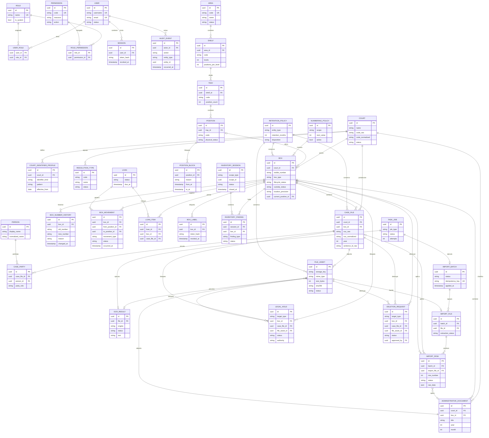

### 11.9 Validaciones conceptuales mínimas

| Regla | Entidades | Verificación futura |
|---|---|---|
| Una caja no mezcla tipos | `Box`, `CaseFile`, `AdministrativeDocument` | Restricción de servicio y prueba de integridad |
| Una posición no tiene dos cajas activas | `Box`, `Position` | Índice único parcial o bloqueo transaccional |
| Un expediente tiene tribunal | `CaseFile`, `Court` | FK obligatoria |
| Un documento administrativo tiene tribunal | `AdministrativeDocument`, `Court` | FK obligatoria |
| Un archivo tiene hash | `FileAsset` | Formato SHA-256 y verificación |
| Un préstamo abierto es único por unidad | `Loan`, `LoanItem` | Restricción de servicio y bloqueo |
| Un evento de auditoría es inmutable | `AuditEvent` | Sin UPDATE/DELETE de aplicación |
| Un número de caja no se repite | `Box`, `NumberingPolicy` | Secuencia transaccional y UK |
| Un código de tribunal puede repetirse | `Court` | UK compuesta contextual, no UK simple |
| Una persona no se deduplica por nombre | `Person` | Sin UK global de nombre |
| Una caja tiene tribunal y año | `Box`, `Court` | FK y validación obligatoria |
| Cada archivo de lote tiene estado propio | `ImportBatch`, `ImportFile`, `ImportRow` | Estado independiente y aplicación condicionada |
| Una suspensión legal bloquea la destrucción | `LegalHold`, `DeletionRequest` | Verificación previa y liberación por actor distinto |

### 11.10 Decisiones asociadas

- D-05: unidad prestable.
- D-16 a D-18: retención, destrucción y suspensión legal.
- D-31: tribunal, año, tipo e inmutabilidad de caja.
- D-34: expediente sin caja.
- D-36: fechas parciales.
- D-39: geometría 2D/3D.

---

## 12. Identificadores, formatos y normalización

### 12.1 Inventario de identificadores

| Identificador | Visible | Formato conocido | Unicidad | Mutabilidad | Búsqueda |
|---|---|---|---|---|---|
| UUID interno | No | UUID v4/v7 opaco | Global | Inmutable | Exacta |
| NUC bruto | Sí | Texto; ejemplos `00001`, `2022-102-00001` | Detección por tribunal; D-02 con validación de datos | Corrección excepcional auditada | Exacta y prefijo/sufijo controlado |
| NUC normalizado | Sí, derivado | Texto canónico según perfil D-01/D-08 | Mismo alcance que el NUC bruto; D-02 | Derivado del bruto | Exacta |
| Número de proceso | Opcional | Texto; perfil versionado D-01 | No se fuerza unicidad; relación con NUC por validar | Corrección auditada | Exacta y parcial controlada |
| Sentencia bruta | Sí | Texto; patrón `000-0000-SSSS-0000` | Sin UK inicial; D-03 | Corrección auditada | Exacta |
| Código de tribunal bruto | Sí | `589`, `102`, `106`, `107`, `107-01`, `107-02` | No único global | Histórico | Exacta |
| Número visible de caja | Sí | Configurable; valor inicial sin prefijo ni relleno; D-10 | No reutilizable | Corrección excepcional auditada | Exacta y rango |
| Etiqueta de posición | Sí | Configurable por área/anaquel | Dentro de su padre | Corrección auditada | Exacta |
| Token QR | Sí, impreso | Opaco aleatorio | Global | Revocable | Exacta por hash |
| SHA-256 de archivo | No | 64 hexadecimales | Por contenido | Inmutable | Exacta |
| Clave de idempotencia | No | Texto opaco del cliente | Por operación y actor | Inmutable durante vigencia | Exacta |
| `X-Request-ID` | No | Texto opaco | Por petición | Inmutable | Exacta en logs/auditoría |

### 12.2 Reglas generales de identificadores visibles

1. Se reciben y almacenan como texto; nunca como entero.
2. Se conserva el valor bruto una vez descartados los espacios exteriores
   accidentales; los separadores y ceros iniciales se conservan.
3. Se conserva una versión normalizada solo para comparación y búsqueda.
4. La normalización no elimina ceros iniciales, guiones ni estructura.
5. La normalización no convierte un NUC corto en uno largo ni viceversa.
6. Se rechazan cadenas vacías, solo espacios o caracteres de control.
7. Se eliminan espacios exteriores; los espacios interiores se rechazan salvo
   que un perfil aprobado los permita.
8. Se convierten guiones Unicode a `-` solo en la versión normalizada.
9. Se convierten letras a mayúsculas solo en la versión normalizada.
10. No se aplica búsqueda difusa a identificadores por defecto.
11. La búsqueda exacta tiene prioridad sobre la búsqueda parcial.
12. Un identificador corregido conserva historial y motivo.

### 12.3 Límites de longitud propuestos

| Campo | Longitud bruta máxima | Longitud normalizada máxima | Observación |
|---|---|---|---|
| NUC | 64 caracteres | 64 caracteres | Aceptado en D-01 |
| Número de proceso | 64 caracteres | 64 caracteres | Campo opcional; D-01 |
| Sentencia | 64 caracteres | 64 caracteres | Sin regex global; D-03 |
| Código de tribunal | 32 caracteres | 32 caracteres | Puede contener guion |
| Número visible de caja | 32 caracteres | 32 caracteres | Formato configurable; D-10 |
| Etiqueta de posición | 32 caracteres | 32 caracteres | Única dentro de bandeja/anaquel |

Los límites son contractuales para B1; B2 puede materializarlos como
`VARCHAR` con validación de servicio. No se usan límites menores sin revisar
datos históricos.

### 12.4 NUC: reglas conocidas

- El NUC es el identificador central del expediente.
- Los ejemplos confirmados son `00001` y `2022-102-00001`.
- El NUC puede contener año, código de tribunal y secuencia, pero la semántica
  exacta de cada bloque no está confirmada.
- El bloque `102` del ejemplo coincide con un código de tribunal del catálogo;
  no se debe asumir que siempre sea así.
- El bloque `00001` parece una secuencia con ceros iniciales; no se convierte a
  entero.
- Un NUC de cinco dígitos no se debe expandir automáticamente a un NUC de
  diecisiete caracteres.
- Un NUC con separadores no se debe comprimir a solo dígitos para almacenarlo.
- La búsqueda por "últimos cinco dígitos" es una búsqueda de sufijo sobre el
  valor normalizado, no una igualdad con la secuencia interna.
- Si dos expedientes comparten los últimos cinco dígitos, la API devuelve ambos
  como candidatos y no elige uno por heurística.
- Si el NUC llega con espacios o guiones Unicode, se normaliza para comparar,
  pero se conserva el bruto.
- El NUC no se reutiliza aunque el expediente se archive o se anule.

### 12.5 NUC: formatos candidatos y validación

| Perfil | Patrón propuesto | Ejemplo | Estado |
|---|---|---|---|
| Secuencia corta | `^[0-9]{5}$` | `00001` | Confirmado como ejemplo; no como formato único |
| Compuesto con año | `^[0-9]{4}-[0-9]{3}-[0-9]{5}$` | `2022-102-00001` | Confirmado como ejemplo; no como formato único |
| Histórico alfanumérico | Perfil versionado | Valor histórico conservado | Aceptado con advertencia D-04 |
| Otros separadores | Perfil versionado | Valor histórico conservado | Aceptado con advertencia D-04 |

La validación de NUC **NO DEBE** implementarse con una única expresión regular
global. El diseño aceptado en D-01/D-08 es un perfil versionado por tribunal o
por tipo de identificador, con posibilidad de excepción histórica documentada.

### 12.6 NUC: normalización conceptual

Algoritmo normativo aceptado, independiente del lenguaje:

1. Recibir texto UTF-8.
2. Rechazar si no es cadena.
3. Eliminar espacios y tabulaciones al inicio y al final.
4. Rechazar caracteres de control.
5. Sustituir guiones Unicode por `-`.
6. Convertir letras latinas a mayúsculas.
7. Colapsar espacios interiores solo si el perfil los admite.
8. Conservar ceros y guiones.
9. No eliminar prefijos ni sufijos.
10. Guardar el resultado en `nuc_normalized`.
11. Guardar en `nuc_raw` el valor recibido sin espacios exteriores, conservando
    separadores, ceros y demás caracteres originales.

La normalización no decide equivalencia semántica. Dos valores con el mismo
texto normalizado son candidatos a duplicado; la decisión final depende del
alcance de unicidad aprobado.

### 12.7 NUC: unicidad

Opciones evaluadas:

| Opción | Descripción | Ventaja | Riesgo |
|---|---|---|---|
| A | NUC único global | Búsqueda simple | Puede fallar si tribunales repiten NUC |
| B | NUC único por tribunal | Refleja jurisdicciones | Depende de una identidad de tribunal estable |
| C | NUC único por tribunal y año | Más cercano a numeración judicial | Puede fallar en formatos sin año |
| D | Sin unicidad de NUC; solo identificador interno | Tolera historia sucia | Permite duplicados reales sin control |

Decisión aceptada D-02: se detecta duplicado por `court_id` +
`nuc_normalized`, con identidad de tribunal estable. No se crea una UK inicial
global ni por tribunal; el conflicto se revisa antes de imponer una restricción.

Reglas aceptadas:

- Dentro del alcance de detección, un NUC normalizado repetido es un conflicto
  que requiere revisión.
- Un duplicado detectado en alta devuelve `409 Conflict`.
- Un duplicado histórico se importa solo con marca de revisión y motivo.
- La corrección de NUC requiere permiso, motivo y auditoría.
- La corrección no elimina el valor anterior.
- Un expediente archivado conserva su NUC.
- Un expediente anulado conserva su NUC para impedir reutilización.

### 12.8 Sentencia: reglas conocidas

- El patrón confirmado es `000-0000-SSSS-0000` como ejemplo.
- No se conoce con certeza qué representa cada bloque.
- No se debe inferir que `SSSS` sea un código de tribunal, sala o tipo.
- La sentencia es opcional en el expediente.
- La sentencia no sustituye al NUC.
- La sentencia se conserva como texto bruto.
- La normalización aceptada es mayúsculas y guiones ASCII, sin quitar bloques.
- La sentencia no tiene UK inicial; D-03 exige catálogo de patrones y
  advertencia de duplicado.
- La relación entre sentencia y tipo de resolución se rige por D-03/D-07.
- Si se requiere más de una resolución por expediente, B2 debe evaluar una
  entidad `Resolution` en lugar de columnas sueltas.

### 12.9 Número de proceso

El término "número de proceso" aparece como posible sinónimo o complemento del
NUC. B1 no debe fusionarlos sin confirmación.

Preguntas que debe cerrar D-01:

- ¿El número de proceso es exactamente el NUC?
- ¿El NUC es un identificador compuesto que contiene el número de proceso?
- ¿Puede existir un expediente con número de proceso pero sin NUC?
- ¿Puede existir un NUC sin número de proceso?
- ¿El número cambia por apelación, acumulación o redistribución?
- ¿Qué formato tiene y qué tribunal lo asigna?

El contrato no expone `process_number` obligatorio. Si el negocio lo requiere,
se añade como texto con perfil versionado D-01; no se deduce del NUC.

### 12.10 Códigos de tribunal

- El código es visible y puede repetirse.
- El código no es clave primaria.
- La identidad se resuelve por UUID interno y, en la UI, por código + nombre.
- El código bruto se conserva.
- El código normalizado se usa para comparación.
- Un código puede tener guion (`107-01`).
- No se debe interpretar `107-01` como jerarquía automática de `107`.
- La vigencia del código se registra con fechas.
- Un tribunal inactivo sigue resolviendo registros históricos.
- No se elimina un tribunal con cajas o expedientes asociados.

### 12.11 Números visibles de caja

- Son identificadores de negocio, no claves.
- Se asignan en el servidor.
- No se aceptan números generados por el cliente salvo importación aprobada.
- No se reutilizan.
- Una caja anulada conserva su número.
- Una caja archivada conserva su número.
- La corrección de número es excepcional y auditada.
- El historial de números es obligatorio si se permite corrección.
- El formato es configurable; el valor inicial no usa prefijo ni relleno
  artificial (D-10).

### 12.12 Identificadores de archivos y etiquetas

- Un archivo se identifica internamente por UUID.
- Su integridad se verifica por SHA-256.
- El nombre original no es identificador.
- Un archivo puede compartir hash con otro si el contenido es idéntico; la
  decisión de deduplicar almacenamiento es de B9, no de B1.
- Una etiqueta QR usa un token aleatorio opaco.
- El token se guarda como hash, no en claro.
- El token no contiene NUC, número de caja ni datos personales.
- El token se puede revocar y reemitir.
- Escanear una etiqueta no concede permiso por sí solo.

### 12.13 Casos límite obligatorios

| Caso | Resultado esperado |
|---|---|
| NUC vacío | `422 validation_error` |
| NUC solo con espacios | `422 validation_error` |
| NUC con ceros iniciales | Se conserva el valor |
| NUC con guion Unicode | Bruto conservado; normalizado con `-` |
| NUC corto y NUC largo relacionados | No se equiparan automáticamente |
| Dos expedientes con mismos últimos cinco dígitos | Búsqueda devuelve candidatos |
| Duplicado en el mismo alcance | `409 conflict` |
| Duplicado histórico marcado | Se acepta solo con revisión y motivo |
| Sentencia vacía | Permitida como `null` |
| Sentencia con formato no reconocido | Se conserva y se marca advertencia, no se rechaza sin D-03 |
| Código de tribunal duplicado | Se elige por UUID/nombre, no por código |
| Corrección de NUC | Historial + auditoría + motivo |

### 12.14 Decisiones asociadas

- D-01: semántica y formato del NUC y del número de proceso.
- D-02: alcance de unicidad del NUC.
- D-03: formato y unicidad de la sentencia.
- D-04: tratamiento de formatos históricos y excepciones.
- D-24: comportamiento exacto de la búsqueda por últimos cinco dígitos.

---

## 13. Catálogo inicial de tribunales

### 13.1 Datos confirmados

El catálogo inicial observado contiene códigos repetidos. Los nombres y estados
indicados provienen de `docs/AGENTS.md`; siguen sujetos a confirmación
institucional. No se inventan nombres ni se eliminan los duplicados.

| Referencia B1 | Código bruto | Nombre | Estado indicado | Observación |
|---|---|---|---|---|
| `CT-589-A` | `589` | Juzgado de Instrucción | Por confirmar | Comparte código con `CT-589-B` |
| `CT-589-B` | `589` | Juzgado de Instrucción en Atención Permanente | Por confirmar | Comparte código con `CT-589-A` |
| `CT-102` | `102` | Corte de Apelación | Activo según información inicial | Aparece en NUC de ejemplo |
| `CT-106` | `106` | Primera Cámara Penal del Juzgado de Primera Instancia | Inactivo | Conservar historia |
| `CT-107-A` | `107` | Segunda Cámara Penal del Juzgado de Primera Instancia | Inactivo | Comparte código con `CT-107-B` |
| `CT-107-B` | `107` | Juzgado de Primera Instancia Unipersonal | Por confirmar | Comparte código con `CT-107-A` |
| `CT-107-01` | `107-01` | Tribunal Ejecución de la Pena | Por confirmar | Código con guion |
| `CT-107-02` | `107-02` | Tribunal Colegiado de Primera Instancia | Por confirmar | Código con guion |

Las referencias `CT-*` son códigos documentales de este borrador, no valores
que deban persistirse.

### 13.2 Regla de identidad

- La clave de tribunal es su UUID interno.
- El código no es único.
- El nombre no se asume único.
- La combinación código + nombre no se declara única; la identidad es el UUID
  interno (D-06).
- La UI y la importación deben mostrar al menos código y nombre.
- Si dos tribunales comparten código y nombre, se requiere un atributo
  adicional aprobado (sede, jurisdicción, vigencia o identificador
  institucional).
- No se deben fusionar registros automáticamente por coincidencia de código.

### 13.3 Campos conceptuales

| Campo | Obligatorio | Regla |
|---|---|---|
| `id` | Sí | UUID interno |
| `name` | Sí | Texto visible; no único por defecto |
| `code_raw` | Sí | Código recibido, sin perder formato |
| `code_normalized` | Sí | Para comparación |
| `court_type` | No | Catálogo opcional si se confirma en B5 |
| `jurisdiction` | No | Solo si el negocio lo requiere |
| `status` | Sí | `ACTIVE`, `INACTIVE` |
| `effective_from` | No | Fecha de vigencia |
| `effective_to` | No | Fin de vigencia |
| `notes` | No | Texto interno |
| `source` | No | Origen del registro |

### 13.4 Importación y resolución de conflictos

Secuencia obligatoria:

1. Normalizar el código.
2. Buscar todos los tribunales con ese código.
3. Si hay cero coincidencias, proponer alta; no crear automáticamente.
4. Si hay una coincidencia, verificar nombre y vigencia.
5. Si hay varias coincidencias, requerir nombre o identificador adicional.
6. Si el nombre tampoco distingue, marcar fila como ambigua.
7. No elegir el "primero" por orden de base de datos.
8. Registrar la decisión de mapeo y el actor.
9. Aplicar solo tras aprobación del lote.

Estados de resolución de una fila de tribunal:

- `MATCHED_UNIQUE`: una sola coincidencia válida.
- `MATCHED_WITH_WARNING`: coincidencia con diferencia menor.
- `AMBIGUOUS`: más de una coincidencia posible.
- `NOT_FOUND`: no existe; requiere alta o descarte.
- `CONFLICT`: datos incompatibles.
- `SKIPPED`: el usuario decidió no importar.

### 13.5 Desactivación

- Un tribunal se desactiva, no se borra.
- Las cajas, expedientes y documentos existentes siguen siendo consultables.
- No se permiten nuevas altas que lo referencien si está inactivo, salvo
  operación histórica autorizada.
- La desactivación se audita.
- La reactivación se audita.
- El código y el nombre histórico no se reescriben.

### 13.6 Decisiones asociadas

- D-06: identidad estable del tribunal y resolución de códigos duplicados.
- D-07: semántica de tipos de resolución.
- D-08: perfiles de formato por tribunal.

---

## 14. Tipos de resolución y perfiles de formato

### 14.1 Tipos conocidos

| Código | Nombre propuesto | Semántica | Estado |
|---|---|---|---|
| `SADM` | Por confirmar | No confirmada | Catálogo editable; validar D-07 |
| `SPEN` | Por confirmar | No confirmada | Catálogo editable; validar D-07 |
| `RPE` | Por confirmar | No confirmada | Catálogo editable; validar D-07 |

No se debe expandir la sigla como "sentencia administrativa", "sentencia
penal" o "resolución de..." sin confirmación institucional. La sigla puede
significar cosas distintas entre tribunales.

### 14.2 Modelo conceptual

- `ResolutionType` es un catálogo, no un `Enum` cerrado de código.
- Cada tipo tiene código estable, nombre visible, estado y vigencia.
- Cada tipo puede tener uno o varios perfiles de formato.
- Un perfil de formato pertenece a un tribunal y a un tipo, o a un ámbito
  global aprobado.
- Los perfiles son versionados.
- Un cambio de perfil no revalida retroactivamente datos históricos.
- Un expediente puede tener tipo de resolución y número de sentencia; la
  relación se rige por D-03/D-07.

### 14.3 Campos de `ResolutionType`

| Campo | Obligatorio | Regla |
|---|---|---|
| `id` | Sí | UUID |
| `code` | Sí | Estable, único |
| `name` | Sí | Visible |
| `description` | No | Texto |
| `status` | Sí | `ACTIVE`, `INACTIVE` |
| `effective_from` | No | Vigencia |
| `effective_to` | No | Fin de vigencia |
| `format_profiles` | No | Uno o varios perfiles |

### 14.4 Perfil de formato

| Campo | Descripción |
|---|---|
| `pattern` | Patrón de validación, si está aprobado |
| `normalization` | Reglas de comparación |
| `tokens` | Significado de cada bloque, si se conoce |
| `examples` | Ejemplos válidos confirmados |
| `rejects` | Ejemplos inválidos confirmados |
| `court_id` | Ámbito, si aplica |
| `effective_from` | Inicio de vigencia |
| `effective_to` | Fin de vigencia |
| `strict` | Si rechaza o solo advierte |

Regla: `strict=true` solo puede activarse cuando exista una muestra
representativa y aprobación del responsable de archivo. Por defecto, un formato
nuevo se valida en modo advertencia.

### 14.5 Relación con sentencia y NUC

- El tipo de resolución no es el NUC.
- El número de sentencia no es el NUC.
- Un expediente puede no tener sentencia.
- Un expediente puede tener sentencia sin que el tipo esté confirmado.
- La sentencia no se usa para identificar unívocamente el expediente salvo
  decisión expresa.
- Si se necesita historial de varias resoluciones, B2 debe crear una entidad
  `Resolution`; B1 deja la puerta abierta y no la implementa.

### 14.6 Decisiones asociadas

- D-07: significado y alcance de `SADM`, `SPEN`, `RPE`.
- D-08: perfiles por tribunal y modo estricto/advertencia.

---

## 15. Políticas de numeración

### 15.1 Estado inicial confirmado

- Inventario inicial: 4.401 cajas.
- Siguiente número global: 4.402.
- La numeración actual se presume global.
- No se debe asumir que el próximo número sea siempre 4.402 después de una
  importación o corrección.
- El número visible no es la clave interna.

### 15.2 Modelo de política

| Campo | Descripción |
|---|---|
| `scope` | `GLOBAL`, `COURT`, `BOX_TYPE`, `YEAR`, u otro aprobado |
| `prefix` | Prefijo opcional |
| `suffix` | Sufijo opcional |
| `padding` | Ceros a la izquierda |
| `start_value` | Valor inicial |
| `next_value` | Próximo valor |
| `step` | Incremento |
| `reset_policy` | `NEVER`, `YEARLY`, `PER_SCOPE` |
| `active` | Solo una política activa por alcance |
| `effective_from` | Inicio de vigencia |
| `effective_to` | Fin de vigencia |

### 15.3 Reglas de asignación

1. El servidor asigna el número dentro de la transacción de creación de la caja.
2. El cliente no envía el número en el alta normal.
3. La asignación y la caja se confirman atómicamente.
4. Si la transacción falla, el número puede consumirse; no se reutiliza.
5. Un número consumido y no usado queda como hueco documentado, no como número
   disponible.
6. La política activa se lee con bloqueo o mediante secuencia atómica.
7. No se permiten dos cajas con el mismo número visible dentro del alcance.
8. Un número asignado no cambia por edición de otros campos.
9. Una caja anulada conserva su número.
10. Una caja archivada conserva su número.
11. La corrección de número requiere operación específica y auditoría.
12. La importación puede conservar números históricos sin consumir la secuencia
    global, según D-13.

### 15.4 Concurrencia

Escenario: dos usuarios crean cajas al mismo tiempo.

Resultado correcto:

- cada caja recibe un número distinto;
- no hay espera indefinida;
- no hay número duplicado;
- si una transacción falla, no se reasigna su número;
- el hueco es aceptable y auditable.

No se debe implementar "leer el máximo y sumar uno" sin bloqueo o secuencia
atómica. Esa estrategia produce duplicados bajo concurrencia.

### 15.5 Huecos, anulaciones y reutilización

| Situación | Regla |
|---|---|
| Transacción falla después de reservar | Hueco permitido; no reutilizar |
| Caja se anula | Número conservado; no reutilizar |
| Caja se archiva | Número conservado |
| Caja se destruye | Número conservado en historial |
| Importación con número histórico | Se conserva; no se renumera sin decisión |
| Número duplicado histórico | Se marca conflicto; no se elige uno al azar |
| Corrección de número | Se registra historial; el anterior no se reutiliza |

### 15.6 Corrección de número visible

Proceso conceptual:

1. Solicitar corrección con motivo.
2. Verificar permiso `boxes.number_correct`.
3. Verificar que el nuevo número no esté usado en el alcance.
4. Registrar número anterior, nuevo, actor, fecha y motivo.
5. Actualizar la caja.
6. Auditar el cambio.
7. No modificar el historial de movimientos ni etiquetas ya emitidas sin un
   proceso de reetiquetado.

La corrección no es una edición normal. No se debe permitir en un formulario
genérico de caja sin confirmación y trazabilidad.

### 15.7 Importación histórica

- El archivo de importación puede traer números visibles.
- El número importado se conserva como valor histórico.
- Si el número no existe en la secuencia, se registra como número externo.
- Si el número entra en conflicto con uno existente, la fila se marca.
- No se renumera automáticamente.
- La secuencia global se actualiza al menos por encima del mayor número
  histórico confirmado, según D-13.
- La decisión de actualizar la secuencia debe ser explícita y auditada.

### 15.8 Ejemplos

| Caso | Resultado |
|---|---|
| Siguiente valor 4402, alta correcta | Caja `4402`; siguiente `4403` |
| Siguiente valor 4402, fallo posterior | Hueco `4402`; siguiente `4403` |
| Caja `4402` anulada | `4402` no se reutiliza |
| Importación trae `4402` | Conflicto si ya existe; revisión |
| Importación trae `5000` | Se conserva; secuencia se ajusta si se aprueba |
| Corrección `4402` a `4403` | Historial con ambos valores; `4402` no se reutiliza |

### 15.9 Decisiones asociadas

- D-09: alcance de la numeración.
- D-10: formato, prefijo, padding y dígito verificador.
- D-11: momento de asignación.
- D-12: política de huecos y anulación.
- D-13: números históricos y actualización de secuencia.

---

## 16. Máquinas de estado

### 16.1 Reglas generales de transición

1. Toda transición se ejecuta en el servidor.
2. El cliente no envía el estado destino como único requisito; envía una acción
   de negocio (`approve`, `deliver`, `return`, `close`, etc.).
3. Cada transición valida estado actual, guardas, permiso y versión.
4. Cada transición relevante genera evento de auditoría.
5. Una transición inválida devuelve `409 conflict` o `422 validation_error`,
   nunca un `500`.
6. Los estados terminales no se abandonan sin una operación de corrección
   explícita y auditada.
7. Las fechas de vencimiento no cambian el estado persistido por sí solas; se
   calculan como condición (`overdue`) o se actualizan con una tarea explícita.
8. No se permite editar directamente un campo de estado desde un formulario
   genérico.
9. Las transiciones deben ser idempotentes cuando el cliente reintente con la
   misma clave de idempotencia.
10. Las transiciones que afectan ubicación, custodia y contenido deben ser
    atómicas.

### 16.2 Caja: ciclo de vida

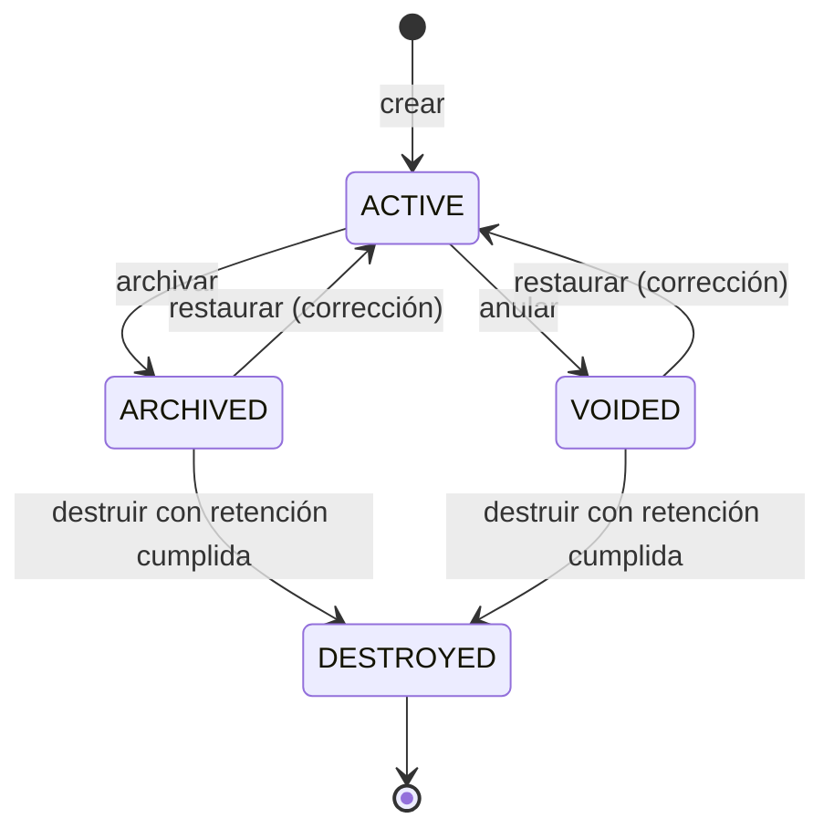

| Actual | Acción | Destino | Guarda | Permiso | Auditoría |
|---|---|---|---|---|---|
| — | Crear | `ACTIVE` | Tipo válido, número asignado | `boxes.create` | `box.created` |
| `ACTIVE` | Archivar | `ARCHIVED` | Sin préstamo abierto; contenido consistente | `boxes.archive` | `box.archived` |
| `ARCHIVED` | Restaurar | `ACTIVE` | Corrección aprobada; posición disponible si aplica | `boxes.restore` | `box.restored` |
| `ACTIVE` | Anular | `VOIDED` | Sin préstamo abierto; motivo obligatorio | `boxes.void` | `box.voided` |
| `VOIDED` | Restaurar | `ACTIVE` | Corrección aprobada; número no reutilizado | `boxes.restore` | `box.restored` |
| `ARCHIVED` | Destruir | `DESTROYED` | Retención cumplida; sin suspensión legal; aprobación | `boxes.destroy` | `box.destroyed` |
| `VOIDED` | Destruir | `DESTROYED` | Retención cumplida; sin suspensión legal; aprobación | `boxes.destroy` | `box.destroyed` |

Reglas:

- `ARCHIVED` no significa destruida ni eliminada.
- `VOIDED` conserva número, historia y auditoría.
- `DESTROYED` es terminal; solo se alcanza tras disposición aprobada.
- Una caja con suspensión legal no puede pasar a `DESTROYED`.
- Una caja con préstamo abierto no puede archivarse, anularse ni destruirse.
- Una caja destruida no libera su número para reutilización.

### 16.3 Caja: custodia y ubicación

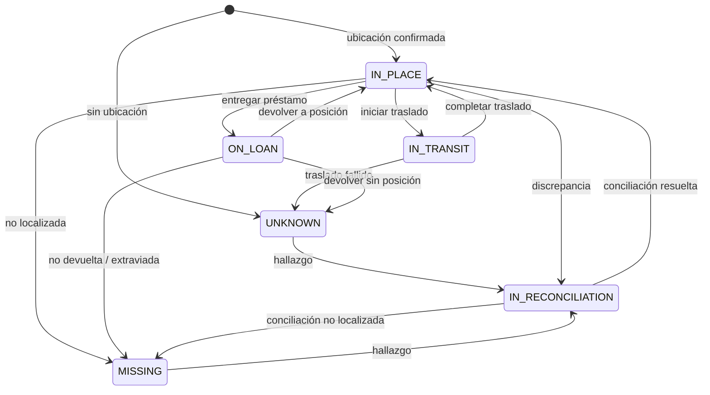

| Actual | Acción | Destino | Guarda | Permiso | Auditoría |
|---|---|---|---|---|---|
| `UNKNOWN` | Asignar ubicación | `IN_PLACE` | Posición disponible; confirmación | `boxes.move` | `box.location_assigned` |
| `IN_PLACE` | Iniciar traslado | `IN_TRANSIT` | Movimiento planificado; origen correcto | `boxes.move` | `box.movement_started` |
| `IN_TRANSIT` | Completar traslado | `IN_PLACE` | Destino disponible; confirmación | `boxes.move` | `box.movement_completed` |
| `IN_TRANSIT` | Cancelar traslado | `IN_PLACE` | Origen sigue disponible; motivo | `boxes.move` | `box.movement_cancelled` |
| `IN_PLACE` | Entregar préstamo | `ON_LOAN` | Préstamo aprobado; unidad libre | `loans.deliver` | `loan.delivered` |
| `ON_LOAN` | Devolver | `IN_PLACE` | Devolución registrada; posición confirmada | `loans.return` | `loan.returned` |
| `ON_LOAN` | Devolver sin posición | `UNKNOWN` | Devolución registrada; sin posición válida | `loans.return` | `loan.returned` |
| `IN_PLACE` | Marcar no localizada | `MISSING` | Motivo; conciliación o incidencia | `boxes.mark_missing` | `box.marked_missing` |
| `ON_LOAN` | Marcar extraviada | `MISSING` | Préstamo abierto; incidencia | `loans.mark_lost` | `loan.marked_lost` |
| `UNKNOWN` | Iniciar conciliación | `IN_RECONCILIATION` | Sesión activa | `inventory.manage` | `inventory.finding_created` |
| `MISSING` | Iniciar conciliación | `IN_RECONCILIATION` | Sesión activa | `inventory.manage` | `inventory.finding_created` |
| `IN_RECONCILIATION` | Resolver en posición | `IN_PLACE` | Hallazgo resuelto; posición confirmada | `inventory.resolve` | `inventory.finding_resolved` |
| `IN_RECONCILIATION` | Confirmar no localizada | `MISSING` | Hallazgo aceptado; motivo | `inventory.resolve` | `inventory.finding_resolved` |

Reglas de ubicación:

- `current_position_id` representa la última posición conocida o asignada.
- La posición solo está ocupada si la caja está `IN_PLACE`.
- Una caja `ON_LOAN`, `IN_TRANSIT`, `MISSING` o `IN_RECONCILIATION` no debe
  bloquear la posición como ocupada, salvo regla física aprobada.
- `location_precision` se deriva de la combinación de custodia, posición y
  confirmación; no se edita directamente.
- `IN_TRANSIT` requiere movimiento en estado `IN_TRANSIT`.
- `ON_LOAN` requiere préstamo en estado `DELIVERED`.
- No se puede estar `ON_LOAN` y `IN_TRANSIT` al mismo tiempo.
- Una caja `VOIDED` o `DESTROYED` no puede estar `IN_PLACE`.

### 16.4 Posición

Separar estado administrativo de ocupación:

| Dimensión | Valores | Persistencia propuesta |
|---|---|---|
| Estado administrativo | `AVAILABLE`, `BLOCKED`, `RETIRED` | Persistido |
| Ocupación | `FREE`, `OCCUPIED` | Derivado de caja `IN_PLACE` |

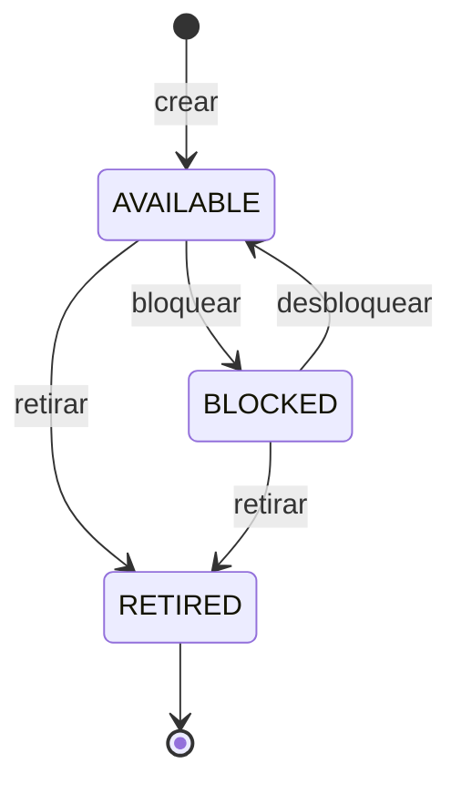

| Actual | Acción | Destino | Guarda | Permiso | Auditoría |
|---|---|---|---|---|---|
| — | Crear | `AVAILABLE` | Capacidad del anaquel no excedida | `locations.manage` | `position.created` |
| `AVAILABLE` | Bloquear | `BLOCKED` | Sin caja `IN_PLACE`; motivo y vigencia | `locations.block` | `position.blocked` |
| `BLOCKED` | Desbloquear | `AVAILABLE` | Bloqueo vigente o corrección | `locations.block` | `position.unblocked` |
| `AVAILABLE` | Retirar | `RETIRED` | Sin caja `IN_PLACE`; sin bloqueo activo | `locations.retire` | `position.retired` |
| `BLOCKED` | Retirar | `RETIRED` | Bloqueo cancelado; sin caja | `locations.retire` | `position.retired` |

Reglas:

- Una posición `BLOCKED` no acepta cajas.
- Una posición `RETIRED` no acepta cajas ni se reactiva sin corrección.
- Una posición `OCCUPIED` no puede bloquearse ni retirarse.
- La ocupación se calcula, no se edita a mano.
- Si se detectan dos cajas `IN_PLACE` en una posición, es un defecto de
  integridad bloqueante, no un estado válido.

### 16.5 Movimiento de caja

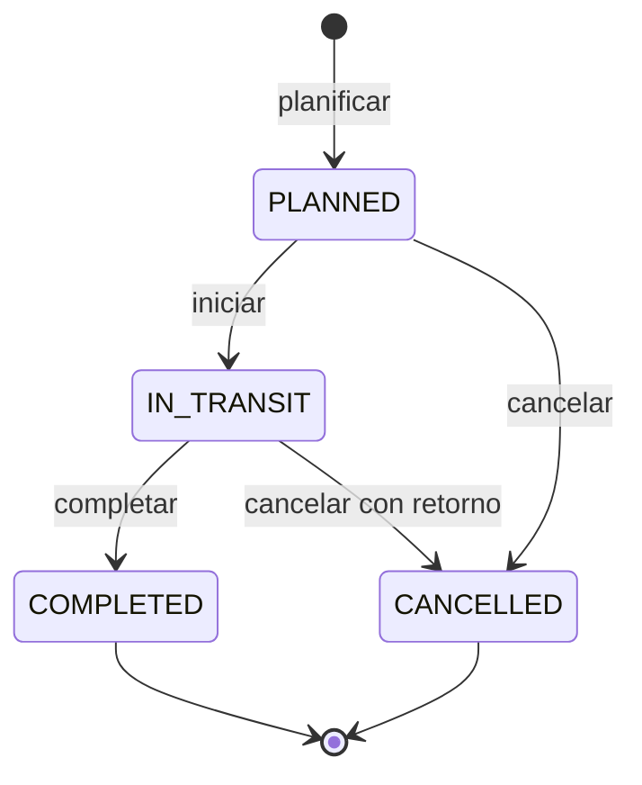

| Actual | Acción | Destino | Guarda | Permiso | Auditoría |
|---|---|---|---|---|---|
| — | Planificar | `PLANNED` | Origen y destino válidos; destino disponible | `boxes.move` | `movement.created` |
| `PLANNED` | Iniciar | `IN_TRANSIT` | Caja en origen; sin préstamo abierto | `boxes.move` | `movement.started` |
| `PLANNED` | Cancelar | `CANCELLED` | Motivo | `boxes.move` | `movement.cancelled` |
| `IN_TRANSIT` | Completar | `COMPLETED` | Destino disponible; caja presente | `boxes.move` | `movement.completed` |
| `IN_TRANSIT` | Cancelar | `CANCELLED` | Retorno a origen confirmado | `boxes.move` | `movement.cancelled` |

Reglas:

- Completar un movimiento actualiza caja y posición en la misma transacción.
- Un movimiento no puede completarse dos veces.
- Un movimiento cancelado no cambia la posición final.
- No se permite mover una caja en préstamo.
- No se permite mover una caja anulada o destruida.
- El destino no puede ser la misma posición que el origen.
- El historial de movimientos es append-only; una corrección genera otro
  movimiento, no borra el anterior.

### 16.6 Préstamo

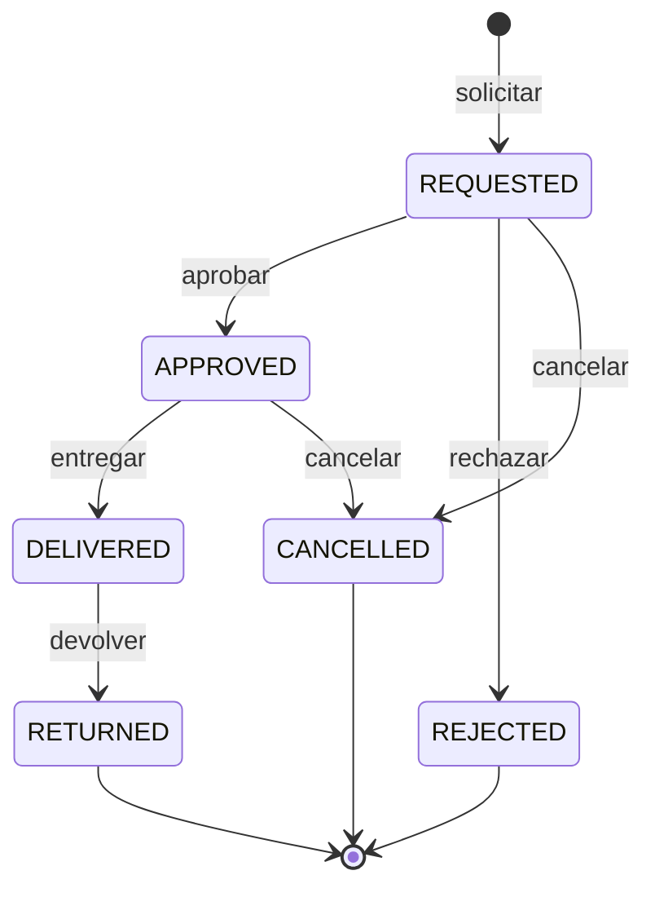

| Actual | Acción | Destino | Guarda | Permiso | Auditoría |
|---|---|---|---|---|---|
| — | Solicitar | `REQUESTED` | Unidad disponible; sin préstamo abierto | `loans.request` | `loan.requested` |
| `REQUESTED` | Aprobar | `APPROVED` | Aprobador distinto del solicitante, si D-15 | `loans.approve` | `loan.approved` |
| `REQUESTED` | Rechazar | `REJECTED` | Motivo | `loans.approve` | `loan.rejected` |
| `REQUESTED` | Cancelar | `CANCELLED` | Solicitante o supervisor | `loans.cancel` | `loan.cancelled` |
| `APPROVED` | Entregar | `DELIVERED` | Unidad presente; custodia actualizada | `loans.deliver` | `loan.delivered` |
| `APPROVED` | Cancelar | `CANCELLED` | Motivo; antes de entrega | `loans.cancel` | `loan.cancelled` |
| `DELIVERED` | Devolver | `RETURNED` | Devolución registrada; ubicación o `UNKNOWN` | `loans.return` | `loan.returned` |

Reglas:

- `OVERDUE` es una condición calculada, no un estado persistido obligatorio.
- Un préstamo `DELIVERED` mantiene la caja en custodia `ON_LOAN`.
- La devolución actualiza custodia y ubicación en la misma transacción.
- Una unidad con préstamo abierto no puede prestarse de nuevo.
- La aprobación no puede ser automática por defecto.
- El rechazo y la cancelación requieren motivo.
- Una pérdida durante el préstamo se registra como incidencia; no se simula una
  devolución normal.
- El préstamo de una caja y el préstamo de un expediente son alternativas; D-05
  debe decidir si pueden coexistir.
- Las alertas de vencimiento, sus canales y destinatarios se definen en D-38;
  no se envían notificaciones automáticas antes de aprobarla.

### 16.7 Incidencia de pérdida o daño

Estados conceptuales de una incidencia, si se implementa:

`OPEN` -> `UNDER_REVIEW` -> `RESOLVED` | `ACCEPTED_LOSS` | `CANCELLED`.

Una incidencia no reemplaza la máquina de préstamo. La complementa y deja
rastro de la condición física. B1 no crea la entidad; B2 la evaluará si D-05 la
requiere.

### 16.8 Lote de importación

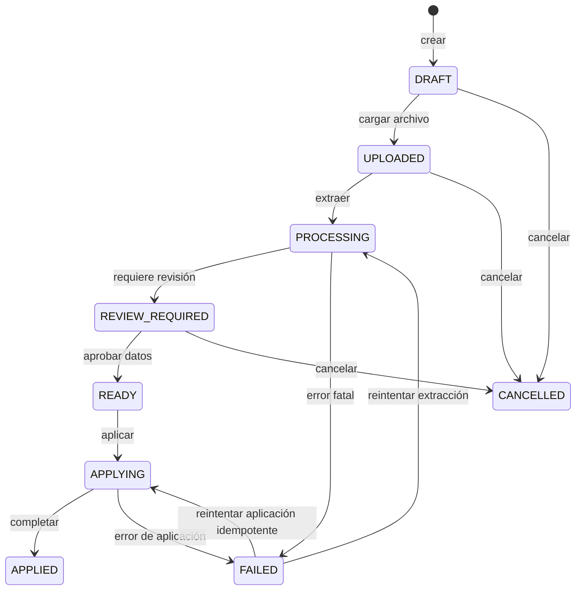

| Actual | Acción | Destino | Guarda | Permiso | Auditoría |
|---|---|---|---|---|---|
| — | Crear | `DRAFT` | Tipo de importación válido | `imports.create` | `import.created` |
| `DRAFT` | Cargar | `UPLOADED` | Archivo válido; límites | `imports.upload` | `import.uploaded` |
| `UPLOADED` | Extraer | `PROCESSING` | Tarea encolada; idempotencia | `imports.process` | `import.processing` |
| `PROCESSING` | Requiere revisión | `REVIEW_REQUIRED` | Hay filas o advertencias | Sistema | `import.review_required` |
| `PROCESSING` | Fallar | `FAILED` | Error irrecuperable | Sistema | `import.failed` |
| `REVIEW_REQUIRED` | Aprobar | `READY` | Todas las filas resueltas o omitidas | `imports.approve` | `import.approved` |
| `READY` | Aplicar | `APPLYING` | Aprobación; sin cambios pendientes | `imports.apply` | `import.applying` |
| `APPLYING` | Completar | `APPLIED` | Sin errores pendientes | Sistema | `import.applied` |
| `APPLYING` | Fallar | `FAILED` | Error; checkpoint conservado | Sistema | `import.failed` |
| `FAILED` | Reintentar | `PROCESSING` o `APPLYING` | Misma clave de idempotencia | `imports.process` | `import.retried` |
| Cualquiera no terminal | Cancelar | `CANCELLED` | Sin aplicación parcial no revertida | `imports.cancel` | `import.cancelled` |

Reglas:

- Un lote no se aplica dos veces.
- La aplicación es idempotente por `idempotency_key`.
- Las filas con error no se aplican.
- Las filas omitidas no bloquean el lote si la política lo permite.
- El lote no pasa a `APPLIED` si quedan filas aplicables pendientes.
- Un fallo a mitad de aplicación debe ser reanudable sin duplicar registros.
- El resumen del lote registra creadas, actualizadas, omitidas y fallidas.
- No se borra el archivo fuente ni las filas originales al aplicar.
- La aprobación y la aplicación deben ser acciones separadas.
- `INVENTORY_TABLE` procesa CSV/XLSX; `DOCUMENT_DIGITIZATION` procesa uno o
  varios PDF, DOCX, TIFF, JPEG o PNG.
- Cada `ImportFile` tiene estado y errores propios; un archivo fallido no impide
  revisar los demás, pero sí bloquea la aplicación si aporta filas obligatorias.
- La aprobación del lote exige que todo `ImportFile` esté procesado, omitido de
  forma justificada o marcado como no aplicable.

### 16.8.1 Archivo de lote

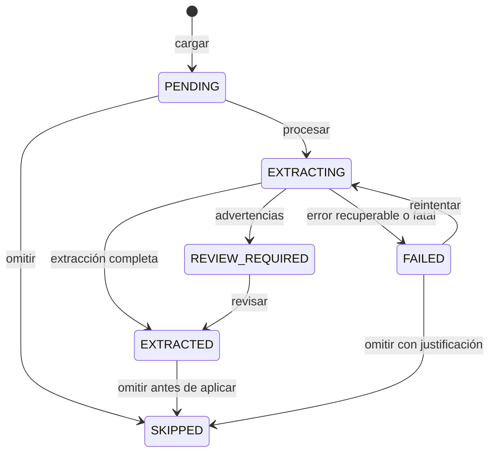

| Actual | Acción | Destino | Guarda | Permiso | Auditoría |
|---|---|---|---|---|---|
| - | Cargar | `PENDING` | Tipo permitido; hash; límites | `imports.upload` | `import_file.created` |
| `PENDING` | Procesar | `EXTRACTING` | Tarea encolada; idempotencia | `imports.process` | `import_file.processing` |
| `EXTRACTING` | Completar | `EXTRACTED` | Extracción terminada | Sistema | `import_file.extracted` |
| `EXTRACTING` | Requiere revisión | `REVIEW_REQUIRED` | Advertencias | Sistema | `import_file.review_required` |
| `EXTRACTING` | Fallar | `FAILED` | Error y checkpoint | Sistema | `import_file.failed` |
| `REVIEW_REQUIRED` | Revisar | `EXTRACTED` | Advertencias aceptadas | `imports.review` | `import_file.reviewed` |
| `FAILED` | Reintentar | `EXTRACTING` | Misma clave de idempotencia | `imports.process` | `import_file.retried` |
| No aplicado | Omitir | `SKIPPED` | Motivo obligatorio | `imports.review` | `import_file.skipped` |

Reglas:

- Un archivo se procesa de forma independiente, pero la aplicación del lote
  espera a los archivos obligatorios.
- Un archivo puede producir cero filas; eso no es error si el lote lo permite.
- Un archivo con error no se elimina; se conserva para diagnóstico.
- El estado del archivo no sustituye el estado de sus filas.

### 16.9 Fila de importación

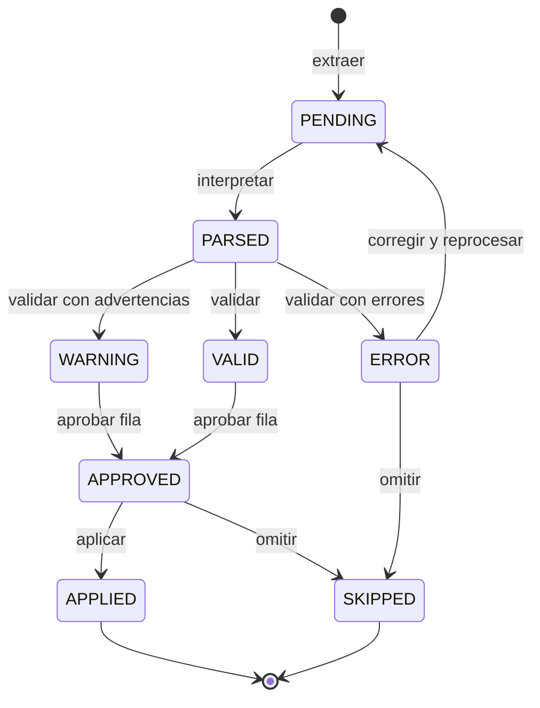

| Actual | Acción | Destino | Guarda | Permiso | Auditoría |
|---|---|---|---|---|---|
| — | Extraer | `PENDING` | Fila creada | Sistema | — |
| `PENDING` | Interpretar | `PARSED` | Formato reconocido | Sistema | — |
| `PARSED` | Validar | `VALID` | Sin advertencias ni errores | Sistema | — |
| `PARSED` | Validar | `WARNING` | Advertencias no bloqueantes | Sistema | — |
| `PARSED` | Validar | `ERROR` | Error bloqueante | Sistema | — |
| `VALID` | Aprobar | `APPROVED` | Lote en revisión | `imports.approve` | `import.row_approved` |
| `WARNING` | Aprobar | `APPROVED` | Advertencia aceptada con motivo | `imports.approve` | `import.row_approved` |
| `ERROR` | Corregir | `PENDING` | Datos corregidos | `imports.review` | `import.row_corrected` |
| `APPROVED` | Aplicar | `APPLIED` | Sin conflicto al aplicar | Sistema | `import.row_applied` |
| `APPROVED` | Omitir | `SKIPPED` | Motivo | `imports.review` | `import.row_skipped` |
| `ERROR` | Omitir | `SKIPPED` | Motivo | `imports.review` | `import.row_skipped` |

Reglas:

- Una fila `ERROR` nunca se aplica.
- Una fila `WARNING` requiere aceptación explícita.
- Una fila `APPLIED` no se vuelve a aplicar.
- La fila conserva `raw_data` y `mapped_data`.
- La fila aplicada conserva el UUID de la entidad creada o actualizada.
- Corregir una fila después de aplicar exige un nuevo lote o una operación de
  corrección auditada, no una edición silenciosa.

### 16.10 Archivo digital

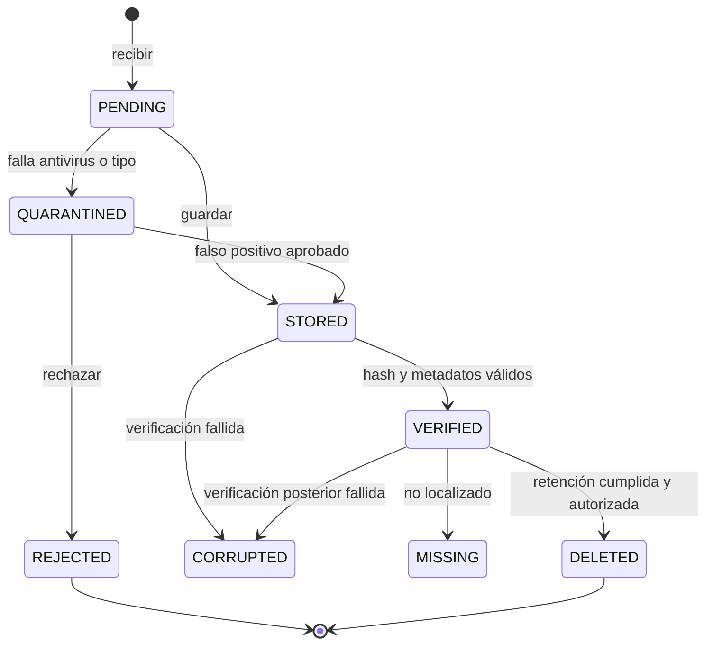

| Actual | Acción | Destino | Guarda | Permiso | Auditoría |
|---|---|---|---|---|---|
| — | Recibir | `PENDING` | Dentro de límites | `files.upload` | `file.received` |
| `PENDING` | Guardar | `STORED` | Hash calculado; almacenamiento correcto | Sistema | `file.stored` |
| `PENDING` | Cuarentena | `QUARANTINED` | Antivirus o tipo no permitido | Sistema | `file.quarantined` |
| `QUARANTINED` | Rechazar | `REJECTED` | Motivo; sin uso | `files.reject` | `file.rejected` |
| `QUARANTINED` | Liberar | `STORED` | Falso positivo aprobado | `files.review` | `file.released` |
| `STORED` | Verificar | `VERIFIED` | SHA-256 coincide; metadatos válidos | Sistema | `file.verified` |
| `STORED` | Corromper | `CORRUPTED` | Verificación fallida | Sistema | `file.corrupted` |
| `VERIFIED` | Perder | `MISSING` | Objeto no localizado | Sistema | `file.missing` |
| `VERIFIED` | Corromper | `CORRUPTED` | Verificación posterior fallida | Sistema | `file.corrupted` |
| `VERIFIED` | Eliminar | `DELETED` | Retención cumplida; sin suspensión | `files.delete` | `file.deleted` |

Reglas:

- Un archivo `PENDING` no se sirve al usuario.
- Un archivo `QUARANTINED` no se sirve ni se vincula como definitivo.
- Un archivo `REJECTED` no se descarga.
- Un archivo `CORRUPTED` o `MISSING` se marca y no se sirve como válido.
- La eliminación física del objeto requiere decisión de retención.
- El hash se calcula antes de marcar `STORED`.
- El nombre original no se usa como ruta de almacenamiento.
- El archivo original no se sobrescribe; una nueva versión es otro archivo o
  una relación de versión explícita.
- Un archivo no se comparte por URL pública.

### 16.11 OCR

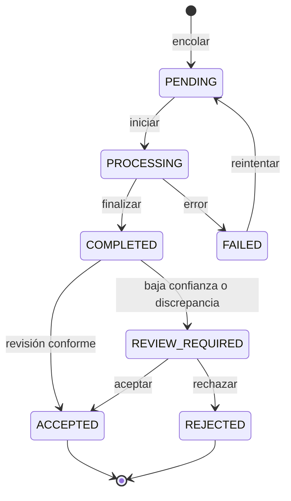

| Actual | Acción | Destino | Guarda | Permiso | Auditoría |
|---|---|---|---|---|---|
| — | Encolar | `PENDING` | Archivo válido | `ocr.process` | `ocr.queued` |
| `PENDING` | Procesar | `PROCESSING` | Motor disponible; idempotencia | Sistema | `ocr.processing` |
| `PROCESSING` | Completar | `COMPLETED` | Texto y confianza generados | Sistema | `ocr.completed` |
| `PROCESSING` | Fallar | `FAILED` | Error registrado | Sistema | `ocr.failed` |
| `COMPLETED` | Requiere revisión | `REVIEW_REQUIRED` | Confianza bajo umbral o discrepancia | Sistema | `ocr.review_required` |
| `COMPLETED` | Aceptar | `ACCEPTED` | Revisor autorizado; sin cambios manuales | `ocr.review` | `ocr.accepted` |
| `REVIEW_REQUIRED` | Aceptar | `ACCEPTED` | Revisor confirma texto | `ocr.review` | `ocr.accepted` |
| `REVIEW_REQUIRED` | Rechazar | `REJECTED` | Motivo | `ocr.review` | `ocr.rejected` |
| `FAILED` | Reintentar | `PENDING` | Límite de intentos no excedido | `ocr.process` | `ocr.retried` |

Reglas:

- El OCR no escribe directamente en campos definitivos del expediente.
- El texto aceptado puede proponer datos, pero la aplicación requiere acción
  explícita.
- Cada resultado conserva motor y versión.
- Reejecutar OCR no borra el resultado anterior; crea un nuevo intento o
  versión.
- La confianza no es una probabilidad calibrada universal; es un indicador del
  motor.
- El umbral de revisión se calibra con muestras reales en B5 (D-22).
- Un texto OCR no se considera prueba de identidad ni de contenido legal.

### 16.12 Conciliación

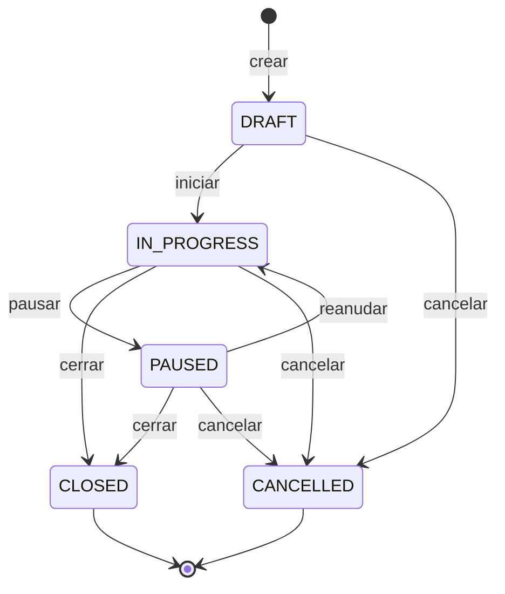

| Actual | Acción | Destino | Guarda | Permiso | Auditoría |
|---|---|---|---|---|---|
| — | Crear | `DRAFT` | Alcance válido | `inventory.create` | `inventory.created` |
| `DRAFT` | Iniciar | `IN_PROGRESS` | Responsable asignado | `inventory.manage` | `inventory.started` |
| `IN_PROGRESS` | Pausar | `PAUSED` | Motivo | `inventory.manage` | `inventory.paused` |
| `PAUSED` | Reanudar | `IN_PROGRESS` | Responsable activo | `inventory.manage` | `inventory.resumed` |
| `IN_PROGRESS` | Cerrar | `CLOSED` | Hallazgos resueltos o aceptados | `inventory.close` | `inventory.closed` |
| `PAUSED` | Cerrar | `CLOSED` | Hallazgos resueltos o aceptados | `inventory.close` | `inventory.closed` |
| Cualquiera no terminal | Cancelar | `CANCELLED` | Motivo; sin efectos automáticos | `inventory.cancel` | `inventory.cancelled` |

Reglas:

- Una sesión cerrada no admite nuevos hallazgos.
- Cerrar una sesión no aplica correcciones automáticamente.
- Un hallazgo `OPEN` impide el cierre salvo aceptación explícita.
- Una sesión cancelada no altera el inventario.
- El alcance puede ser área, anaquel, bandeja, rango de posiciones o caja.
- El resumen guarda totales esperados, observados y diferencias.

### 16.13 Hallazgo de conciliación

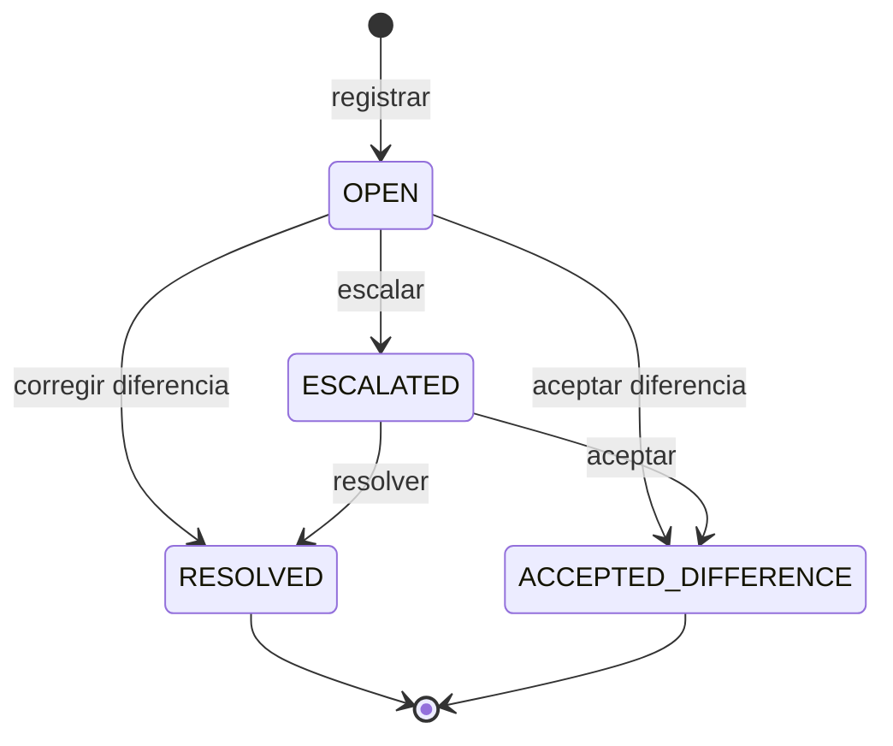

| Actual | Acción | Destino | Guarda | Permiso | Auditoría |
|---|---|---|---|---|---|
| — | Registrar | `OPEN` | Sesión activa | `inventory.manage` | `inventory.finding_created` |
| `OPEN` | Resolver | `RESOLVED` | Acción correctiva registrada | `inventory.resolve` | `inventory.finding_resolved` |
| `OPEN` | Aceptar diferencia | `ACCEPTED_DIFFERENCE` | Motivo y aprobador | `inventory.accept_difference` | `inventory.finding_accepted` |
| `OPEN` | Escalar | `ESCALATED` | Motivo | `inventory.manage` | `inventory.finding_escalated` |
| `ESCALATED` | Resolver | `RESOLVED` | Acción correctiva registrada | `inventory.resolve` | `inventory.finding_resolved` |
| `ESCALATED` | Aceptar | `ACCEPTED_DIFFERENCE` | Motivo y aprobador | `inventory.accept_difference` | `inventory.finding_accepted` |

Reglas:

- Un hallazgo no modifica la caja por sí mismo.
- Resolver implica que la acción correctiva ya se ejecutó o se ejecutará en un
  movimiento explícito.
- Aceptar una diferencia requiere motivo.
- Un hallazgo no se elimina; se resuelve o se acepta.

### 16.14 Usuario

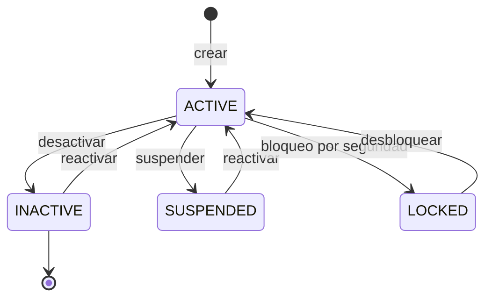

Reglas:

- Un usuario inactivo no inicia sesión.
- Un usuario suspendido no inicia sesión.
- Un usuario bloqueado por seguridad requiere desbloqueo autorizado.
- Los roles se asignan solo a usuarios activos.
- Un usuario no se borra si tiene auditoría o movimientos.
- La baja lógica no elimina eventos históricos.

### 16.15 Matriz de consistencia de estados

| Entidad | Estado terminal | ¿Se puede restaurar? | ¿Se puede borrar físicamente? |
|---|---|---|---|
| Caja `DESTROYED` | Sí | No | Solo metadatos según retención |
| Movimiento `COMPLETED` | Sí | No; se corrige con otro movimiento | No |
| Préstamo `RETURNED` | Sí | No | No |
| Lote `APPLIED` | Sí | No; se corrige con otro lote | No |
| Archivo `DELETED` | Sí | No | Sí, tras retención |
| OCR `ACCEPTED` | Sí | No; nuevo intento crea versión | No |
| Conciliación `CLOSED` | Sí | No | No |
| Usuario `INACTIVE` | No | Sí | No si tiene historia |

---

## 17. Roles, permisos y separación de funciones

### 17.1 Principios

1. Denegar por defecto.
2. Los permisos son aditivos; un usuario con varios roles recibe la unión.
3. El servidor aplica el permiso; ocultar un botón no es seguridad.
4. Un permiso se evalúa sobre recurso y acción, no solo sobre módulo.
5. Los permisos del sistema son códigos estables, no etiquetas de UI.
6. No se usan roles como sustituto de reglas de negocio.
7. Las operaciones críticas requieren separación de funciones.
8. Los cambios de rol se auditan.
9. Un usuario no puede elevar sus propios permisos.
10. Un rol del sistema no se elimina; se desactiva o se corrige.

### 17.2 Roles iniciales

| Rol | Código propuesto | Propósito | Alcance |
|---|---|---|---|
| Administrador | `administrator` | Configuración, usuarios, roles y operaciones críticas | Global |
| Supervisor de archivo | `archive_supervisor` | Aprobación, control, catálogos operativos e inventario | Global operativo |
| Archivista | `archivist` | Operación diaria de cajas, expedientes, movimientos y conciliación | Global operativo |
| Digitalizador | `scanner` | Carga de archivos, OCR y revisión de extracción | Lotes y archivos asignados |
| Consulta | `viewer` | Búsqueda y consulta autorizada | Solo lectura |

### 17.3 Reglas de asignación

- Un usuario puede tener más de un rol.
- Un usuario no puede quedar sin rol activo si su cuenta está activa.
- Solo `administrator` asigna o revoca roles.
- Solo `administrator` crea o desactiva usuarios.
- El último administrador activo no puede desactivarse ni perder el rol.
- Un usuario no puede aprobar su propia solicitud crítica.
- Un usuario no puede aprobar un lote que él mismo creó, salvo excepción
  aprobada y auditada.
- Los permisos de consulta no incluyen escritura.
- Los permisos de digitalización no incluyen aprobación final de importación.
- Los permisos de archivo no incluyen administración de usuarios.

### 17.4 Catálogo de permisos

Leyenda de matriz: `A` administrador, `S` supervisor, `Ar` archivista,
`D` digitalizador, `C` consulta. `—` sin permiso. `Propio` solo sobre sus
propios recursos. `Asignado` solo sobre recursos asignados.

#### 17.4.1 Identidad y acceso

| Permiso | A | S | Ar | D | C |
|---|---|---|---|---|---|
| `auth.login` | Sí | Sí | Sí | Sí | Sí |
| `auth.logout` | Sí | Sí | Sí | Sí | Sí |
| `auth.session.read_own` | Sí | Sí | Sí | Sí | Sí |
| `auth.session.revoke_own` | Sí | Sí | Sí | Sí | Sí |
| `auth.password.change_own` | Sí | Sí | Sí | Sí | Sí |
| `users.read` | Sí | Sí | — | — | — |
| `users.create` | Sí | — | — | — | — |
| `users.update` | Sí | — | — | — | — |
| `users.deactivate` | Sí | — | — | — | — |
| `users.assign_roles` | Sí | — | — | — | — |
| `users.reset_password` | Sí | — | — | — | — |
| `users.unlock` | Sí | — | — | — | — |
| `roles.read` | Sí | — | — | — | — |
| `roles.manage` | Sí | — | — | — | — |

#### 17.4.2 Catálogos y configuración

| Permiso | A | S | Ar | D | C |
|---|---|---|---|---|---|
| `courts.read` | Sí | Sí | Sí | Sí | Sí |
| `courts.create` | Sí | Sí | — | — | — |
| `courts.update` | Sí | Sí | — | — | — |
| `courts.deactivate` | Sí | — | — | — | — |
| `resolution_types.read` | Sí | Sí | Sí | Sí | Sí |
| `resolution_types.manage` | Sí | Sí | — | — | — |
| `identifier_profiles.read` | Sí | Sí | Sí | — | — |
| `identifier_profiles.manage` | Sí | Sí | — | — | — |
| `numbering_policies.read` | Sí | Sí | Sí | — | — |
| `numbering_policies.manage` | Sí | — | — | — | — |
| `retention_policies.read` | Sí | Sí | — | — | — |
| `retention_policies.manage` | Sí | — | — | — | — |
| `settings.read` | Sí | — | — | — | — |
| `settings.manage` | Sí | — | — | — | — |

#### 17.4.3 Organización física

| Permiso | A | S | Ar | D | C |
|---|---|---|---|---|---|
| `locations.read` | Sí | Sí | Sí | Sí | Sí |
| `locations.create` | Sí | Sí | Sí | — | — |
| `locations.update` | Sí | Sí | Sí | — | — |
| `locations.block` | Sí | Sí | Sí | — | — |
| `locations.retire` | Sí | Sí | — | — | — |

#### 17.4.4 Cajas

| Permiso | A | S | Ar | D | C |
|---|---|---|---|---|---|
| `boxes.read` | Sí | Sí | Sí | Sí | Sí |
| `boxes.create` | Sí | Sí | Sí | — | — |
| `boxes.update` | Sí | Sí | Sí | — | — |
| `boxes.archive` | Sí | Sí | — | — | — |
| `boxes.restore` | Sí | Sí | — | — | — |
| `boxes.void` | Sí | Sí | — | — | — |
| `boxes.destroy` | Sí | Sí | — | — | — |
| `boxes.move` | Sí | Sí | Sí | — | — |
| `boxes.number_correct` | Sí | Sí | — | — | — |
| `boxes.label.print` | Sí | Sí | Sí | — | — |
| `boxes.mark_missing` | Sí | Sí | Sí | — | — |

#### 17.4.5 Expedientes y documentos administrativos

| Permiso | A | S | Ar | D | C |
|---|---|---|---|---|---|
| `cases.read` | Sí | Sí | Sí | Sí | Sí |
| `cases.create` | Sí | Sí | Sí | — | — |
| `cases.update` | Sí | Sí | Sí | — | — |
| `cases.archive` | Sí | Sí | — | — | — |
| `cases.correct_nuc` | Sí | Sí | — | — | — |
| `cases.party_manage` | Sí | Sí | Sí | — | — |
| `admin_docs.read` | Sí | Sí | Sí | Sí | Sí |
| `admin_docs.create` | Sí | Sí | Sí | — | — |
| `admin_docs.update` | Sí | Sí | Sí | — | — |
| `admin_docs.archive` | Sí | Sí | — | — | — |

#### 17.4.6 Archivos y OCR

| Permiso | A | S | Ar | D | C |
|---|---|---|---|---|---|
| `files.read` | Sí | Sí | Sí | Sí | Sí |
| `files.download` | Sí | Sí | Sí | Sí | Sí |
| `files.upload` | Sí | Sí | Sí | Sí | — |
| `files.delete` | Sí | — | — | — | — |
| `files.review` | Sí | Sí | — | — | — |
| `ocr.read` | Sí | Sí | Sí | Sí | Sí |
| `ocr.process` | Sí | Sí | Sí | Sí | — |
| `ocr.review` | Sí | Sí | Sí | Sí | — |

#### 17.4.7 Importaciones

| Permiso | A | S | Ar | D | C |
|---|---|---|---|---|---|
| `imports.read` | Sí | Sí | Sí | — | — |
| `imports.create` | Sí | Sí | Sí | — | — |
| `imports.upload` | Sí | Sí | Sí | Sí | — |
| `imports.process` | Sí | Sí | Sí | — | — |
| `imports.review` | Sí | Sí | Sí | — | — |
| `imports.approve` | Sí | Sí | — | — | — |
| `imports.apply` | Sí | Sí | — | — | — |
| `imports.cancel` | Sí | Sí | — | — | — |

#### 17.4.8 Préstamos

| Permiso | A | S | Ar | D | C |
|---|---|---|---|---|---|
| `loans.read` | Sí | Sí | Sí | Sí | Sí |
| `loans.request` | Sí | Sí | Sí | — | — |
| `loans.approve` | Sí | Sí | — | — | — |
| `loans.deliver` | Sí | Sí | Sí | — | — |
| `loans.return` | Sí | Sí | Sí | — | — |
| `loans.cancel` | Sí | Sí | Propio | — | — |
| `loans.mark_lost` | Sí | Sí | — | — | — |

#### 17.4.9 Conciliación

| Permiso | A | S | Ar | D | C |
|---|---|---|---|---|---|
| `inventory.read` | Sí | Sí | Sí | — | — |
| `inventory.create` | Sí | Sí | Sí | — | — |
| `inventory.manage` | Sí | Sí | Sí | — | — |
| `inventory.resolve` | Sí | Sí | Sí | — | — |
| `inventory.accept_difference` | Sí | Sí | — | — | — |
| `inventory.close` | Sí | Sí | — | — | — |
| `inventory.cancel` | Sí | Sí | — | — | — |

#### 17.4.10 Auditoría y reportes

| Permiso | A | S | Ar | D | C |
|---|---|---|---|---|---|
| `audit.read` | Sí | Sí | — | — | — |
| `audit.export` | Sí | — | — | — | — |
| `reports.read` | Sí | Sí | Sí | — | — |
| `reports.export` | Sí | Sí | Sí | — | — |

### 17.5 Reglas de separación de funciones

| Operación | Regla |
|---|---|
| Alta de usuario | Solo administrador |
| Asignación de rol | Solo administrador; no autoasignación |
| Aprobación de préstamo | Aprobador distinto del solicitante |
| Entrega de préstamo | Puede ser distinta del aprobador |
| Aprobación de importación | Creador no aprueba su propio lote |
| Aplicación de importación | Posterior a aprobación; no automática por carga |
| Corrección de NUC | Supervisor o administrador; motivo obligatorio |
| Corrección de número de caja | Supervisor o administrador; historial obligatorio |
| Destrucción | Retención cumplida; aprobación de dos personas |
| Cierre de conciliación | Supervisor o administrador |
| Exportación de auditoría | Solo administrador |
| Cambio de política de retención | Solo administrador con aprobación institucional |

### 17.6 Permisos de recurso y alcance

Además del rol, el servicio debe verificar:

- que el recurso exista;
- que el usuario tenga alcance sobre el recurso;
- que el recurso no esté bloqueado por suspensión legal;
- que la transición sea válida;
- que el usuario no esté inactivo;
- que la sesión sea válida;
- que la operación no viole separación de funciones.

No se debe resolver acceso solo por pertenencia a un rol. Por ejemplo,
`boxes.read` no implica acceso a cualquier caja si D-14 define restricciones por
sensibilidad, tribunal o área.

### 17.7 Visibilidad de datos personales

- Los nombres de imputados son datos personales.
- La búsqueda por nombre debe respetar permisos y finalidad.
- No se exponen datos personales en logs.
- No se incluyen nombres en tokens QR ni URLs.
- La exportación de datos personales requiere permiso y auditoría.
- La consulta pública, si existiera, no forma parte de B1.
- La anonimización de reportes es una decisión D-25.

### 17.8 Decisiones asociadas

- D-14: alcance de visibilidad por rol y recurso.
- D-15: separación de funciones y excepciones.
- D-25: tratamiento de datos personales y anonimización.
- D-26: retención y acceso a auditoría.

### 17.9 Comprobaciones de aceptación de la matriz

- [ ] Cada rol tiene un propósito distinto.
- [ ] Consulta no tiene permisos de escritura.
- [ ] Digitalizador no aprueba importaciones.
- [ ] Archivista no administra usuarios.
- [ ] Supervisor no administra roles.
- [ ] Administrador no puede aprobarse a sí mismo una operación crítica.
- [ ] Cada permiso tiene código estable.
- [ ] Cada operación crítica tiene regla de separación.
- [ ] Los permisos de auditoría son restringidos.
- [ ] La matriz no depende de la UI.

---

## 18. Borrado, archivo, retención y suspensión legal

### 18.1 Principios

1. Archivar no es borrar.
2. Anular no es borrar.
3. Borrar lógicamente no es destruir físicamente.
4. La destrucción requiere política, plazo, aprobación y evidencia.
5. Una suspensión legal bloquea la destrucción y la redacción.
6. La historia de movimientos y auditoría no se reescribe.
7. Los archivos originales no se sobrescriben.
8. Las copias de respaldo no sustituyen la retención.
9. Ningún plazo legal se inventa en B1.
10. La eliminación de datos personales se evalúa con la política aprobada.

### 18.2 Vocabulario operativo

| Término | Efecto | ¿Desaparece de consulta? | ¿Se puede revertir? |
|---|---|---|---|
| Desactivar | Deja de estar disponible para nuevas operaciones | No | Sí |
| Archivar | Sale de operación diaria, se conserva | No por defecto | Sí, con corrección |
| Anular | Se marca inválido, se conserva | No por defecto | Sí, con corrección |
| Borrado lógico | Se marca no vigente | Sí, salvo permisos especiales | Sí, con restauración |
| Destruir | Se elimina el contenido según política | Sí | No |
| Redactar | Se eliminan o enmascaran datos personales | Parcial | No |
| Suspensión legal | Bloquea destrucción y redacción | No | Sí, al liberar |

### 18.3 Campos conceptuales de ciclo de vida

Toda entidad principal debe poder expresar, según corresponda:

| Campo | Propósito |
|---|---|
| `status` | Estado de negocio |
| `archived_at` | Fecha de archivo |
| `archived_by` | Actor del archivo |
| `voided_at` | Fecha de anulación |
| `voided_by` | Actor de la anulación |
| `deleted_at` | Fecha de baja lógica |
| `deleted_by` | Actor de la baja |
| `destroyed_at` | Fecha de destrucción |
| `destroyed_by` | Actor de la destrucción |
| `retention_until` | Fecha calculada de revisión, si aplica |
| `legal_hold` | Indicador derivado de suspensiones activas |

No se debe usar un único campo `is_deleted` para representar archivo, anulación
y destrucción. Son conceptos distintos.

### 18.4 Reglas de baja lógica

- Una entidad con dependencias no se borra físicamente por acción normal.
- La baja lógica conserva el UUID.
- La baja lógica conserva las relaciones históricas.
- La baja lógica no libera números visibles.
- La baja lógica no libera posiciones ocupadas sin movimiento explícito.
- La baja lógica se audita.
- La restauración se audita.
- Un registro con suspensión legal no se redacta ni destruye.
- Un registro con auditoría asociada no se elimina de forma que rompa la
  trazabilidad.

### 18.5 Suspensión legal

Entidad conceptual complementaria: `LegalHold`.

| Campo | Obligatorio | Descripción |
|---|---|---|
| `id` | Sí | UUID |
| `target_type` | Sí | `BOX`, `CASE_FILE` o `FILE_ASSET` |
| `box_id` | Condicional | UUID de la caja; exactamente un objetivo |
| `case_file_id` | Condicional | UUID del expediente; exactamente un objetivo |
| `file_asset_id` | Condicional | UUID del archivo; exactamente un objetivo |
| `authority` | Sí | Autoridad o área que la solicita |
| `reference` | Sí | Expediente, oficio o referencia |
| `reason` | Sí | Motivo |
| `status` | Sí | `ACTIVE`, `RELEASED` |
| `effective_from` | Sí | Inicio |
| `effective_to` | No | Fin, si existe |
| `created_by` | Sí | Actor que registra |
| `released_by` | No | Actor que libera |
| `released_at` | No | Fecha de liberación |
| `release_reason` | No | Motivo de liberación |
| `evidence_file_id` | No | Documento de respaldo |

Estados:

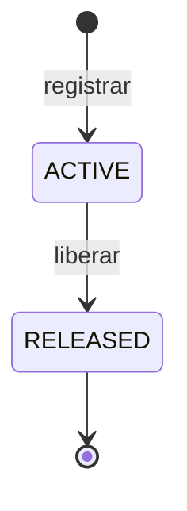

Reglas:

- Una suspensión activa bloquea destrucción y redacción.
- Una suspensión activa no impide la consulta autorizada.
- Una suspensión activa no impide un movimiento físico urgente, pero debe
  registrarse y justificarse.
- No se libera por vencimiento automático sin autoridad.
- Liberar requiere un actor distinto de quien la creó (D-18).
- Varias suspensiones pueden afectar la misma entidad.
- La entidad se considera retenida si al menos una suspensión está activa.
- El bloqueo debe comprobarse en el servicio y, cuando sea posible, en la base
  de datos.

### 18.6 Solicitud de destrucción

Entidad conceptual complementaria: `DeletionRequest`.

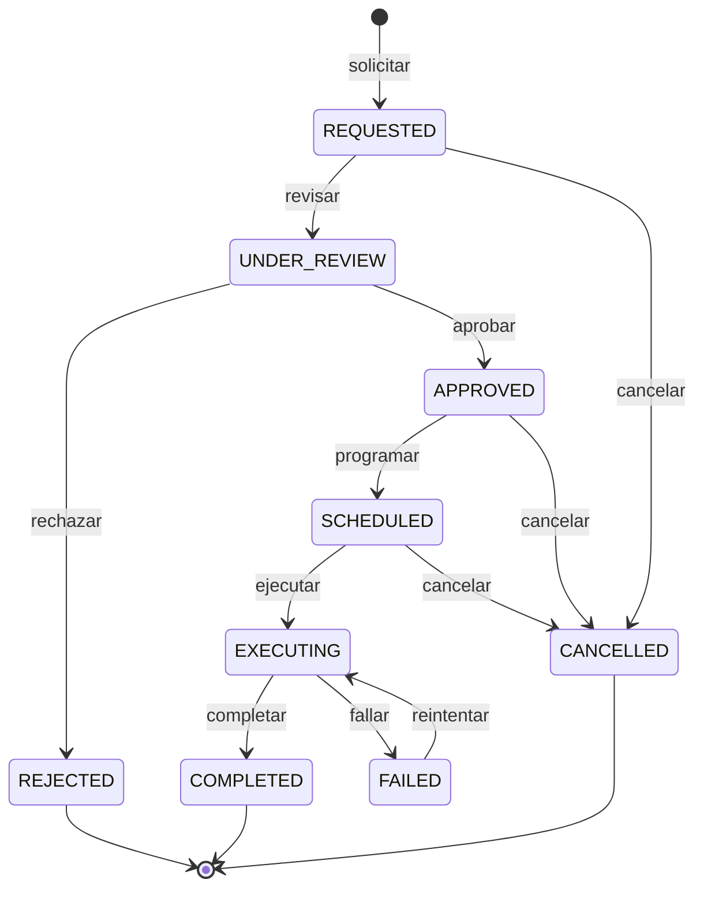

| Estado | Significado |
|---|---|
| `REQUESTED` | Solicitud registrada |
| `UNDER_REVIEW` | Revisión de política, retención y suspensiones |
| `REJECTED` | No procede |
| `APPROVED` | Aprobada por autoridad competente |
| `SCHEDULED` | Programada para ejecución |
| `EXECUTING` | En ejecución |
| `COMPLETED` | Ejecutada con evidencia |
| `FAILED` | Error; requiere intervención |
| `CANCELLED` | Cancelada antes de ejecutar |

Reglas:

- Solicitar no destruye nada.
- Aprobar no destruye nada.
- La ejecución es un paso separado.
- La aprobación requiere doble control (D-17).
- La ejecución verifica de nuevo retención y suspensiones.
- Si aparece una suspensión entre aprobación y ejecución, se detiene.
- El resultado registra qué se destruyó, qué se conservó y por qué.
- La evidencia de destrucción se conserva según política.

### 18.7 Política de retención

`RetentionPolicy` debe definir:

| Campo | Descripción |
|---|---|
| `entity_type` | Caja, expediente, documento, archivo u otro |
| `trigger_event` | Creación, archivo, cierre, sentencia u otro aprobado |
| `retention_months` | Plazo aprobado, no inventado |
| `disposition` | `REVIEW`, `TRANSFER`, `DESTROY`, `PERMANENT` |
| `legal_basis` | Norma o referencia institucional |
| `authority` | Autoridad que aprueba |
| `effective_from` | Vigencia |
| `effective_to` | Fin de vigencia |
| `active` | Estado |

Reglas:

- Sin `legal_basis` aprobada, la política no se activa.
- Sin plazo aprobado, no se destruye.
- Una política nueva no se aplica retroactivamente sin decisión expresa.
- La fecha de revisión se calcula desde el evento definido.
- La política aplicable se conserva en el registro o se puede reconstruir.
- Cambiar una política no cambia la historia ya ejecutada.
- La política debe distinguir soporte físico y archivo digital cuando difieran.

### 18.8 Disposición final

| Disposición | Uso | Evidencia |
|---|---|---|
| `REVIEW` | Requiere revisión humana | Resultado de revisión |
| `TRANSFER` | Transferencia a archivo histórico | Acta de transferencia |
| `DESTROY` | Destrucción autorizada | Acta o certificado |
| `PERMANENT` | Conservación permanente | Política aplicable |

No se asume que `DESTROY` sea el destino por defecto. La ausencia de política
significa conservar, no destruir.

### 18.9 Destrucción física y digital

- La destrucción física de cajas requiere acta y testigos según D-17.
- La destrucción digital requiere borrado del objeto y de derivados, salvo
  copias sujetas a retención de respaldo.
- El hash y los metadatos mínimos pueden conservarse para auditoría, según
  D-17.
- El número visible no se reutiliza después de destruir.
- La posición se libera con un movimiento o actualización auditada.
- Los expedientes y documentos asociados se destruyen o redactan según política.
- Un archivo `MISSING` o `CORRUPTED` no se marca como destruido sin revisión.
- La evidencia de destrucción no contiene datos personales innecesarios.

### 18.10 Archivos, derivados y temporales

| Objeto | Retención propuesta | Observación |
|---|---|---|
| Original digital | Según política del documento | No sobrescribir |
| OCR aceptado | Mientras viva el documento | Derivado revisable |
| OCR rechazado | Plazo corto de auditoría | D-22 |
| Miniatura | Mientras viva el original | Regenerable |
| Archivo temporal de carga | Horas o días | Borrado automático |
| Archivo en cuarentena | Hasta revisión | Aislado |
| Archivo de importación fuente | Según auditoría del lote | No borrar al aplicar |
| Logs técnicos | Plazo operativo | No sustituyen auditoría |
| Respaldos | Según política de respaldo | D-27 |

Ningún archivo temporal debe quedar accesible por URL pública.

### 18.11 Respaldos y restauración

- Un respaldo no es un mecanismo de retención legal.
- La restauración no debe resucitar registros destruidos sin control.
- La destrucción debe reflejarse en la política de respaldos según D-27.
- Una suspensión legal debe propagarse a la retención de respaldos cuando sea
  técnicamente posible.
- El procedimiento de restauración debe documentar cómo se reconcilian
  registros destruidos después del respaldo.
- No se prueba la restauración solo en producción.

### 18.12 Prohibiciones

- No borrar una caja con expedientes asociados.
- No borrar un expediente con archivos o auditoría sin proceso.
- No borrar un archivo `VERIFIED` sin política.
- No destruir con suspensión legal activa.
- No reutilizar un número visible.
- No eliminar eventos de auditoría.
- No redactar datos bajo suspensión.
- No usar `DELETE` en cascada como estrategia de baja.
- No confundir archivo histórico con borrado.
- No definir plazos legales por conveniencia técnica.

### 18.13 Casos de prueba conceptuales

| Caso | Resultado esperado |
|---|---|
| Archivar caja con préstamo abierto | `409 conflict` |
| Anular caja con préstamo abierto | `409 conflict` |
| Destruir caja sin política | `409 conflict` |
| Destruir caja con suspensión activa | `409 conflict` |
| Destruir caja con retención vigente | `409 conflict` |
| Restaurar caja archivada | Permitido con permiso y auditoría |
| Baja lógica de expediente | Oculto para consulta normal, historia conservada |
| Restaurar expediente | Permitido con permiso y auditoría |
| Destruir archivo temporal | Permitido sin aprobación especial |
| Destruir archivo original | Requiere política y aprobación |
| Liberar suspensión | Requiere autoridad y auditoría |
| Aparece suspensión durante ejecución | Se detiene la destrucción |

### 18.14 Decisiones asociadas

- D-16: plazos, base legal y autoridad de retención.
- D-17: aprobación, evidencia y conservación mínima tras destrucción.
- D-18: autoridad y separación para suspensión legal.
- D-26: retención de auditoría.
- D-27: respaldos, restauración y propagación de destrucción.
- D-30: transferencia al archivo histórico.
- D-31: reglas exactas de tribunal y año por tipo de caja, e inmutabilidad.
- D-32: datos mínimos y roles de las partes del expediente.
- D-33: niveles de confidencialidad.
- D-34: expediente sin caja.

---

## 19. Reglas funcionales detalladas

### 19.1 Convención

Cada regla tiene un código estable, una condición verificable y un efecto
observable. Las reglas son contractuales para B2/B3; las validaciones
posteriores de sección 31.5 no se convierten en restricciones rígidas.

### 19.2 Catálogos

| Código | Regla | Verificación |
|---|---|---|
| `BR-CAT-001` | El código de tribunal no es único global | Se permiten duplicados con UUID distinto |
| `BR-CAT-002` | Un tribunal inactivo no se usa en nuevas altas | Alta devuelve `409` salvo operación histórica |
| `BR-CAT-003` | Un tribunal con dependencias no se elimina | Baja lógica o desactivación |
| `BR-CAT-004` | Los perfiles de identificador son versionados | Cambio no altera historia |
| `BR-CAT-005` | Un tipo de resolución inactivo no se usa en nuevas altas | Se conserva en historia |
| `BR-CAT-006` | Una política de numeración activa por alcance | Validación de unicidad lógica |
| `BR-CAT-007` | Una política de retención sin base legal no se activa | Estado `DRAFT` o rechazo |
| `BR-CAT-008` | Los cambios de catálogo se auditan | Evento con antes/después |

### 19.3 Organización física

| Código | Regla | Verificación |
|---|---|---|
| `BR-LOC-001` | Un área tiene código único | Conflicto `409` |
| `BR-LOC-002` | Un anaquel pertenece a un área | FK obligatoria |
| `BR-LOC-003` | Una bandeja pertenece a un anaquel | FK obligatoria |
| `BR-LOC-004` | Una posición pertenece a una bandeja | FK obligatoria |
| `BR-LOC-005` | El código de posición es único dentro de su padre | Conflicto `409` |
| `BR-LOC-006` | La capacidad no se excede | Rechazo al crear o mover |
| `BR-LOC-007` | La capacidad es configurable por anaquel | No asumir 7x9 |
| `BR-LOC-008` | Una posición bloqueada no recibe cajas | `409 conflict` |
| `BR-LOC-009` | Una posición retirada no recibe cajas | `409 conflict` |
| `BR-LOC-010` | Una posición ocupada no se bloquea ni retira | `409 conflict` |
| `BR-LOC-011` | La ocupación se deriva de cajas `IN_PLACE` | No editable manualmente |
| `BR-LOC-012` | Un bloqueo tiene motivo y vigencia | Validación obligatoria |

### 19.4 Cajas

| Código | Regla | Verificación |
|---|---|---|
| `BR-BOX-001` | Una caja es de expedientes o administrativa | Tipo obligatorio y excluyente |
| `BR-BOX-002` | Una caja no mezcla tipos de contenido | Validación al asociar |
| `BR-BOX-003` | El número visible lo asigna el servidor | Cliente no lo define en alta normal |
| `BR-BOX-004` | El número visible no se reutiliza | Restricción de unicidad e historial |
| `BR-BOX-005` | Una caja puede estar vacía | Contenido `EMPTY` permitido |
| `BR-BOX-006` | Una caja puede existir sin ubicación | Custodia `UNKNOWN` permitida |
| `BR-BOX-007` | Una caja con préstamo abierto no se mueve, archiva, anula ni destruye | `409 conflict` |
| `BR-BOX-008` | Una caja destruida no se restaura | Estado terminal |
| `BR-BOX-009` | Una caja anulada conserva número e historia | No reutilización |
| `BR-BOX-010` | La corrección de número requiere motivo e historial | Auditoría y permiso |
| `BR-BOX-011` | El tipo de caja no cambia si tiene contenido incompatible | Rechazo |
| `BR-BOX-012` | La ubicación se actualiza con movimiento atómico | Caja y posición consistentes |
| `BR-BOX-013` | Una caja `IN_PLACE` requiere posición válida | Validación de estado |
| `BR-BOX-014` | Una caja `ON_LOAN` requiere préstamo `DELIVERED` | Validación de estado |
| `BR-BOX-015` | Una caja `DESTROYED` no ocupa posición | Liberación auditada |
| `BR-BOX-016` | La caja exige tribunal y año; las reglas por tipo y su inmutabilidad se cierran en D-31 | Validación obligatoria; corrección auditada |

### 19.5 Expedientes

| Código | Regla | Verificación |
|---|---|---|
| `BR-CASE-001` | El NUC es obligatorio | `422` si falta |
| `BR-CASE-002` | El tribunal es obligatorio | FK obligatoria |
| `BR-CASE-003` | El NUC se conserva como texto | Sin conversión numérica |
| `BR-CASE-004` | El NUC normalizado no se altera destructivamente | Ambos valores guardados |
| `BR-CASE-005` | La unicidad del NUC se detecta por tribunal; no hay UK global | Implementación D-02 con revisión de duplicados |
| `BR-CASE-006` | Un duplicado en el alcance devuelve conflicto | `409` con candidato |
| `BR-CASE-007` | La sentencia es opcional | `null` permitido |
| `BR-CASE-008` | La sentencia no se usa como NUC | Campos separados |
| `BR-CASE-009` | La corrección de NUC requiere motivo y auditoría | Permiso `cases.correct_nuc` |
| `BR-CASE-010` | Un expediente conserva su NUC al archivar | No reutilización |
| `BR-CASE-011` | Un expediente no se asocia a caja administrativa | Validación de tipo |
| `BR-CASE-012` | El expediente puede estar sin caja de forma temporal | Motivo y alerta D-34; caja obligatoria antes de archivo histórico |
| `BR-CASE-013` | Las partes se guardan individualmente | No lista de texto libre |
| `BR-CASE-014` | El rol de parte sale de catálogo aprobado | D-32 |
| `BR-CASE-015` | No se duplica la misma persona y rol en un expediente | Restricción lógica |
| `BR-CASE-016` | La búsqueda por nombre respeta D-14/D-25 | Autorización por recurso |
| `BR-CASE-017` | Una fecha parcial conserva su precisión | D-36; nunca inventar día o mes |

### 19.6 Documentos administrativos

| Código | Regla | Verificación |
|---|---|---|
| `BR-ADM-001` | El título es obligatorio | `422` si falta |
| `BR-ADM-002` | El tribunal es obligatorio | FK obligatoria |
| `BR-ADM-003` | El año es obligatorio | Entero válido |
| `BR-ADM-004` | El mes es opcional | Sin inventar mes |
| `BR-ADM-005` | Solo se asocia a caja administrativa | Validación de tipo |
| `BR-ADM-006` | No se mezcla con expedientes en la misma caja | Validación de contenido |
| `BR-ADM-007` | El documento puede no tener archivo digital | Estado permitido |
| `BR-ADM-008` | Un documento archivado conserva su historia | Baja lógica |

### 19.7 Archivos

| Código | Regla | Verificación |
|---|---|---|
| `BR-FILE-001` | El tamaño máximo se valida antes de aceptar | D-21 |
| `BR-FILE-002` | El tipo MIME se valida por contenido | No confiar en extensión |
| `BR-FILE-003` | El hash SHA-256 es obligatorio | Cálculo en servidor |
| `BR-FILE-004` | El nombre original se sanea para mostrar | No se usa como ruta |
| `BR-FILE-005` | El archivo se guarda en almacenamiento privado | Sin URL pública |
| `BR-FILE-006` | La descarga exige autenticación y permiso | `files.download` |
| `BR-FILE-007` | El archivo original no se sobrescribe | Nueva versión o nuevo archivo |
| `BR-FILE-008` | Un archivo en cuarentena no se sirve | `409` o `403` |
| `BR-FILE-009` | Un archivo corrupto no se sirve como válido | Estado y alerta |
| `BR-FILE-010` | La eliminación requiere retención y permiso | D-16/D-17 |
| `BR-FILE-011` | Un archivo no se vincula a dos documentos incompatibles | Relación explícita |
| `BR-FILE-012` | El hash se verifica al menos al almacenar y al servir crítico | D-27 |
| `BR-FILE-013` | El antivirus se ejecuta antes de marcar `STORED` | D-23 |
| `BR-FILE-014` | Los metadatos no incluyen secretos ni rutas internas | Revisión de contrato |

### 19.8 Importaciones

| Código | Regla | Verificación |
|---|---|---|
| `BR-IMP-001` | La carga no aplica datos | Solo crea lote |
| `BR-IMP-002` | La extracción no modifica entidades definitivas | Solo filas |
| `BR-IMP-003` | La revisión es obligatoria antes de aplicar | Estado `READY` |
| `BR-IMP-004` | La aprobación y aplicación son acciones separadas | Permisos distintos |
| `BR-IMP-005` | El creador no aprueba su propio lote | D-15 |
| `BR-IMP-006` | La aplicación es idempotente | Clave única |
| `BR-IMP-007` | Una fila con error no se aplica | Estado `ERROR` |
| `BR-IMP-008` | Una fila con advertencia requiere aceptación | Trazabilidad |
| `BR-IMP-009` | Un duplicado no se resuelve al azar | Revisión |
| `BR-IMP-010` | El lote conserva el archivo fuente | Retención |
| `BR-IMP-011` | El lote conserva filas y resultados | Auditoría |
| `BR-IMP-012` | Una importación fallida es reanudable | Checkpoint |
| `BR-IMP-013` | Las fórmulas de hojas de cálculo no se ejecutan | Lectura de valores |
| `BR-IMP-014` | Los límites de filas y tamaño están definidos | D-21/D-29 |
| `BR-IMP-015` | La codificación se detecta y se registra | D-29 |

### 19.9 Préstamos

| Código | Regla | Verificación |
|---|---|---|
| `BR-LOAN-001` | Una unidad tiene como máximo un préstamo abierto | Restricción lógica |
| `BR-LOAN-002` | La solicitud no cambia la custodia | Solo `REQUESTED` |
| `BR-LOAN-003` | La aprobación no entrega la unidad | Separación de pasos |
| `BR-LOAN-004` | La entrega cambia custodia a `ON_LOAN` | Atómico |
| `BR-LOAN-005` | La devolución cambia custodia y ubicación | Atómico |
| `BR-LOAN-006` | El vencimiento no cambia el estado por sí solo | Condición calculada |
| `BR-LOAN-007` | El rechazo y la cancelación requieren motivo | Validación |
| `BR-LOAN-008` | Una pérdida no se registra como devolución normal | Incidencia |
| `BR-LOAN-009` | La unidad prestada no se mueve ni anula | `409 conflict` |
| `BR-LOAN-010` | El solicitante no aprueba su préstamo | D-15 |
| `BR-LOAN-011` | Cada `LoanItem` referencia exactamente una caja o un expediente | Nunca ambos; D-05 |

### 19.10 Conciliación

| Código | Regla | Verificación |
|---|---|---|
| `BR-INV-001` | Una sesión tiene alcance explícito | Área, anaquel, bandeja, rango o caja |
| `BR-INV-002` | Un hallazgo pertenece a una sesión | FK obligatoria |
| `BR-INV-003` | Un hallazgo no modifica inventario por sí solo | Acción separada |
| `BR-INV-004` | Una sesión no cierra con hallazgos abiertos | Salvo aceptación |
| `BR-INV-005` | Aceptar diferencia requiere motivo | Validación |
| `BR-INV-006` | Una sesión cerrada no admite hallazgos | `409 conflict` |
| `BR-INV-007` | El resumen conserva esperado vs observado | Reporte |
| `BR-INV-008` | La conciliación no borra historia de movimientos | Append-only |

### 19.11 Búsqueda y consulta

| Código | Regla | Verificación |
|---|---|---|
| `BR-SRCH-001` | La búsqueda exacta tiene prioridad | Orden de resultados |
| `BR-SRCH-002` | La búsqueda no es difusa por defecto | Sin tolerancia a errores |
| `BR-SRCH-003` | Los últimos cinco dígitos buscan sufijo del NUC normalizado | Resultados múltiples posibles |
| `BR-SRCH-004` | La búsqueda por nombre no distingue mayúsculas | Normalización |
| `BR-SRCH-005` | Los acentos se normalizan para búsqueda, no para visualización | Campo derivado |
| `BR-SRCH-006` | La consulta de menores de longitud mínima se rechaza | D-24 |
| `BR-SRCH-007` | Los filtros desconocidos se rechazan | `422` |
| `BR-SRCH-008` | El orden se limita a campos permitidos | Allowlist |
| `BR-SRCH-009` | La paginación máxima es 100 | Contrato B0 |
| `BR-SRCH-010` | La consulta no expone datos de otro alcance | Autorización |

### 19.12 Auditoría

| Código | Regla | Verificación |
|---|---|---|
| `BR-AUD-001` | Toda acción crítica genera evento | Lista de acciones |
| `BR-AUD-002` | El evento incluye actor, fecha, acción y entidad | Validación |
| `BR-AUD-003` | El evento incluye `request_id` si existe | Correlación |
| `BR-AUD-004` | El evento no incluye contraseñas, tokens ni archivos | Revisión |
| `BR-AUD-005` | El evento es append-only | Sin UPDATE/DELETE de aplicación |
| `BR-AUD-006` | El antes/después se guarda como diff seguro | Sin secretos |
| `BR-AUD-007` | La consulta de auditoría requiere permiso | `audit.read` |
| `BR-AUD-008` | La exportación de auditoría requiere permiso | `audit.export` |
| `BR-AUD-009` | La fecha se guarda en UTC | Contrato |
| `BR-AUD-010` | La retención de auditoría se define en D-26 | No borrar por defecto |

### 19.13 Reglas de integridad global

| Código | Regla |
|---|---|
| `BR-GEN-001` | Toda operación de escritura valida autenticación y permiso |
| `BR-GEN-002` | Toda operación crítica valida estado actual |
| `BR-GEN-003` | Toda operación con reintento acepta clave de idempotencia |
| `BR-GEN-004` | Toda modificación concurrente usa versión o bloqueo |
| `BR-GEN-005` | Toda referencia usa UUID, no número visible |
| `BR-GEN-006` | Ninguna respuesta expone trazas internas |
| `BR-GEN-007` | Ningún error devuelve datos de otra entidad |
| `BR-GEN-008` | Ningún listado se devuelve sin paginación, salvo catálogo acotado |
| `BR-GEN-009` | Ningún borrado físico ocurre por una operación normal |
| `BR-GEN-010` | Las validaciones posteriores no se implementan como restricciones rígidas |

---

## 20. Convenciones de API

### 20.1 Base y formato

- Base: `/api/v1`.
- Transporte: HTTPS en entornos reales.
- Formato: JSON UTF-8.
- `Content-Type: application/json` salvo carga multipart.
- Nombres de campos: `snake_case`.
- Códigos de estado de negocio: `UPPER_SNAKE_CASE`.
- Códigos de error: `lower_snake_case`.
- Fechas: `YYYY-MM-DD`.
- Fechas y horas: ISO 8601 UTC con `Z`.
- UUID: cadena canónica con guiones.
- Booleanos: `true`/`false`, nunca `"true"`.
- Nulos: `null`, no `"null"` ni `""`.
- No se usa un envoltorio genérico `data` para respuestas exitosas.
- Los listados usan el contrato de página de B0.
- Los errores usan el contrato de error de B0.

### 20.2 Identificadores en rutas

- Las rutas usan UUID internos.
- No se usan NUC, número de caja ni código de tribunal como clave de ruta.
- Un recurso inexistente devuelve `404`.
- Un UUID malformado devuelve `422`.
- Los números visibles se buscan por query, no por path.

### 20.3 Respuestas exitosas

| Operación | Estado | Cuerpo |
|---|---|---|
| `GET` individual | `200` | Recurso |
| `GET` listado | `200` | Página |
| `POST` creación | `201` | Recurso creado + `Location` |
| `PATCH` actualización | `200` | Recurso actualizado |
| Acción de transición | `200` o `202` | Recurso o tarea |
| Eliminación lógica | `200` | Recurso con estado actualizado |
| Descarga | `200` | Binario |
| Sin contenido | `204` | Vacío |

No se devuelve `200` con un cuerpo de error.

### 20.4 Paginación

Contrato heredado de B0:

```json
{
  "items": [],
  "total": 0,
  "page": 1,
  "page_size": 25,
  "pages": 0,
  "has_next": false,
  "has_previous": false
}
```

Reglas:

- `page` empieza en 1.
- `page_size` por defecto 25.
- `page_size` máximo 100.
- Una página fuera de rango devuelve `items: []`, no `404`.
- `total` es el total de elementos que cumplen el filtro.
- `pages` es `ceil(total / page_size)` o 0.
- El orden debe ser determinista; se añade `id` como desempate.
- No se permite paginación sin límite.
- Los catálogos pequeños pueden devolver todos sus elementos solo si el
  contrato del endpoint lo declara.

### 20.5 Ordenamiento

- Parámetros: `sort_by`, `order` (`asc`/`desc`).
- `sort_by` debe pertenecer a una allowlist por endpoint.
- Un campo no permitido devuelve `422 validation_error`.
- El orden por defecto debe ser documentado.
- Valores nulos: se propone `NULLS LAST` en ambos sentidos; D-19 lo confirma.
- El desempate final es `id` ascendente.
- No se aceptan expresiones SQL, nombres de columnas ni funciones.

### 20.6 Filtros

- Los filtros son parámetros de query explícitos.
- Los filtros desconocidos se rechazan.
- Los filtros de igualdad usan el valor exacto.
- Los filtros de rango usan `from` y `to` inclusivos.
- Los filtros de fecha usan ISO 8601.
- Los filtros de estado usan códigos estables.
- Los filtros múltiples se repiten como claves separadas.
- Un filtro vacío se rechaza; no significa "todos".
- Para "sin valor" se usa un booleano explícito (`has_box`, `has_location`).
- El máximo de valores por filtro múltiple es 50 (D-29).
- Los filtros no permiten SQL, comodines ni expresiones regulares.

### 20.7 Búsqueda

- La búsqueda exacta de identificadores usa parámetros específicos.
- La búsqueda general usa `q` solo en endpoints que la declaren.
- No se aplica búsqueda difusa por defecto.
- La búsqueda por últimos cinco dígitos usa `nuc_last5`.
- La búsqueda por nombre usa normalización sin acentos y sin distinguir
  mayúsculas.
- La longitud mínima de `q` es 3 caracteres (D-24).
- Los resultados exactos se ordenan antes que los parciales.
- La búsqueda no omite autorización ni paginación.
- No se devuelve un único resultado cuando hay ambigüedad.

### 20.8 Idempotencia

- Operaciones de creación y transición aceptan `Idempotency-Key`.
- La clave es opaca, de 16 a 128 caracteres.
- Se vincula a actor, método y ruta.
- Una repetición con el mismo cuerpo devuelve el mismo resultado.
- Una repetición con cuerpo distinto devuelve `409 idempotency_conflict`.
- La vigencia mínima propuesta es 24 horas; D-20 la confirma.
- La clave no sustituye una restricción de unicidad.
- La clave no se registra en claro en logs.

### 20.9 Concurrencia

- Los recursos editables exponen `ETag` o `version`.
- Las actualizaciones críticas aceptan `If-Match`.
- Una versión desactualizada devuelve `412 precondition_failed`.
- Una transición de estado no se basa en el estado enviado por el cliente.
- El servidor vuelve a validar el estado actual.
- Los bloqueos deben ser cortos y transaccionales.
- No se permite "last write wins" en estados críticos.

### 20.10 Autenticación y CSRF

- La autenticación se implementa en B4.
- La sesión usa cookie `HttpOnly`, `Secure` en producción y `SameSite`.
- Las operaciones mutables con cookie requieren protección CSRF.
- La API no acepta tokens en query string.
- Un `401` indica sesión ausente o inválida.
- Un `403` indica sesión válida sin permiso.
- El logout invalida la sesión en servidor.
- El cambio de contraseña invalida sesiones según B4.
- Los detalles de MFA quedan fuera de B1.

### 20.11 Cabeceras

| Cabecera | Uso |
|---|---|
| `X-Request-ID` | Correlación; se genera si no llega |
| `Idempotency-Key` | Reintento seguro de escritura |
| `If-Match` | Control de concurrencia |
| `ETag` | Versión del recurso |
| `Location` | URI del recurso creado |
| `Retry-After` | Rate limit o servicio no disponible |
| `Cache-Control` | `no-store` para datos sensibles |
| `Content-Disposition` | Descarga con nombre seguro |

### 20.12 Caché

- Respuestas autenticadas: `Cache-Control: no-store`.
- Catálogos públicos: no aplica en B1.
- Descargas: no cacheables por defecto.
- Errores: no cacheables.
- El almacenamiento en caché de datos personales está prohibido sin revisión.

### 20.13 Versionado y evolución

- La versión mayor vive en la ruta (`/v1`).
- Añadir un campo opcional es compatible.
- Añadir un valor de enum puede ser incompatible para clientes estrictos; se
  documenta.
- Eliminar o renombrar un campo requiere nueva versión o periodo de deprecación.
- Un cambio de semántica requiere nueva versión.
- Los contratos publicados no se rompen en silencio.
- OpenAPI se genera desde el código en B3; en B1 es preliminar.

### 20.14 Límites generales

| Límite | Valor propuesto | Decisión |
|---|---|---|
| `page_size` máximo | 100 | Confirmado B0 |
| Tamaño de cuerpo JSON | 1 MiB | D-21 |
| Tamaño de archivo | 100 MiB general; TIFF 200 MiB | D-21 |
| Filas por importación | 50.000 | D-29 |
| Valores por filtro múltiple | 50 | D-29 |
| Duración de idempotencia | 24 h | D-20 |
| Timeout de petición síncrona | 30 s | D-20 |
| Timeout de tarea asíncrona | Configurable por tipo; se fija en B5 | D-20 |

### 20.15 Decisiones asociadas

- D-19: política de códigos de dominio, orden de nulos y semántica 403/404.
- D-20: idempotencia, concurrencia, timeouts y trabajos asíncronos.
- D-21: tamaños y tipos de archivo.
- D-24: búsqueda.
- D-29: límites de filtros, importaciones y lotes.
- D-33: confidencialidad y ocultación de existencia.

---

## 21. Errores y códigos estables

### 21.1 Contrato heredado

```json
{
  "error": {
    "code": "validation_error",
    "message": "Los datos enviados no son validos.",
    "details": {
      "errors": [
        {
          "location": ["body", "nuc"],
          "message": "El NUC es obligatorio.",
          "type": "missing"
        }
      ]
    },
    "request_id": "b7d4f0c2a1e34f6c"
  }
}
```

Reglas:

- `error` siempre presente en una respuesta de error.
- `code` es estable y no se traduce.
- `message` es apto para usuario y está en español.
- `details` es opcional y estructurado.
- `request_id` se incluye si está disponible.
- No se incluyen trazas, SQL, rutas internas ni secretos.
- Un error de validación no devuelve `200`.
- Un error de dominio no se colapsa a `500`.

### 21.2 Códigos de transporte existentes

| Código | HTTP | Uso |
|---|---|---|
| `validation_error` | 422 | Validación de cuerpo, query o path |
| `bad_request` | 400 | Petición inválida no cubierta por validación |
| `unauthorized` | 401 | Sesión ausente o inválida |
| `forbidden` | 403 | Sin permiso |
| `not_found` | 404 | Recurso inexistente o no visible |
| `method_not_allowed` | 405 | Método no permitido |
| `conflict` | 409 | Conflicto genérico |
| `rate_limited` | 429 | Límite de peticiones |
| `service_unavailable` | 503 | Dependencia no disponible |
| `internal_error` | 500 | Error no esperado |

Estos códigos ya existen en B0 y no se renombran.

### 21.3 Códigos de dominio propuestos

Se propone añadir códigos específicos manteniendo el formato
`lower_snake_case`. Son códigos de contrato, no una obligación de implementarlos
todos en B1.

| Código | HTTP | Cuándo |
|---|---|---|
| `invalid_identifier_format` | 422 | NUC, sentencia o código con formato inválido |
| `nuc_duplicate` | 409 | NUC duplicado en el alcance |
| `court_ambiguous` | 409 | Varias coincidencias de tribunal |
| `box_type_conflict` | 409 | Mezcla de expedientes y administrativos |
| `case_box_type_mismatch` | 409 | Expediente en caja administrativa |
| `admin_doc_box_type_mismatch` | 409 | Documento en caja de expedientes |
| `position_occupied` | 409 | Posición ya ocupada |
| `position_blocked` | 409 | Posición bloqueada |
| `position_retired` | 409 | Posición retirada |
| `location_capacity_exceeded` | 409 | Capacidad excedida |
| `number_already_used` | 409 | Número visible duplicado |
| `number_not_assignable` | 409 | Política inactiva o inválida |
| `invalid_state_transition` | 409 | Transición no permitida |
| `loan_already_open` | 409 | Unidad ya prestada |
| `loan_not_returnable` | 409 | Préstamo no entregado |
| `legal_hold_active` | 409 | Suspensión activa |
| `retention_blocked` | 409 | Retención vigente |
| `destroy_not_approved` | 409 | Falta aprobación de destrucción |
| `inventory_open_findings` | 409 | Hallazgos abiertos al cerrar |
| `import_already_applied` | 409 | Lote ya aplicado |
| `import_not_ready` | 409 | Lote no aprobado |
| `import_row_invalid` | 422 | Fila con error |
| `idempotency_conflict` | 409 | Misma clave, cuerpo distinto |
| `precondition_failed` | 412 | `If-Match` desactualizado |
| `file_too_large` | 413 | Archivo excede límite |
| `unsupported_media_type` | 415 | Tipo no permitido |
| `checksum_mismatch` | 422 | Hash no coincide |
| `antivirus_rejected` | 422 | Archivo rechazado por antivirus |
| `file_not_available` | 409 | Archivo en cuarentena, corrupto o perdido |
| `ocr_not_reviewable` | 409 | OCR no está en estado revisable |
| `export_too_large` | 413 | Exportación excede límite |
| `dependency_unavailable` | 503 | Dependencia externa caída |

La aprobación de esta lista es D-19. B3 puede implementar primero los códigos
usados por los flujos de B2--B6 y añadir el resto por necesidad contractual.

### 21.4 Detalles por tipo de error

#### Validación

```json
{
  "error": {
    "code": "validation_error",
    "message": "Los datos enviados no son validos.",
    "details": {
      "errors": [
        {
          "location": ["body", "nuc"],
          "message": "El NUC es obligatorio.",
          "type": "missing"
        }
      ]
    },
    "request_id": "req-123"
  }
}
```

#### Conflicto de estado

```json
{
  "error": {
    "code": "invalid_state_transition",
    "message": "La caja no puede archivarse mientras tiene un prestamo abierto.",
    "details": {
      "entity": "box",
      "entity_id": "6f4d...",
      "current_status": "ACTIVE",
      "attempted_action": "archive",
      "conflict": "open_loan"
    },
    "request_id": "req-124"
  }
}
```

#### Duplicado

```json
{
  "error": {
    "code": "nuc_duplicate",
    "message": "Ya existe un expediente con ese NUC en el tribunal indicado.",
    "details": {
      "existing_case_file_id": "c1a2...",
      "nuc": "2022-102-00001",
      "scope": "court"
    },
    "request_id": "req-125"
  }
}
```

No se debe devolver el expediente completo en el error de duplicado si el
usuario no tiene permiso para verlo.

### 21.5 403 frente a 404

Propuesta:

- `401`: no hay sesión válida.
- `403`: hay sesión y permiso insuficiente, y revelar la existencia no es
  sensible.
- `404`: el recurso no existe o está fuera del alcance y revelar su existencia
  sería un riesgo.
- `409`: el recurso existe y la operación choca con su estado.

La política aceptada D-33 usa `404` cuando revelar la existencia es sensible;
en caso de duda, no filtrar datos.

### 21.6 Reintentos

| Situación | ¿Reintentar? | Condición |
|---|---|---|
| `429` | Sí | Respetar `Retry-After` |
| `503` | Sí | Con backoff y jitter |
| `500` | Solo operaciones idempotentes | Con clave |
| `409` | No automático | Requiere revisión |
| `422` | No | Corregir datos |
| `401` | No sin reautenticar | — |
| `403` | No | Solicitar permiso |
| `412` | No | Recargar recurso |

### 21.7 Decisiones asociadas

- D-19: catálogo de códigos, 403/404 y orden de nulos.
- D-20: idempotencia y reintentos.
- D-21: límites de archivos.
- D-33: confidencialidad.

---

## 22. Filtros, orden, paginación y búsqueda

### 22.1 Contrato común de listado

Parámetros comunes:

| Parámetro | Tipo | Regla |
|---|---|---|
| `page` | entero | >= 1; defecto 1 |
| `page_size` | entero | 1..100; defecto 25 |
| `sort_by` | string | Allowlist del endpoint |
| `order` | `asc`/`desc` | Defecto documentado |

Respuesta:

```json
{
  "items": [],
  "total": 0,
  "page": 1,
  "page_size": 25,
  "pages": 0,
  "has_next": false,
  "has_previous": false
}
```

### 22.2 Filtros por recurso

#### Cajas

| Filtro | Tipo | Semántica |
|---|---|---|
| `box_type` | enum | `EXPEDIENTES` o `DOCUMENTOS_ADMINISTRATIVOS` |
| `lifecycle_status` | enum | Estado de ciclo de vida |
| `custody_status` | enum | Estado de custodia |
| `court_id` | UUID | Tribunal de referencia de la caja |
| `position_id` | UUID | Posición actual |
| `area_id` | UUID | Área de la posición |
| `shelf_id` | UUID | Anaquel de la posición |
| `has_location` | bool | Tiene posición conocida |
| `has_open_loan` | bool | Tiene préstamo abierto |
| `number` | string | Número visible exacto |
| `year` | entero | Año de la caja, si aplica |

#### Expedientes

| Filtro | Tipo | Semántica |
|---|---|---|
| `nuc` | string | NUC exacto normalizado |
| `nuc_last5` | string | Sufijo de cinco dígitos |
| `court_id` | UUID | Tribunal |
| `year` | entero | Año |
| `box_id` | UUID | Caja |
| `has_box` | bool | Tiene caja |
| `name` | string | Nombre de parte |
| `party_role` | enum | Rol de parte |
| `sentence` | string | Sentencia o resolución exacta |
| `sentence_partial` | string | Fragmento de sentencia |
| `entry_date_from` | fecha | Fecha de entrada desde |
| `entry_date_to` | fecha | Fecha de entrada hasta |
| `sentence_date_from` | fecha | Fecha de sentencia desde |
| `sentence_date_to` | fecha | Fecha de sentencia hasta |
| `status` | enum | Ciclo de vida |

#### Documentos administrativos

| Filtro | Tipo | Semántica |
|---|---|---|
| `court_id` | UUID | Tribunal |
| `year` | entero | Año |
| `month` | entero | 1..12 |
| `box_id` | UUID | Caja |
| `title` | string | Título parcial |
| `status` | enum | Ciclo de vida |

#### Préstamos

| Filtro | Tipo | Semántica |
|---|---|---|---|
| `status` | enum | Estado |
| `overdue` | bool | Vencido y no devuelto |
| `requester_id` | UUID | Solicitante |
| `approver_id` | UUID | Aprobador |
| `box_id` | UUID | Caja |
| `case_file_id` | UUID | Expediente |
| `due_from` | fecha | Vencimiento desde |
| `due_to` | fecha | Vencimiento hasta |

#### Importaciones

| Filtro | Tipo | Semántica |
|---|---|---|---|
| `status` | enum | Estado del lote |
| `created_by` | UUID | Creador |
| `reviewed_by` | UUID | Revisor |
| `approved_by` | UUID | Aprobador |
| `created_from` | fecha-hora | Desde |
| `created_to` | fecha-hora | Hasta |

#### Auditoría

| Filtro | Tipo | Semántica |
|---|---|---|---|
| `entity_type` | string | Tipo de entidad |
| `entity_id` | UUID | Entidad |
| `actor_id` | UUID | Actor |
| `action` | string | Acción |
| `occurred_from` | fecha-hora | Desde |
| `occurred_to` | fecha-hora | Hasta |
| `request_id` | string | Correlación |

### 22.3 Orden permitido

| Recurso | Campos propuestos |
|---|---|---|
| Cajas | `visible_number`, `created_at`, `updated_at` |
| Expedientes | `nuc_normalized`, `year`, `created_at`, `updated_at` |
| Documentos administrativos | `year`, `month`, `title`, `created_at` |
| Préstamos | `requested_at`, `due_at`, `status` |
| Importaciones | `created_at`, `status` |
| Auditoría | `occurred_at` |
| Ubicaciones | `area.code`, `shelf.code`, `tray.code`, `position.code` |

Los nombres exactos de campos anidados requieren allowlist propia. No se acepta
`sort_by=area.code` si no está declarado.

### 22.4 Semántica de búsqueda por NUC

1. Normalizar el valor de entrada.
2. Buscar coincidencia exacta de `nuc_normalized`.
3. Si hay exacta, devolverla primero.
4. Si no hay exacta, buscar por sufijo solo si el usuario usó `nuc_last5`.
5. No convertir automáticamente un NUC corto en uno largo.
6. No aplicar fuzzy matching.
7. No elegir un resultado si hay varios.
8. Devolver los candidatos paginados.

### 22.5 Búsqueda por nombre

- Se normaliza para comparación: minúsculas, sin acentos, espacios colapsados.
- La visualización conserva el nombre original.
- La búsqueda puede ser parcial por prefijo o contiene (D-24).
- La longitud mínima es 3 caracteres (D-24).
- Los nombres muy comunes generan muchos resultados; se exige paginación.
- No se infiere identidad por nombre.
- No se fusionan personas por nombre.

### 22.6 Búsqueda por caja y ubicación

- `number` busca número visible exacto.
- La búsqueda por rango de números es una capacidad separada.
- `area_id`, `shelf_id`, `tray_id` y `position_id` filtran ubicación actual.
- Una caja sin ubicación no aparece en filtros de ubicación salvo `has_location=false`.
- Una caja en préstamo no ocupa posición para el filtro de ocupación.
- La etiqueta de posición no se usa como identificador global.

### 22.7 Errores de consulta

| Caso | Resultado |
|---|---|
| `page=0` | `422 validation_error` |
| `page_size=101` | `422 validation_error` |
| `sort_by` no permitido | `422 validation_error` |
| `order` inválido | `422 validation_error` |
| Filtro desconocido | `422 validation_error` |
| Fecha inválida | `422 validation_error` |
| Rango invertido | `422 validation_error` |
| `nuc_last5` no numérico | `422 validation_error` |
| `q` demasiado corto | `422 validation_error` |
| Página fuera de rango | `200` con lista vacía |

### 22.8 Rendimiento y seguridad

- Los filtros no se interpolan en SQL.
- El orden no se interpola desde texto libre.
- Los listados siempre están paginados.
- Las consultas sobre datos personales se auditan si D-25 lo exige.
- Los totales grandes pueden requerir conteo estimado en el futuro; B1 mantiene
  `total` exacto salvo decisión posterior.
- No se exponen consultas internas ni planes de ejecución.
- Los índices se diseñan en B2/B8 a partir de estos filtros.

### 22.9 Búsqueda global

La interfaz requiere una búsqueda única que localice cajas, expedientes y
documentos administrativos. B1 propone un contrato de fachada:

```http
GET /api/v1/search?q=00001&types=BOX,CASE_FILE,ADMINISTRATIVE_DOCUMENT
    &court_id=...&year=2022&limit_per_type=20
```

Respuesta conceptual:

```json
{
  "query": "00001",
  "partial": false,
  "groups": {
    "boxes": { "total": 1, "items": [] },
    "case_files": { "total": 3, "items": [] },
    "administrative_documents": { "total": 0, "items": [] }
  }
}
```

Reglas:

- `q` busca en NUC, nombre de parte, sentencia, título administrativo, número
  de caja y texto permitido por D-24.
- Los filtros de tribunal, año, tipo, área, estantería, bandeja, posición,
  estado de ubicación, estado de caja, estado de préstamo y fechas se aplican a
  todos los grupos que los soportan.
- Cada grupo se limita con `limit_per_type` (máximo 50) y devuelve su propio
  `total`; para profundizar se usa el listado especializado conservando filtros.
- El orden dentro de cada grupo combina coincidencia exacta, prefijo y
  relevancia; debe ser determinista.
- Si un grupo falla, la respuesta global no se degrada silenciosamente: se
  informa `partial: true` y el grupo afectado con error.
- La búsqueda global nunca omite permisos ni auditoría; cada grupo aplica el
  alcance del usuario.
- La implementación puede materializar índices en B2/B8, pero B1 no los define.

### 22.10 Decisiones asociadas

- D-19: orden de nulos y códigos.
- D-24: búsqueda exacta/parcial, longitud mínima y acentos.
- D-25: acceso a datos personales.
- D-29: límites de filtros múltiples y exportaciones.
- D-31: tribunal y año obligatorios de caja y su inmutabilidad.
- D-36: representación y búsqueda de fechas parciales.
- D-37: contrato definitivo de búsqueda global agrupada o unificada.

---

## 23. Mapa de recursos y ejemplos de contrato

### 23.1 Endpoints propuestos

Esta tabla define el alcance contractual preliminar. No se implementa en B1.

#### Autenticación y usuarios

| Método | Ruta | Propósito | Permiso | Éxito |
|---|---|---|---|---|
| `POST` | `/auth/login` | Iniciar sesión | Público | `200` |
| `GET` | `/auth/session` | Sesión actual | Autenticado | `200` |
| `DELETE` | `/auth/session` | Cerrar sesión | Autenticado | `204` |
| `POST` | `/auth/password` | Cambiar contraseña propia | Autenticado | `204` |
| `GET` | `/users` | Listar usuarios | `users.read` | `200` |
| `POST` | `/users` | Crear usuario | `users.create` | `201` |
| `GET` | `/users/{id}` | Ver usuario | `users.read` | `200` |
| `PATCH` | `/users/{id}` | Actualizar usuario | `users.update` | `200` |
| `POST` | `/users/{id}/deactivate` | Desactivar | `users.deactivate` | `200` |
| `PUT` | `/users/{id}/roles` | Asignar roles | `users.assign_roles` | `200` |
| `POST` | `/users/{id}/reset-password` | Resetear contraseña | `users.reset_password` | `202` |
| `GET` | `/roles` | Listar roles y permisos | `roles.read` | `200` |

#### Catálogos

| Método | Ruta | Propósito | Permiso | Éxito |
|---|---|---|---|---|
| `GET` | `/courts` | Listar tribunales | `courts.read` | `200` |
| `POST` | `/courts` | Crear tribunal | `courts.create` | `201` |
| `GET` | `/courts/{id}` | Ver tribunal | `courts.read` | `200` |
| `PATCH` | `/courts/{id}` | Actualizar tribunal | `courts.update` | `200` |
| `POST` | `/courts/{id}/deactivate` | Desactivar tribunal | `courts.deactivate` | `200` |
| `GET` | `/resolution-types` | Listar tipos | `resolution_types.read` | `200` |
| `POST` | `/resolution-types` | Crear tipo | `resolution_types.manage` | `201` |
| `GET` | `/identifier-profiles` | Listar perfiles | `identifier_profiles.read` | `200` |
| `POST` | `/identifier-profiles` | Crear perfil | `identifier_profiles.manage` | `201` |
| `GET` | `/numbering-policies` | Listar políticas | `numbering_policies.read` | `200` |
| `PATCH` | `/numbering-policies/{id}` | Actualizar política | `numbering_policies.manage` | `200` |
| `GET` | `/retention-policies` | Listar políticas | `retention_policies.read` | `200` |
| `POST` | `/retention-policies` | Crear política | `retention_policies.manage` | `201` |

#### Organización física

| Método | Ruta | Propósito | Permiso | Éxito |
|---|---|---|---|---|
| `GET` | `/areas` | Listar áreas | `locations.read` | `200` |
| `POST` | `/areas` | Crear área | `locations.create` | `201` |
| `GET` | `/shelves` | Listar anaqueles | `locations.read` | `200` |
| `POST` | `/shelves` | Crear anaquel | `locations.create` | `201` |
| `GET` | `/trays` | Listar bandejas | `locations.read` | `200` |
| `POST` | `/trays` | Crear bandeja | `locations.create` | `201` |
| `GET` | `/positions` | Listar posiciones | `locations.read` | `200` |
| `POST` | `/positions` | Crear posición | `locations.create` | `201` |
| `POST` | `/positions/{id}/block` | Bloquear | `locations.block` | `200` |
| `POST` | `/positions/{id}/unblock` | Desbloquear | `locations.block` | `200` |

#### Cajas

| Método | Ruta | Propósito | Permiso | Éxito |
|---|---|---|---|---|
| `GET` | `/boxes` | Listar/buscar cajas | `boxes.read` | `200` |
| `POST` | `/boxes` | Crear caja | `boxes.create` | `201` |
| `GET` | `/boxes/{id}` | Ver caja | `boxes.read` | `200` |
| `PATCH` | `/boxes/{id}` | Actualizar caja | `boxes.update` | `200` |
| `POST` | `/boxes/{id}/archive` | Archivar | `boxes.archive` | `200` |
| `POST` | `/boxes/{id}/restore` | Restaurar | `boxes.restore` | `200` |
| `POST` | `/boxes/{id}/void` | Anular | `boxes.void` | `200` |
| `POST` | `/boxes/{id}/move` | Trasladar | `boxes.move` | `200` |
| `POST` | `/boxes/{id}/number-corrections` | Corregir número | `boxes.number_correct` | `200` |
| `POST` | `/boxes/{id}/label` | Emitir etiqueta | `boxes.label.print` | `201` |
| `GET` | `/boxes/{id}/movements` | Historial | `boxes.read` | `200` |
| `POST` | `/boxes/{id}/missing` | Marcar no localizada | `boxes.mark_missing` | `200` |

#### Expedientes y documentos

| Método | Ruta | Propósito | Permiso | Éxito |
|---|---|---|---|---|
| `GET` | `/case-files` | Listar/buscar expedientes | `cases.read` | `200` |
| `POST` | `/case-files` | Crear expediente | `cases.create` | `201` |
| `GET` | `/case-files/{id}` | Ver expediente | `cases.read` | `200` |
| `PATCH` | `/case-files/{id}` | Actualizar expediente | `cases.update` | `200` |
| `POST` | `/case-files/{id}/archive` | Archivar | `cases.archive` | `200` |
| `POST` | `/case-files/{id}/nuc-corrections` | Corregir NUC | `cases.correct_nuc` | `200` |
| `GET` | `/case-files/{id}/parties` | Listar partes | `cases.read` | `200` |
| `POST` | `/case-files/{id}/parties` | Añadir parte | `cases.party_manage` | `201` |
| `GET` | `/administrative-documents` | Listar documentos | `admin_docs.read` | `200` |
| `POST` | `/administrative-documents` | Crear documento | `admin_docs.create` | `201` |
| `GET` | `/administrative-documents/{id}` | Ver documento | `admin_docs.read` | `200` |
| `PATCH` | `/administrative-documents/{id}` | Actualizar documento | `admin_docs.update` | `200` |
| `POST` | `/administrative-documents/{id}/archive` | Archivar documento | `admin_docs.archive` | `200` |

#### Archivos y OCR

| Método | Ruta | Propósito | Permiso | Éxito |
|---|---|---|---|---|
| `POST` | `/files` | Subir archivo | `files.upload` | `201` |
| `GET` | `/files/{id}` | Ver metadatos | `files.read` | `200` |
| `GET` | `/files/{id}/content` | Descargar | `files.download` | `200` |
| `POST` | `/files/{id}/ocr` | Encolar OCR | `ocr.process` | `202` |
| `GET` | `/ocr-results/{id}` | Ver resultado | `ocr.read` | `200` |
| `POST` | `/ocr-results/{id}/accept` | Aceptar OCR | `ocr.review` | `200` |
| `POST` | `/ocr-results/{id}/reject` | Rechazar OCR | `ocr.review` | `200` |

#### Importaciones

| Método | Ruta | Propósito | Permiso | Éxito |
|---|---|---|---|---|
| `GET` | `/imports` | Listar lotes | `imports.read` | `200` |
| `POST` | `/imports` | Crear lote | `imports.create` | `201` |
| `GET` | `/imports/{id}` | Ver lote | `imports.read` | `200` |
| `POST` | `/imports/{id}/files` | Adjuntar uno o varios archivos | `imports.upload` | `202` |
| `GET` | `/imports/{id}/files` | Listar archivos y estados | `imports.read` | `200` |
| `POST` | `/imports/{id}/files/{file_id}/skip` | Omitir archivo con motivo | `imports.review` | `200` |
| `POST` | `/imports/{id}/process` | Extraer filas y OCR | `imports.process` | `202` |
| `GET` | `/imports/{id}/rows` | Listar filas | `imports.read` | `200` |
| `PATCH` | `/imports/{id}/rows/{row_id}` | Corregir fila | `imports.review` | `200` |
| `POST` | `/imports/{id}/approve` | Aprobar lote | `imports.approve` | `200` |
| `POST` | `/imports/{id}/apply` | Aplicar lote | `imports.apply` | `202` |
| `POST` | `/imports/{id}/cancel` | Cancelar lote | `imports.cancel` | `200` |

#### Préstamos

| Método | Ruta | Propósito | Permiso | Éxito |
|---|---|---|---|---|
| `GET` | `/loans` | Listar préstamos | `loans.read` | `200` |
| `POST` | `/loans` | Solicitar préstamo | `loans.request` | `201` |
| `GET` | `/loans/{id}` | Ver préstamo | `loans.read` | `200` |
| `POST` | `/loans/{id}/approve` | Aprobar | `loans.approve` | `200` |
| `POST` | `/loans/{id}/reject` | Rechazar | `loans.approve` | `200` |
| `POST` | `/loans/{id}/deliver` | Entregar | `loans.deliver` | `200` |
| `POST` | `/loans/{id}/return` | Devolver | `loans.return` | `200` |
| `POST` | `/loans/{id}/cancel` | Cancelar | `loans.cancel` | `200` |
| `POST` | `/loans/{id}/mark-lost` | Marcar pérdida | `loans.mark_lost` | `200` |

#### Conciliación, auditoría y reportes

| Método | Ruta | Propósito | Permiso | Éxito |
|---|---|---|---|---|
| `GET` | `/inventory-sessions` | Listar sesiones | `inventory.read` | `200` |
| `POST` | `/inventory-sessions` | Crear sesión | `inventory.create` | `201` |
| `GET` | `/inventory-sessions/{id}` | Ver sesión | `inventory.read` | `200` |
| `POST` | `/inventory-sessions/{id}/start` | Iniciar | `inventory.manage` | `200` |
| `POST` | `/inventory-sessions/{id}/close` | Cerrar | `inventory.close` | `200` |
| `GET` | `/inventory-sessions/{id}/findings` | Listar hallazgos | `inventory.read` | `200` |
| `POST` | `/inventory-sessions/{id}/findings` | Crear hallazgo | `inventory.manage` | `201` |
| `POST` | `/findings/{id}/resolve` | Resolver hallazgo | `inventory.resolve` | `200` |
| `POST` | `/findings/{id}/accept-difference` | Aceptar diferencia | `inventory.accept_difference` | `200` |
| `GET` | `/audit-events` | Consultar auditoría | `audit.read` | `200` |
| `GET` | `/audit-events/export` | Exportar auditoría | `audit.export` | `202` |
| `GET` | `/reports/boxes` | Reporte de cajas | `reports.read` | `200` |
| `GET` | `/reports/loans` | Reporte de préstamos | `reports.read` | `200` |
| `GET` | `/reports/inventory` | Reporte de inventario | `reports.read` | `200` |

#### Búsqueda global

| Método | Ruta | Propósito | Permiso | Éxito |
|---|---|---|---|---|
| `GET` | `/search` | Buscar cajas, expedientes y documentos administrativos | Permiso del recurso consultado | `200` |

#### Salud

| Método | Ruta | Propósito | Permiso | Éxito |
|---|---|---|---|---|
| `GET` | `/health` | Liveness | Público interno | `200` |
| `GET` | `/ready` | Readiness | Público interno | `200`/`503` |

### 23.2 Ejemplo: crear caja

```http
POST /api/v1/boxes
Content-Type: application/json
X-Request-ID: req-20261025-001
Idempotency-Key: 4b1f0c9e-6a10-4f8a-9e10-2b4c6d8e0f12
```

```json
{
  "box_type": "EXPEDIENTES",
  "court_id": "9f2c1d4e-6a7b-4c8d-9e0f-1a2b3c4d5e6f",
  "year": 2026,
  "notes": "Alta inicial"
}
```

```http
HTTP/1.1 201 Created
Location: /api/v1/boxes/5c7d9e1f-2a3b-4c5d-8e9f-0a1b2c3d4e5f
ETag: "1"
```

```json
{
  "id": "5c7d9e1f-2a3b-4c5d-8e9f-0a1b2c3d4e5f",
  "visible_number": "4402",
  "box_type": "EXPEDIENTES",
  "court": {
    "id": "9f2c1d4e-6a7b-4c8d-9e0f-1a2b3c4d5e6f",
    "code": "102",
    "name": "Corte de Apelación"
  },
  "lifecycle_status": "ACTIVE",
  "custody_status": "UNKNOWN",
  "location_precision": "UNKNOWN",
  "current_position": null,
  "content_summary": {
    "case_files": 0,
    "administrative_documents": 0
  },
  "created_at": "2026-10-25T15:00:00Z",
  "updated_at": "2026-10-25T15:00:00Z",
  "version": 1
}
```

El `court_id` y el `year` son obligatorios conforme a `AGENTS.md`. D-31 debe
cerrar las variantes por tipo de caja y las condiciones exactas de
inmutabilidad; una corrección posterior requiere flujo auditado.

### 23.3 Ejemplo: listar cajas

```http
GET /api/v1/boxes?box_type=EXPEDIENTES&has_location=false&page=1&page_size=25&sort_by=visible_number&order=asc
```

```json
{
  "items": [
    {
      "id": "5c7d9e1f-2a3b-4c5d-8e9f-0a1b2c3d4e5f",
      "visible_number": "4402",
      "box_type": "EXPEDIENTES",
      "lifecycle_status": "ACTIVE",
      "custody_status": "UNKNOWN",
      "location_precision": "UNKNOWN"
    }
  ],
  "total": 1,
  "page": 1,
  "page_size": 25,
  "pages": 1,
  "has_next": false,
  "has_previous": false
}
```

### 23.4 Ejemplo: crear expediente

```http
POST /api/v1/case-files
Content-Type: application/json
```

```json
{
  "nuc": "2022-102-00001",
  "court_id": "9f2c1d4e-6a7b-4c8d-9e0f-1a2b3c4d5e6f",
  "year": 2022,
  "box_id": "5c7d9e1f-2a3b-4c5d-8e9f-0a1b2c3d4e5f",
  "sentence": null,
  "parties": [
    {
      "display_name": "Nombre de ejemplo",
      "party_role": "PENDIENTE"
    }
  ]
}
```

```http
HTTP/1.1 201 Created
```

```json
{
  "id": "a1b2c3d4-e5f6-4a7b-8c9d-0e1f2a3b4c5d",
  "nuc": "2022-102-00001",
  "nuc_normalized": "2022-102-00001",
  "court_id": "9f2c1d4e-6a7b-4c8d-9e0f-1a2b3c4d5e6f",
  "year": 2022,
  "box_id": "5c7d9e1f-2a3b-4c5d-8e9f-0a1b2c3d4e5f",
  "sentence": null,
  "status": "ACTIVE",
  "created_at": "2026-10-25T15:05:00Z",
  "updated_at": "2026-10-25T15:05:00Z",
  "version": 1
}
```

`party_role: "PENDIENTE"` es un marcador de ejemplo, no un valor contractual.
D-32 debe aprobar el catálogo real.

### 23.5 Ejemplo: subir archivo

```http
POST /api/v1/files
Content-Type: multipart/form-data; boundary=...
```

Campos:

| Campo | Tipo | Obligatorio |
|---|---|---|
| `file` | binario | Sí |
| `case_file_id` | UUID | Uno de los dos vínculos |
| `administrative_document_id` | UUID | Uno de los dos vínculos |
| `kind` | string | Sí |
| `notes` | string | No |

```json
{
  "id": "f1e2d3c4-b5a6-4f7e-8d9c-0b1a2f3e4d5c",
  "original_name": "documento.pdf",
  "mime_type": "application/pdf",
  "size_bytes": 245760,
  "sha256": "9f86d081884c7d659a2feaa0c55ad015a3bf4f1b2b0b822cd15d6c15b0f00a08",
  "status": "PENDING",
  "linked_to": {
    "case_file_id": "a1b2c3d4-e5f6-4a7b-8c9d-0e1f2a3b4c5d"
  },
  "created_at": "2026-10-25T15:10:00Z"
}
```

El estado `PENDING` indica que aún no se ha verificado. No se promete descarga
inmediata.

### 23.6 Ejemplo: transición de préstamo

```http
POST /api/v1/loans/7a8b9c0d-1e2f-4a3b-8c4d-5e6f7a8b9c0d/approve
Content-Type: application/json
If-Match: "3"
```

```json
{
  "comment": "Autorizado por necesidad de consulta"
}
```

```json
{
  "id": "7a8b9c0d-1e2f-4a3b-8c4d-5e6f7a8b9c0d",
  "status": "APPROVED",
  "approved_by": "2b3c4d5e-6f7a-4b8c-9d0e-1f2a3b4c5d6e",
  "approved_at": "2026-10-25T15:20:00Z",
  "due_at": "2026-10-27T18:00:00Z",
  "version": 4
}
```

La aprobación no cambia la custodia de la caja. La entrega es otra llamada.

### 23.7 Ejemplo de error de estado

```http
HTTP/1.1 409 Conflict
```

```json
{
  "error": {
    "code": "invalid_state_transition",
    "message": "La caja no puede entregarse porque el prestamo no esta aprobado.",
    "details": {
      "entity": "loan",
      "entity_id": "7a8b9c0d-1e2f-4a3b-8c4d-5e6f7a8b9c0d",
      "current_status": "REQUESTED",
      "attempted_action": "deliver"
    },
    "request_id": "req-20261025-002"
  }
}
```

### 23.8 Reglas de contrato de los ejemplos

- Los UUID y nombres son ficticios.
- Los campos mostrados no autorizan su implementación.
- Los valores `PENDIENTE` son marcadores, no enums.
- Los ejemplos no sustituyen el OpenAPI de la sección 24.
- Si un ejemplo y una regla difieren, prevalece la regla y se corrige el
  ejemplo.
- Los ejemplos no incluyen datos personales reales.

---

## 24. Contrato OpenAPI preliminar

> **Naturaleza:** contrato preliminar de B1. No se implementa en esta fase.
> Cubre los flujos de mayor riesgo y fija convenciones. B3 generará el OpenAPI
> definitivo desde el código y lo contrastará con este borrador. Las decisiones
> bloqueantes ya están aceptadas; `x-pending-decision` solo puede marcar
> detalles operativos que no cambian la forma del contrato.

```yaml
openapi: 3.0.3
info:
  title: SGA API
  version: 0.1.0-b1
  description: |
    Contrato preliminar de la Fase B1 del Sistema de Gestion Documental
    Judicial. No implementa endpoints. Las decisiones de forma estan aceptadas
    y las validaciones operativas posteriores se documentan en la seccion 31.
  contact:
    name: Equipo SGA
servers:
  - url: /api/v1
    description: API versionada
tags:
  - name: Auth
  - name: Courts
  - name: Boxes
  - name: CaseFiles
  - name: AdministrativeDocuments
  - name: Files
  - name: OCR
  - name: Imports
  - name: Loans
  - name: Inventory
  - name: Search
  - name: Audit
  - name: Health
security:
  - cookieAuth: []
paths:
  /auth/login:
    post:
      tags: [Auth]
      operationId: login
      summary: Iniciar sesion
      security: []
      requestBody:
        required: true
        content:
          application/json:
            schema:
              $ref: '#/components/schemas/LoginRequest'
      responses:
        '200':
          description: Sesion iniciada
          headers:
            Set-Cookie:
              schema:
                type: string
          content:
            application/json:
              schema:
                $ref: '#/components/schemas/Session'
        '401':
          $ref: '#/components/responses/Unauthorized'
        '422':
          $ref: '#/components/responses/ValidationError'
        '429':
          $ref: '#/components/responses/TooManyRequests'
  /auth/session:
    get:
      tags: [Auth]
      operationId: getSession
      summary: Consultar sesion actual
      responses:
        '200':
          description: Sesion actual
          content:
            application/json:
              schema:
                $ref: '#/components/schemas/Session'
        '401':
          $ref: '#/components/responses/Unauthorized'
    delete:
      tags: [Auth]
      operationId: logout
      summary: Cerrar sesion
      responses:
        '204':
          description: Sesion cerrada
        '401':
          $ref: '#/components/responses/Unauthorized'
  /courts:
    get:
      tags: [Courts]
      operationId: listCourts
      summary: Listar tribunales
      x-required-permission: courts.read
      parameters:
        - $ref: '#/components/parameters/Page'
        - $ref: '#/components/parameters/PageSize'
        - name: code
          in: query
          schema:
            type: string
        - name: status
          in: query
          schema:
            $ref: '#/components/schemas/CourtStatus'
      responses:
        '200':
          description: Tribunales
          content:
            application/json:
              schema:
                $ref: '#/components/schemas/CourtPage'
        '401':
          $ref: '#/components/responses/Unauthorized'
        '403':
          $ref: '#/components/responses/Forbidden'
        '422':
          $ref: '#/components/responses/ValidationError'
    post:
      tags: [Courts]
      operationId: createCourt
      summary: Crear tribunal
      x-required-permission: courts.create
      parameters:
        - $ref: '#/components/parameters/IdempotencyKey'
      requestBody:
        required: true
        content:
          application/json:
            schema:
              $ref: '#/components/schemas/CourtCreate'
      responses:
        '201':
          description: Tribunal creado
          headers:
            Location:
              $ref: '#/components/headers/Location'
          content:
            application/json:
              schema:
                $ref: '#/components/schemas/Court'
        '401':
          $ref: '#/components/responses/Unauthorized'
        '403':
          $ref: '#/components/responses/Forbidden'
        '409':
          $ref: '#/components/responses/Conflict'
        '422':
          $ref: '#/components/responses/ValidationError'
  /boxes:
    get:
      tags: [Boxes]
      operationId: listBoxes
      summary: Listar y buscar cajas
      x-required-permission: boxes.read
      parameters:
        - $ref: '#/components/parameters/Page'
        - $ref: '#/components/parameters/PageSize'
        - name: sort_by
          in: query
          schema:
            type: string
            enum: [visible_number, created_at, updated_at]
        - $ref: '#/components/parameters/SortOrder'
        - name: box_type
          in: query
          schema:
            $ref: '#/components/schemas/BoxType'
        - name: lifecycle_status
          in: query
          schema:
            $ref: '#/components/schemas/BoxLifecycleStatus'
        - name: custody_status
          in: query
          schema:
            $ref: '#/components/schemas/CustodyStatus'
        - name: court_id
          in: query
          schema:
            type: string
            format: uuid
        - name: number
          in: query
          schema:
            type: string
        - name: has_location
          in: query
          schema:
            type: boolean
        - name: has_open_loan
          in: query
          schema:
            type: boolean
      responses:
        '200':
          description: Cajas
          content:
            application/json:
              schema:
                $ref: '#/components/schemas/BoxPage'
        '401':
          $ref: '#/components/responses/Unauthorized'
        '403':
          $ref: '#/components/responses/Forbidden'
        '422':
          $ref: '#/components/responses/ValidationError'
    post:
      tags: [Boxes]
      operationId: createBox
      summary: Crear caja
      x-required-permission: boxes.create
      parameters:
        - $ref: '#/components/parameters/IdempotencyKey'
      requestBody:
        required: true
        content:
          application/json:
            schema:
              $ref: '#/components/schemas/BoxCreate'
      responses:
        '201':
          description: Caja creada
          headers:
            Location:
              $ref: '#/components/headers/Location'
            ETag:
              $ref: '#/components/headers/ETag'
          content:
            application/json:
              schema:
                $ref: '#/components/schemas/Box'
        '401':
          $ref: '#/components/responses/Unauthorized'
        '403':
          $ref: '#/components/responses/Forbidden'
        '409':
          $ref: '#/components/responses/Conflict'
        '422':
          $ref: '#/components/responses/ValidationError'
  /boxes/{box_id}:
    parameters:
      - $ref: '#/components/parameters/BoxId'
    get:
      tags: [Boxes]
      operationId: getBox
      summary: Obtener caja
      x-required-permission: boxes.read
      responses:
        '200':
          description: Caja
          headers:
            ETag:
              $ref: '#/components/headers/ETag'
          content:
            application/json:
              schema:
                $ref: '#/components/schemas/Box'
        '401':
          $ref: '#/components/responses/Unauthorized'
        '403':
          $ref: '#/components/responses/Forbidden'
        '404':
          $ref: '#/components/responses/NotFound'
    patch:
      tags: [Boxes]
      operationId: updateBox
      summary: Actualizar caja
      x-required-permission: boxes.update
      parameters:
        - $ref: '#/components/parameters/IfMatch'
      requestBody:
        required: true
        content:
          application/json:
            schema:
              $ref: '#/components/schemas/BoxUpdate'
      responses:
        '200':
          description: Caja actualizada
          headers:
            ETag:
              $ref: '#/components/headers/ETag'
          content:
            application/json:
              schema:
                $ref: '#/components/schemas/Box'
        '401':
          $ref: '#/components/responses/Unauthorized'
        '403':
          $ref: '#/components/responses/Forbidden'
        '404':
          $ref: '#/components/responses/NotFound'
        '409':
          $ref: '#/components/responses/Conflict'
        '412':
          $ref: '#/components/responses/PreconditionFailed'
        '422':
          $ref: '#/components/responses/ValidationError'
  /boxes/{box_id}/archive:
    post:
      tags: [Boxes]
      operationId: archiveBox
      summary: Archivar caja
      x-required-permission: boxes.archive
      parameters:
        - $ref: '#/components/parameters/BoxId'
        - $ref: '#/components/parameters/IdempotencyKey'
        - $ref: '#/components/parameters/IfMatch'
      requestBody:
        required: false
        content:
          application/json:
            schema:
              $ref: '#/components/schemas/ReasonRequest'
      responses:
        '200':
          description: Caja archivada
          content:
            application/json:
              schema:
                $ref: '#/components/schemas/Box'
        '401':
          $ref: '#/components/responses/Unauthorized'
        '403':
          $ref: '#/components/responses/Forbidden'
        '404':
          $ref: '#/components/responses/NotFound'
        '409':
          $ref: '#/components/responses/Conflict'
        '412':
          $ref: '#/components/responses/PreconditionFailed'
  /boxes/{box_id}/move:
    post:
      tags: [Boxes]
      operationId: moveBox
      summary: Trasladar caja
      x-required-permission: boxes.move
      parameters:
        - $ref: '#/components/parameters/BoxId'
        - $ref: '#/components/parameters/IdempotencyKey'
      requestBody:
        required: true
        content:
          application/json:
            schema:
              $ref: '#/components/schemas/BoxMoveRequest'
      responses:
        '200':
          description: Caja trasladada o movimiento iniciado
          content:
            application/json:
              schema:
                $ref: '#/components/schemas/Box'
        '401':
          $ref: '#/components/responses/Unauthorized'
        '403':
          $ref: '#/components/responses/Forbidden'
        '404':
          $ref: '#/components/responses/NotFound'
        '409':
          $ref: '#/components/responses/Conflict'
        '422':
          $ref: '#/components/responses/ValidationError'
  /boxes/{box_id}/number-corrections:
    post:
      tags: [Boxes]
      operationId: correctBoxNumber
      summary: Corregir numero visible
      x-required-permission: boxes.number_correct
      parameters:
        - $ref: '#/components/parameters/BoxId'
        - $ref: '#/components/parameters/IdempotencyKey'
      requestBody:
        required: true
        content:
          application/json:
            schema:
              $ref: '#/components/schemas/BoxNumberCorrectionRequest'
      responses:
        '200':
          description: Numero corregido
          content:
            application/json:
              schema:
                $ref: '#/components/schemas/Box'
        '401':
          $ref: '#/components/responses/Unauthorized'
        '403':
          $ref: '#/components/responses/Forbidden'
        '404':
          $ref: '#/components/responses/NotFound'
        '409':
          $ref: '#/components/responses/Conflict'
        '422':
          $ref: '#/components/responses/ValidationError'
  /case-files:
    get:
      tags: [CaseFiles]
      operationId: listCaseFiles
      summary: Listar y buscar expedientes
      x-required-permission: cases.read
      parameters:
        - $ref: '#/components/parameters/Page'
        - $ref: '#/components/parameters/PageSize'
        - name: sort_by
          in: query
          schema:
            type: string
            enum: [nuc_normalized, year, created_at, updated_at]
        - $ref: '#/components/parameters/SortOrder'
        - name: nuc
          in: query
          schema:
            type: string
        - name: nuc_last5
          in: query
          schema:
            type: string
            pattern: '^[0-9]{5}$'
        - name: court_id
          in: query
          schema:
            type: string
            format: uuid
        - name: box_id
          in: query
          schema:
            type: string
            format: uuid
        - name: name
          in: query
          schema:
            type: string
        - name: has_box
          in: query
          schema:
            type: boolean
      responses:
        '200':
          description: Expedientes
          content:
            application/json:
              schema:
                $ref: '#/components/schemas/CaseFilePage'
        '401':
          $ref: '#/components/responses/Unauthorized'
        '403':
          $ref: '#/components/responses/Forbidden'
        '422':
          $ref: '#/components/responses/ValidationError'
    post:
      tags: [CaseFiles]
      operationId: createCaseFile
      summary: Crear expediente
      x-required-permission: cases.create
      parameters:
        - $ref: '#/components/parameters/IdempotencyKey'
      requestBody:
        required: true
        content:
          application/json:
            schema:
              $ref: '#/components/schemas/CaseFileCreate'
      responses:
        '201':
          description: Expediente creado
          headers:
            Location:
              $ref: '#/components/headers/Location'
          content:
            application/json:
              schema:
                $ref: '#/components/schemas/CaseFile'
        '401':
          $ref: '#/components/responses/Unauthorized'
        '403':
          $ref: '#/components/responses/Forbidden'
        '409':
          $ref: '#/components/responses/Conflict'
        '422':
          $ref: '#/components/responses/ValidationError'
  /case-files/{case_file_id}:
    parameters:
      - $ref: '#/components/parameters/CaseFileId'
    get:
      tags: [CaseFiles]
      operationId: getCaseFile
      summary: Obtener expediente
      x-required-permission: cases.read
      responses:
        '200':
          description: Expediente
          headers:
            ETag:
              $ref: '#/components/headers/ETag'
          content:
            application/json:
              schema:
                $ref: '#/components/schemas/CaseFile'
        '401':
          $ref: '#/components/responses/Unauthorized'
        '403':
          $ref: '#/components/responses/Forbidden'
        '404':
          $ref: '#/components/responses/NotFound'
    patch:
      tags: [CaseFiles]
      operationId: updateCaseFile
      summary: Actualizar expediente
      x-required-permission: cases.update
      parameters:
        - $ref: '#/components/parameters/IfMatch'
      requestBody:
        required: true
        content:
          application/json:
            schema:
              $ref: '#/components/schemas/CaseFileUpdate'
      responses:
        '200':
          description: Expediente actualizado
          content:
            application/json:
              schema:
                $ref: '#/components/schemas/CaseFile'
        '401':
          $ref: '#/components/responses/Unauthorized'
        '403':
          $ref: '#/components/responses/Forbidden'
        '404':
          $ref: '#/components/responses/NotFound'
        '409':
          $ref: '#/components/responses/Conflict'
        '412':
          $ref: '#/components/responses/PreconditionFailed'
        '422':
          $ref: '#/components/responses/ValidationError'
  /case-files/{case_file_id}/nuc-corrections:
    post:
      tags: [CaseFiles]
      operationId: correctNuc
      summary: Corregir NUC
      x-required-permission: cases.correct_nuc
      parameters:
        - $ref: '#/components/parameters/CaseFileId'
        - $ref: '#/components/parameters/IdempotencyKey'
      requestBody:
        required: true
        content:
          application/json:
            schema:
              $ref: '#/components/schemas/NucCorrectionRequest'
      responses:
        '200':
          description: NUC corregido
          content:
            application/json:
              schema:
                $ref: '#/components/schemas/CaseFile'
        '401':
          $ref: '#/components/responses/Unauthorized'
        '403':
          $ref: '#/components/responses/Forbidden'
        '404':
          $ref: '#/components/responses/NotFound'
        '409':
          $ref: '#/components/responses/Conflict'
        '422':
          $ref: '#/components/responses/ValidationError'
  /administrative-documents:
    get:
      tags: [AdministrativeDocuments]
      operationId: listAdministrativeDocuments
      summary: Listar documentos administrativos
      x-required-permission: admin_docs.read
      parameters:
        - $ref: '#/components/parameters/Page'
        - $ref: '#/components/parameters/PageSize'
        - name: court_id
          in: query
          schema:
            type: string
            format: uuid
        - name: year
          in: query
          schema:
            type: integer
        - name: month
          in: query
          schema:
            type: integer
            minimum: 1
            maximum: 12
        - name: box_id
          in: query
          schema:
            type: string
            format: uuid
      responses:
        '200':
          description: Documentos
          content:
            application/json:
              schema:
                $ref: '#/components/schemas/AdministrativeDocumentPage'
        '401':
          $ref: '#/components/responses/Unauthorized'
        '403':
          $ref: '#/components/responses/Forbidden'
        '422':
          $ref: '#/components/responses/ValidationError'
    post:
      tags: [AdministrativeDocuments]
      operationId: createAdministrativeDocument
      summary: Crear documento administrativo
      x-required-permission: admin_docs.create
      parameters:
        - $ref: '#/components/parameters/IdempotencyKey'
      requestBody:
        required: true
        content:
          application/json:
            schema:
              $ref: '#/components/schemas/AdministrativeDocumentCreate'
      responses:
        '201':
          description: Documento creado
          headers:
            Location:
              $ref: '#/components/headers/Location'
          content:
            application/json:
              schema:
                $ref: '#/components/schemas/AdministrativeDocument'
        '401':
          $ref: '#/components/responses/Unauthorized'
        '403':
          $ref: '#/components/responses/Forbidden'
        '409':
          $ref: '#/components/responses/Conflict'
        '422':
          $ref: '#/components/responses/ValidationError'
  /files:
    post:
      tags: [Files]
      operationId: uploadFile
      summary: Subir archivo
      x-required-permission: files.upload
      parameters:
        - $ref: '#/components/parameters/IdempotencyKey'
      requestBody:
        required: true
        content:
          multipart/form-data:
            schema:
              $ref: '#/components/schemas/FileUploadRequest'
      responses:
        '201':
          description: Archivo recibido
          content:
            application/json:
              schema:
                $ref: '#/components/schemas/FileAsset'
        '401':
          $ref: '#/components/responses/Unauthorized'
        '403':
          $ref: '#/components/responses/Forbidden'
        '409':
          $ref: '#/components/responses/Conflict'
        '413':
          $ref: '#/components/responses/PayloadTooLarge'
        '415':
          $ref: '#/components/responses/UnsupportedMediaType'
        '422':
          $ref: '#/components/responses/ValidationError'
  /files/{file_id}:
    parameters:
      - $ref: '#/components/parameters/FileId'
    get:
      tags: [Files]
      operationId: getFile
      summary: Obtener metadatos de archivo
      x-required-permission: files.read
      responses:
        '200':
          description: Metadatos
          content:
            application/json:
              schema:
                $ref: '#/components/schemas/FileAsset'
        '401':
          $ref: '#/components/responses/Unauthorized'
        '403':
          $ref: '#/components/responses/Forbidden'
        '404':
          $ref: '#/components/responses/NotFound'
  /files/{file_id}/content:
    parameters:
      - $ref: '#/components/parameters/FileId'
    get:
      tags: [Files]
      operationId: downloadFile
      summary: Descargar archivo
      x-required-permission: files.download
      responses:
        '200':
          description: Contenido binario
          headers:
            Content-Disposition:
              schema:
                type: string
            Content-Type:
              schema:
                type: string
          content:
            application/octet-stream:
              schema:
                type: string
                format: binary
        '401':
          $ref: '#/components/responses/Unauthorized'
        '403':
          $ref: '#/components/responses/Forbidden'
        '404':
          $ref: '#/components/responses/NotFound'
        '409':
          $ref: '#/components/responses/Conflict'
  /ocr-results/{ocr_result_id}:
    parameters:
      - $ref: '#/components/parameters/OcrResultId'
    get:
      tags: [OCR]
      operationId: getOcrResult
      summary: Obtener resultado OCR
      x-required-permission: ocr.read
      responses:
        '200':
          description: Resultado OCR
          content:
            application/json:
              schema:
                $ref: '#/components/schemas/OcrResult'
        '401':
          $ref: '#/components/responses/Unauthorized'
        '403':
          $ref: '#/components/responses/Forbidden'
        '404':
          $ref: '#/components/responses/NotFound'
  /ocr-results/{ocr_result_id}/accept:
    post:
      tags: [OCR]
      operationId: acceptOcrResult
      summary: Aceptar resultado OCR
      x-required-permission: ocr.review
      parameters:
        - $ref: '#/components/parameters/OcrResultId'
        - $ref: '#/components/parameters/IdempotencyKey'
      requestBody:
        required: false
        content:
          application/json:
            schema:
              $ref: '#/components/schemas/ReasonRequest'
      responses:
        '200':
          description: OCR aceptado
          content:
            application/json:
              schema:
                $ref: '#/components/schemas/OcrResult'
        '401':
          $ref: '#/components/responses/Unauthorized'
        '403':
          $ref: '#/components/responses/Forbidden'
        '404':
          $ref: '#/components/responses/NotFound'
        '409':
          $ref: '#/components/responses/Conflict'
  /imports:
    get:
      tags: [Imports]
      operationId: listImports
      summary: Listar lotes
      x-required-permission: imports.read
      parameters:
        - $ref: '#/components/parameters/Page'
        - $ref: '#/components/parameters/PageSize'
        - name: status
          in: query
          schema:
            $ref: '#/components/schemas/ImportStatus'
      responses:
        '200':
          description: Lotes
          content:
            application/json:
              schema:
                $ref: '#/components/schemas/ImportBatchPage'
        '401':
          $ref: '#/components/responses/Unauthorized'
        '403':
          $ref: '#/components/responses/Forbidden'
        '422':
          $ref: '#/components/responses/ValidationError'
    post:
      tags: [Imports]
      operationId: createImport
      summary: Crear lote
      x-required-permission: imports.create
      parameters:
        - $ref: '#/components/parameters/IdempotencyKey'
      requestBody:
        required: true
        content:
          application/json:
            schema:
              $ref: '#/components/schemas/ImportCreate'
      responses:
        '201':
          description: Lote creado
          content:
            application/json:
              schema:
                $ref: '#/components/schemas/ImportBatch'
        '401':
          $ref: '#/components/responses/Unauthorized'
        '403':
          $ref: '#/components/responses/Forbidden'
        '422':
          $ref: '#/components/responses/ValidationError'
  /imports/{import_id}/approve:
    post:
      tags: [Imports]
      operationId: approveImport
      summary: Aprobar lote
      x-required-permission: imports.approve
      parameters:
        - $ref: '#/components/parameters/ImportId'
        - $ref: '#/components/parameters/IdempotencyKey'
      responses:
        '200':
          description: Lote aprobado
          content:
            application/json:
              schema:
                $ref: '#/components/schemas/ImportBatch'
        '401':
          $ref: '#/components/responses/Unauthorized'
        '403':
          $ref: '#/components/responses/Forbidden'
        '404':
          $ref: '#/components/responses/NotFound'
        '409':
          $ref: '#/components/responses/Conflict'
  /imports/{import_id}/apply:
    post:
      tags: [Imports]
      operationId: applyImport
      summary: Aplicar lote
      x-required-permission: imports.apply
      parameters:
        - $ref: '#/components/parameters/ImportId'
        - $ref: '#/components/parameters/IdempotencyKey'
      responses:
        '202':
          description: Aplicacion encolada
          content:
            application/json:
              schema:
                $ref: '#/components/schemas/TaskAccepted'
        '401':
          $ref: '#/components/responses/Unauthorized'
        '403':
          $ref: '#/components/responses/Forbidden'
        '404':
          $ref: '#/components/responses/NotFound'
        '409':
          $ref: '#/components/responses/Conflict'
  /loans:
    get:
      tags: [Loans]
      operationId: listLoans
      summary: Listar prestamos
      x-required-permission: loans.read
      parameters:
        - $ref: '#/components/parameters/Page'
        - $ref: '#/components/parameters/PageSize'
        - name: status
          in: query
          schema:
            $ref: '#/components/schemas/LoanStatus'
        - name: overdue
          in: query
          schema:
            type: boolean
      responses:
        '200':
          description: Prestamos
          content:
            application/json:
              schema:
                $ref: '#/components/schemas/LoanPage'
        '401':
          $ref: '#/components/responses/Unauthorized'
        '403':
          $ref: '#/components/responses/Forbidden'
        '422':
          $ref: '#/components/responses/ValidationError'
    post:
      tags: [Loans]
      operationId: createLoan
      summary: Solicitar prestamo
      x-required-permission: loans.request
      parameters:
        - $ref: '#/components/parameters/IdempotencyKey'
      requestBody:
        required: true
        content:
          application/json:
            schema:
              $ref: '#/components/schemas/LoanCreate'
      responses:
        '201':
          description: Solicitud creada
          content:
            application/json:
              schema:
                $ref: '#/components/schemas/Loan'
        '401':
          $ref: '#/components/responses/Unauthorized'
        '403':
          $ref: '#/components/responses/Forbidden'
        '409':
          $ref: '#/components/responses/Conflict'
        '422':
          $ref: '#/components/responses/ValidationError'
  /loans/{loan_id}/approve:
    post:
      tags: [Loans]
      operationId: approveLoan
      summary: Aprobar prestamo
      x-required-permission: loans.approve
      parameters:
        - $ref: '#/components/parameters/LoanId'
        - $ref: '#/components/parameters/IdempotencyKey'
        - $ref: '#/components/parameters/IfMatch'
      responses:
        '200':
          description: Prestamo aprobado
          content:
            application/json:
              schema:
                $ref: '#/components/schemas/Loan'
        '401':
          $ref: '#/components/responses/Unauthorized'
        '403':
          $ref: '#/components/responses/Forbidden'
        '404':
          $ref: '#/components/responses/NotFound'
        '409':
          $ref: '#/components/responses/Conflict'
        '412':
          $ref: '#/components/responses/PreconditionFailed'
  /loans/{loan_id}/deliver:
    post:
      tags: [Loans]
      operationId: deliverLoan
      summary: Entregar prestamo
      x-required-permission: loans.deliver
      parameters:
        - $ref: '#/components/parameters/LoanId'
        - $ref: '#/components/parameters/IdempotencyKey'
      requestBody:
        required: true
        content:
          application/json:
            schema:
              $ref: '#/components/schemas/LoanDeliveryRequest'
      responses:
        '200':
          description: Prestamo entregado
          content:
            application/json:
              schema:
                $ref: '#/components/schemas/Loan'
        '401':
          $ref: '#/components/responses/Unauthorized'
        '403':
          $ref: '#/components/responses/Forbidden'
        '404':
          $ref: '#/components/responses/NotFound'
        '409':
          $ref: '#/components/responses/Conflict'
  /loans/{loan_id}/return:
    post:
      tags: [Loans]
      operationId: returnLoan
      summary: Devolver prestamo
      x-required-permission: loans.return
      parameters:
        - $ref: '#/components/parameters/LoanId'
        - $ref: '#/components/parameters/IdempotencyKey'
      requestBody:
        required: true
        content:
          application/json:
            schema:
              $ref: '#/components/schemas/LoanReturnRequest'
      responses:
        '200':
          description: Prestamo devuelto
          content:
            application/json:
              schema:
                $ref: '#/components/schemas/Loan'
        '401':
          $ref: '#/components/responses/Unauthorized'
        '403':
          $ref: '#/components/responses/Forbidden'
        '404':
          $ref: '#/components/responses/NotFound'
        '409':
          $ref: '#/components/responses/Conflict'
        '422':
          $ref: '#/components/responses/ValidationError'
  /inventory-sessions:
    post:
      tags: [Inventory]
      operationId: createInventorySession
      summary: Crear sesion de conciliacion
      x-required-permission: inventory.create
      parameters:
        - $ref: '#/components/parameters/IdempotencyKey'
      requestBody:
        required: true
        content:
          application/json:
            schema:
              $ref: '#/components/schemas/InventorySessionCreate'
      responses:
        '201':
          description: Sesion creada
          content:
            application/json:
              schema:
                $ref: '#/components/schemas/InventorySession'
        '401':
          $ref: '#/components/responses/Unauthorized'
        '403':
          $ref: '#/components/responses/Forbidden'
        '422':
          $ref: '#/components/responses/ValidationError'
  /inventory-sessions/{session_id}/close:
    post:
      tags: [Inventory]
      operationId: closeInventorySession
      summary: Cerrar sesion de conciliacion
      x-required-permission: inventory.close
      parameters:
        - $ref: '#/components/parameters/SessionId'
        - $ref: '#/components/parameters/IdempotencyKey'
      responses:
        '200':
          description: Sesion cerrada
          content:
            application/json:
              schema:
                $ref: '#/components/schemas/InventorySession'
        '401':
          $ref: '#/components/responses/Unauthorized'
        '403':
          $ref: '#/components/responses/Forbidden'
        '404':
          $ref: '#/components/responses/NotFound'
        '409':
          $ref: '#/components/responses/Conflict'
  /findings/{finding_id}/resolve:
    post:
      tags: [Inventory]
      operationId: resolveFinding
      summary: Resolver hallazgo
      x-required-permission: inventory.resolve
      parameters:
        - $ref: '#/components/parameters/FindingId'
        - $ref: '#/components/parameters/IdempotencyKey'
      requestBody:
        required: true
        content:
          application/json:
            schema:
              $ref: '#/components/schemas/FindingResolveRequest'
      responses:
        '200':
          description: Hallazgo resuelto
          content:
            application/json:
              schema:
                $ref: '#/components/schemas/InventoryFinding'
        '401':
          $ref: '#/components/responses/Unauthorized'
        '403':
          $ref: '#/components/responses/Forbidden'
        '404':
          $ref: '#/components/responses/NotFound'
        '409':
          $ref: '#/components/responses/Conflict'
        '422':
          $ref: '#/components/responses/ValidationError'
  /audit-events:
    get:
      tags: [Audit]
      operationId: listAuditEvents
      summary: Consultar auditoria
      x-required-permission: audit.read
      parameters:
        - $ref: '#/components/parameters/Page'
        - $ref: '#/components/parameters/PageSize'
        - name: entity_type
          in: query
          schema:
            type: string
        - name: entity_id
          in: query
          schema:
            type: string
            format: uuid
        - name: actor_id
          in: query
          schema:
            type: string
            format: uuid
        - name: action
          in: query
          schema:
            type: string
        - name: occurred_from
          in: query
          schema:
            type: string
            format: date-time
        - name: occurred_to
          in: query
          schema:
            type: string
            format: date-time
      responses:
        '200':
          description: Eventos
          content:
            application/json:
              schema:
                $ref: '#/components/schemas/AuditEventPage'
        '401':
          $ref: '#/components/responses/Unauthorized'
        '403':
          $ref: '#/components/responses/Forbidden'
        '422':
          $ref: '#/components/responses/ValidationError'
  /search:
    get:
      tags: [Search]
      operationId: globalSearch
      summary: Busqueda global agrupada
      description: |
        Fachada de busqueda sobre cajas, expedientes y documentos
        administrativos. Cada grupo aplica permisos y devuelve su propio total.
        Contrato aceptado en D-24 y D-37.
      parameters:
        - name: q
          in: query
          required: true
          schema:
            type: string
            minLength: 1
        - name: types
          in: query
          style: form
          explode: false
          schema:
            type: array
            items:
              type: string
              enum: [BOX, CASE_FILE, ADMINISTRATIVE_DOCUMENT]
        - name: court_id
          in: query
          schema:
            type: string
            format: uuid
        - name: year
          in: query
          schema:
            type: integer
        - name: limit_per_type
          in: query
          schema:
            type: integer
            minimum: 1
            maximum: 50
            default: 20
      responses:
        '200':
          description: Resultados agrupados
          content:
            application/json:
              schema:
                $ref: '#/components/schemas/SearchResponse'
        '401':
          $ref: '#/components/responses/Unauthorized'
        '403':
          $ref: '#/components/responses/Forbidden'
        '422':
          $ref: '#/components/responses/ValidationError'
        '429':
          $ref: '#/components/responses/TooManyRequests'
  /health:
    get:
      tags: [Health]
      operationId: health
      summary: Liveness
      security: []
      responses:
        '200':
          description: Proceso vivo
          content:
            application/json:
              schema:
                $ref: '#/components/schemas/Health'
  /ready:
    get:
      tags: [Health]
      operationId: ready
      summary: Readiness
      security: []
      responses:
        '200':
          description: Dependencias listas
          content:
            application/json:
              schema:
                $ref: '#/components/schemas/Health'
        '503':
          $ref: '#/components/responses/ServiceUnavailable'
components:
  securitySchemes:
    cookieAuth:
      type: apiKey
      in: cookie
      name: sga_session
  headers:
    Location:
      description: URI del recurso creado
      schema:
        type: string
        format: uri
    ETag:
      description: Version del recurso
      schema:
        type: string
  parameters:
    Page:
      name: page
      in: query
      schema:
        type: integer
        minimum: 1
        default: 1
    PageSize:
      name: page_size
      in: query
      schema:
        type: integer
        minimum: 1
        maximum: 100
        default: 25
    SortOrder:
      name: order
      in: query
      schema:
        type: string
        enum: [asc, desc]
        default: asc
    BoxId:
      name: box_id
      in: path
      required: true
      schema:
        type: string
        format: uuid
    CaseFileId:
      name: case_file_id
      in: path
      required: true
      schema:
        type: string
        format: uuid
    FileId:
      name: file_id
      in: path
      required: true
      schema:
        type: string
        format: uuid
    OcrResultId:
      name: ocr_result_id
      in: path
      required: true
      schema:
        type: string
        format: uuid
    ImportId:
      name: import_id
      in: path
      required: true
      schema:
        type: string
        format: uuid
    LoanId:
      name: loan_id
      in: path
      required: true
      schema:
        type: string
        format: uuid
    SessionId:
      name: session_id
      in: path
      required: true
      schema:
        type: string
        format: uuid
    FindingId:
      name: finding_id
      in: path
      required: true
      schema:
        type: string
        format: uuid
    IdempotencyKey:
      name: Idempotency-Key
      in: header
      required: false
      schema:
        type: string
        minLength: 16
        maxLength: 128
    IfMatch:
      name: If-Match
      in: header
      required: false
      schema:
        type: string
  responses:
    Unauthorized:
      description: Sesion ausente o invalida
      content:
        application/json:
          schema:
            $ref: '#/components/schemas/ErrorResponse'
    Forbidden:
      description: Sin permiso
      content:
        application/json:
          schema:
            $ref: '#/components/schemas/ErrorResponse'
    NotFound:
      description: Recurso no encontrado o no visible
      content:
        application/json:
          schema:
            $ref: '#/components/schemas/ErrorResponse'
    Conflict:
      description: Conflicto de estado o unicidad
      content:
        application/json:
          schema:
            $ref: '#/components/schemas/ErrorResponse'
    ValidationError:
      description: Datos invalidos
      content:
        application/json:
          schema:
            $ref: '#/components/schemas/ErrorResponse'
    PreconditionFailed:
      description: Version desactualizada
      content:
        application/json:
          schema:
            $ref: '#/components/schemas/ErrorResponse'
    PayloadTooLarge:
      description: Cuerpo o archivo demasiado grande
      content:
        application/json:
          schema:
            $ref: '#/components/schemas/ErrorResponse'
    UnsupportedMediaType:
      description: Tipo de archivo no permitido
      content:
        application/json:
          schema:
            $ref: '#/components/schemas/ErrorResponse'
    TooManyRequests:
      description: Limite de peticiones excedido
      headers:
        Retry-After:
          schema:
            type: integer
      content:
        application/json:
          schema:
            $ref: '#/components/schemas/ErrorResponse'
    ServiceUnavailable:
      description: Dependencia no disponible
      content:
        application/json:
          schema:
            $ref: '#/components/schemas/ErrorResponse'
  schemas:
    LoginRequest:
      type: object
      additionalProperties: false
      required: [username, password]
      properties:
        username:
          type: string
          minLength: 1
          maxLength: 100
        password:
          type: string
          minLength: 1
          maxLength: 256
          writeOnly: true
    Session:
      type: object
      required: [user, roles, expires_at]
      properties:
        user:
          $ref: '#/components/schemas/UserRef'
        roles:
          type: array
          items:
            type: string
        expires_at:
          type: string
          format: date-time
        csrf_token:
          type: string
          description: Token CSRF para operaciones mutables.
    UserRef:
      type: object
      required: [id, username]
      properties:
        id:
          type: string
          format: uuid
        username:
          type: string
        display_name:
          type: string
          nullable: true
    CourtStatus:
      type: string
      enum: [ACTIVE, INACTIVE]
    Court:
      type: object
      required: [id, name, code, status, version]
      properties:
        id:
          type: string
          format: uuid
        name:
          type: string
          maxLength: 200
        code:
          type: string
          maxLength: 32
          description: Codigo bruto visible.
        code_normalized:
          type: string
          readOnly: true
        court_type:
          type: string
          nullable: true
          description: Catalogo opcional; se confirma en B5.
        status:
          $ref: '#/components/schemas/CourtStatus'
        effective_from:
          type: string
          format: date
          nullable: true
        effective_to:
          type: string
          format: date
          nullable: true
        version:
          type: integer
          minimum: 1
        created_at:
          type: string
          format: date-time
        updated_at:
          type: string
          format: date-time
    CourtCreate:
      type: object
      additionalProperties: false
      required: [name, code]
      properties:
        name:
          type: string
          minLength: 1
          maxLength: 200
        code:
          type: string
          minLength: 1
          maxLength: 32
        court_type:
          type: string
          nullable: true
        effective_from:
          type: string
          format: date
          nullable: true
        effective_to:
          type: string
          format: date
          nullable: true
    CourtPage:
      allOf:
        - $ref: '#/components/schemas/PageMeta'
        - type: object
          required: [items]
          properties:
            items:
              type: array
              items:
                $ref: '#/components/schemas/Court'
    BoxType:
      type: string
      enum: [EXPEDIENTES, DOCUMENTOS_ADMINISTRATIVOS]
    BoxLifecycleStatus:
      type: string
      enum: [ACTIVE, ARCHIVED, VOIDED, DESTROYED]
    CustodyStatus:
      type: string
      enum: [IN_PLACE, ON_LOAN, IN_TRANSIT, MISSING, IN_RECONCILIATION, UNKNOWN]
    LocationPrecision:
      type: string
      enum: [CONFIRMED, PENDING, UNKNOWN]
    CourtRef:
      type: object
      required: [id, code, name]
      properties:
        id:
          type: string
          format: uuid
        code:
          type: string
        name:
          type: string
    PositionRef:
      type: object
      required: [id, code]
      properties:
        id:
          type: string
          format: uuid
        code:
          type: string
        tray_code:
          type: string
        shelf_code:
          type: string
        area_code:
          type: string
    ContentSummary:
      type: object
      required: [case_files, administrative_documents]
      properties:
        case_files:
          type: integer
          minimum: 0
        administrative_documents:
          type: integer
          minimum: 0
    Box:
      type: object
      required:
        - id
        - visible_number
        - box_type
        - court
        - year
        - lifecycle_status
        - custody_status
        - location_precision
        - version
        - created_at
        - updated_at
      properties:
        id:
          type: string
          format: uuid
        visible_number:
          type: string
          maxLength: 32
        box_type:
          $ref: '#/components/schemas/BoxType'
        court:
          $ref: '#/components/schemas/CourtRef'
        year:
          type: integer
        lifecycle_status:
          $ref: '#/components/schemas/BoxLifecycleStatus'
        custody_status:
          $ref: '#/components/schemas/CustodyStatus'
        location_precision:
          $ref: '#/components/schemas/LocationPrecision'
        current_position:
          allOf:
            - $ref: '#/components/schemas/PositionRef'
          nullable: true
        content_summary:
          $ref: '#/components/schemas/ContentSummary'
        has_open_loan:
          type: boolean
        version:
          type: integer
          minimum: 1
        created_at:
          type: string
          format: date-time
        updated_at:
          type: string
          format: date-time
    BoxCreate:
      type: object
      additionalProperties: false
      required: [box_type, court_id, year]
      properties:
        box_type:
          $ref: '#/components/schemas/BoxType'
        court_id:
          type: string
          format: uuid
          description: Tribunal de referencia obligatorio.
        year:
          type: integer
          description: Año de referencia obligatorio.
        notes:
          type: string
          maxLength: 2000
          nullable: true
    BoxUpdate:
      type: object
      additionalProperties: false
      properties:
        notes:
          type: string
          maxLength: 2000
          nullable: true
      description: |
        La correccion de tribunal, año o tipo no es una edicion generica.
        D-31 define el flujo excepcional y auditado cuando la caja ya tiene
        contenido.
    BoxMoveRequest:
      type: object
      additionalProperties: false
      required: [to_position_id]
      properties:
        to_position_id:
          type: string
          format: uuid
        reason:
          type: string
          maxLength: 500
          nullable: true
    BoxNumberCorrectionRequest:
      type: object
      additionalProperties: false
      required: [new_number, reason]
      properties:
        new_number:
          type: string
          minLength: 1
          maxLength: 32
        reason:
          type: string
          minLength: 1
          maxLength: 500
    BoxPage:
      allOf:
        - $ref: '#/components/schemas/PageMeta'
        - type: object
          required: [items]
          properties:
            items:
              type: array
              items:
                $ref: '#/components/schemas/Box'
    PartyRole:
      type: string
      description: Catalogo editable D-32. No usar valores libres en produccion.
    PartyInput:
      type: object
      additionalProperties: false
      required: [display_name, party_role]
      properties:
        display_name:
          type: string
          minLength: 1
          maxLength: 300
        party_role:
          $ref: '#/components/schemas/PartyRole'
    Party:
      type: object
      required: [id, display_name, party_role]
      properties:
        id:
          type: string
          format: uuid
        display_name:
          type: string
        normalized_name:
          type: string
          readOnly: true
        party_role:
          $ref: '#/components/schemas/PartyRole'
    CaseFileStatus:
      type: string
      enum: [ACTIVE, ARCHIVED, VOIDED, DESTROYED]
    CaseFile:
      type: object
      required:
        - id
        - nuc
        - nuc_normalized
        - court_id
        - status
        - version
        - created_at
        - updated_at
      properties:
        id:
          type: string
          format: uuid
        nuc:
          type: string
          maxLength: 64
        nuc_normalized:
          type: string
          readOnly: true
        court_id:
          type: string
          format: uuid
        year:
          type: integer
          nullable: true
        box_id:
          type: string
          format: uuid
          nullable: true
        sentence:
          type: string
          maxLength: 64
          nullable: true
        sentence_date:
          type: string
          format: date
          nullable: true
        status:
          $ref: '#/components/schemas/CaseFileStatus'
        parties:
          type: array
          items:
            $ref: '#/components/schemas/Party'
        version:
          type: integer
          minimum: 1
        created_at:
          type: string
          format: date-time
        updated_at:
          type: string
          format: date-time
    CaseFileCreate:
      type: object
      additionalProperties: false
      required: [nuc, court_id]
      properties:
        nuc:
          type: string
          minLength: 1
          maxLength: 64
        court_id:
          type: string
          format: uuid
        year:
          type: integer
          nullable: true
        box_id:
          type: string
          format: uuid
          nullable: true
        sentence:
          type: string
          maxLength: 64
          nullable: true
        sentence_date:
          type: string
          format: date
          nullable: true
        parties:
          type: array
          items:
            $ref: '#/components/schemas/PartyInput'
    CaseFileUpdate:
      type: object
      additionalProperties: false
      properties:
        year:
          type: integer
          nullable: true
        box_id:
          type: string
          format: uuid
          nullable: true
        sentence:
          type: string
          maxLength: 64
          nullable: true
        sentence_date:
          type: string
          format: date
          nullable: true
    NucCorrectionRequest:
      type: object
      additionalProperties: false
      required: [new_nuc, reason]
      properties:
        new_nuc:
          type: string
          minLength: 1
          maxLength: 64
        reason:
          type: string
          minLength: 1
          maxLength: 500
    CaseFilePage:
      allOf:
        - $ref: '#/components/schemas/PageMeta'
        - type: object
          required: [items]
          properties:
            items:
              type: array
              items:
                $ref: '#/components/schemas/CaseFile'
    AdministrativeDocumentStatus:
      type: string
      enum: [ACTIVE, ARCHIVED, VOIDED, DESTROYED]
    AdministrativeDocument:
      type: object
      required:
        - id
        - court_id
        - title
        - year
        - status
        - version
        - created_at
        - updated_at
      properties:
        id:
          type: string
          format: uuid
        court_id:
          type: string
          format: uuid
        title:
          type: string
          maxLength: 300
        year:
          type: integer
        month:
          type: integer
          minimum: 1
          maximum: 12
          nullable: true
        box_id:
          type: string
          format: uuid
          nullable: true
        status:
          $ref: '#/components/schemas/AdministrativeDocumentStatus'
        file_id:
          type: string
          format: uuid
          nullable: true
        version:
          type: integer
          minimum: 1
        created_at:
          type: string
          format: date-time
        updated_at:
          type: string
          format: date-time
    AdministrativeDocumentCreate:
      type: object
      additionalProperties: false
      required: [court_id, title, year]
      properties:
        court_id:
          type: string
          format: uuid
        title:
          type: string
          minLength: 1
          maxLength: 300
        year:
          type: integer
        month:
          type: integer
          minimum: 1
          maximum: 12
          nullable: true
        box_id:
          type: string
          format: uuid
          nullable: true
    AdministrativeDocumentPage:
      allOf:
        - $ref: '#/components/schemas/PageMeta'
        - type: object
          required: [items]
          properties:
            items:
              type: array
              items:
                $ref: '#/components/schemas/AdministrativeDocument'
    FileStatus:
      type: string
      enum: [PENDING, QUARANTINED, STORED, VERIFIED, REJECTED, MISSING, CORRUPTED, DELETED]
    FileLink:
      type: object
      properties:
        case_file_id:
          type: string
          format: uuid
          nullable: true
        administrative_document_id:
          type: string
          format: uuid
          nullable: true
    FileAsset:
      type: object
      required:
        - id
        - original_name
        - mime_type
        - size_bytes
        - sha256
        - status
        - created_at
      properties:
        id:
          type: string
          format: uuid
        original_name:
          type: string
        mime_type:
          type: string
        size_bytes:
          type: integer
          minimum: 0
        sha256:
          type: string
          pattern: '^[a-f0-9]{64}$'
        status:
          $ref: '#/components/schemas/FileStatus'
        linked_to:
          $ref: '#/components/schemas/FileLink'
        created_at:
          type: string
          format: date-time
        created_by:
          type: string
          format: uuid
          nullable: true
    FileUploadRequest:
      type: object
      required: [file, kind]
      properties:
        file:
          type: string
          format: binary
        case_file_id:
          type: string
          format: uuid
          nullable: true
        administrative_document_id:
          type: string
          format: uuid
          nullable: true
        kind:
          type: string
          description: Clasificacion funcional del archivo.
        notes:
          type: string
          maxLength: 1000
          nullable: true
      description: |
        Debe indicarse exactamente uno de case_file_id o
        administrative_document_id. La validacion exacta pertenece a B9/B10.
    OcrStatus:
      type: string
      enum: [PENDING, PROCESSING, COMPLETED, FAILED, REVIEW_REQUIRED, ACCEPTED, REJECTED]
    OcrResult:
      type: object
      required: [id, file_id, engine, status, created_at]
      properties:
        id:
          type: string
          format: uuid
        file_id:
          type: string
          format: uuid
        engine:
          type: string
        engine_version:
          type: string
          nullable: true
        status:
          $ref: '#/components/schemas/OcrStatus'
        text:
          type: string
          nullable: true
        confidence:
          type: number
          minimum: 0
          maximum: 1
          nullable: true
        reviewed_by:
          type: string
          format: uuid
          nullable: true
        reviewed_at:
          type: string
          format: date-time
          nullable: true
        created_at:
          type: string
          format: date-time
    ImportStatus:
      type: string
      enum:
        - DRAFT
        - UPLOADED
        - PROCESSING
        - REVIEW_REQUIRED
        - READY
        - APPLYING
        - APPLIED
        - FAILED
        - CANCELLED
    ImportCounts:
      type: object
      properties:
        total:
          type: integer
          minimum: 0
        valid:
          type: integer
          minimum: 0
        warning:
          type: integer
          minimum: 0
        error:
          type: integer
          minimum: 0
        applied:
          type: integer
          minimum: 0
        skipped:
          type: integer
          minimum: 0
    ImportBatch:
      type: object
      required: [id, import_kind, status, source_type, created_at]
      properties:
        id:
          type: string
          format: uuid
        import_kind:
          type: string
          enum: [INVENTORY_TABLE, DOCUMENT_DIGITIZATION]
        status:
          $ref: '#/components/schemas/ImportStatus'
        source_type:
          type: string
          enum: [CSV, XLSX, PDF, DOCX, TIFF, JPEG, PNG, MIXED]
        created_by:
          type: string
          format: uuid
        reviewed_by:
          type: string
          format: uuid
          nullable: true
        approved_by:
          type: string
          format: uuid
          nullable: true
        counts:
          $ref: '#/components/schemas/ImportCounts'
        created_at:
          type: string
          format: date-time
        applied_at:
          type: string
          format: date-time
          nullable: true
        error_code:
          type: string
          nullable: true
    ImportCreate:
      type: object
      additionalProperties: false
      required: [import_kind, source_type]
      properties:
        import_kind:
          type: string
          enum: [INVENTORY_TABLE, DOCUMENT_DIGITIZATION]
        source_type:
          type: string
          enum: [CSV, XLSX, PDF, DOCX, TIFF, JPEG, PNG, MIXED]
        notes:
          type: string
          maxLength: 1000
          nullable: true
    ImportBatchPage:
      allOf:
        - $ref: '#/components/schemas/PageMeta'
        - type: object
          required: [items]
          properties:
            items:
              type: array
              items:
                $ref: '#/components/schemas/ImportBatch'
    TaskAccepted:
      type: object
      required: [task_id, status]
      properties:
        task_id:
          type: string
          format: uuid
        status:
          type: string
          enum: [QUEUED, RUNNING]
        location:
          type: string
          format: uri
    LoanStatus:
      type: string
      enum: [REQUESTED, APPROVED, DELIVERED, RETURNED, CANCELLED, REJECTED]
    LoanCreateBase:
      type: object
      additionalProperties: false
      properties:
        reason:
          type: string
          minLength: 1
          maxLength: 500
        due_at:
          type: string
          format: date-time
          nullable: true
        notes:
          type: string
          maxLength: 1000
          nullable: true
    LoanCreateBox:
      allOf:
        - $ref: '#/components/schemas/LoanCreateBase'
        - type: object
          required: [box_id]
          properties:
            box_id:
              type: string
              format: uuid
    LoanCreateCaseFile:
      allOf:
        - $ref: '#/components/schemas/LoanCreateBase'
        - type: object
          required: [case_file_id]
          properties:
            case_file_id:
              type: string
              format: uuid
    LoanCreate:
      oneOf:
        - $ref: '#/components/schemas/LoanCreateBox'
        - $ref: '#/components/schemas/LoanCreateCaseFile'
      description: Una caja o un expediente por LoanItem, nunca ambos (D-05).
    Loan:
      type: object
      required: [id, status, requested_by, requested_at, version]
      properties:
        id:
          type: string
          format: uuid
        status:
          $ref: '#/components/schemas/LoanStatus'
        item_type:
          type: string
          enum: [BOX, CASE_FILE]
        box_id:
          type: string
          format: uuid
          nullable: true
        case_file_id:
          type: string
          format: uuid
          nullable: true
        requested_by:
          type: string
          format: uuid
        approved_by:
          type: string
          format: uuid
          nullable: true
        delivered_by:
          type: string
          format: uuid
          nullable: true
        returned_by:
          type: string
          format: uuid
          nullable: true
        requested_at:
          type: string
          format: date-time
        approved_at:
          type: string
          format: date-time
          nullable: true
        delivered_at:
          type: string
          format: date-time
          nullable: true
        returned_at:
          type: string
          format: date-time
          nullable: true
        due_at:
          type: string
          format: date-time
          nullable: true
        overdue:
          type: boolean
          readOnly: true
        reason:
          type: string
          nullable: true
        version:
          type: integer
          minimum: 1
    LoanDeliveryRequest:
      type: object
      additionalProperties: false
      properties:
        comment:
          type: string
          maxLength: 1000
          nullable: true
        unit_present:
          type: boolean
          default: true
    LoanReturnRequest:
      type: object
      additionalProperties: false
      required: [condition]
      properties:
        condition:
          type: string
          enum: [GOOD, DAMAGED, INCOMPLETE]
        comment:
          type: string
          maxLength: 1000
          nullable: true
        to_position_id:
          type: string
          format: uuid
          nullable: true
    LoanPage:
      allOf:
        - $ref: '#/components/schemas/PageMeta'
        - type: object
          required: [items]
          properties:
            items:
              type: array
              items:
                $ref: '#/components/schemas/Loan'
    InventoryScopeType:
      type: string
      enum: [AREA, SHELF, TRAY, POSITION_RANGE, BOX]
    InventorySessionStatus:
      type: string
      enum: [DRAFT, IN_PROGRESS, PAUSED, CLOSED, CANCELLED]
    InventorySession:
      type: object
      required: [id, scope_type, status, created_by, created_at]
      properties:
        id:
          type: string
          format: uuid
        scope_type:
          $ref: '#/components/schemas/InventoryScopeType'
        scope_id:
          type: string
          format: uuid
          nullable: true
        status:
          $ref: '#/components/schemas/InventorySessionStatus'
        responsible_id:
          type: string
          format: uuid
          nullable: true
        created_by:
          type: string
          format: uuid
        created_at:
          type: string
          format: date-time
        started_at:
          type: string
          format: date-time
          nullable: true
        closed_at:
          type: string
          format: date-time
          nullable: true
        summary:
          type: object
          additionalProperties: true
    InventorySessionCreate:
      type: object
      additionalProperties: false
      required: [scope_type]
      properties:
        scope_type:
          $ref: '#/components/schemas/InventoryScopeType'
        scope_id:
          type: string
          format: uuid
          nullable: true
        responsible_id:
          type: string
          format: uuid
          nullable: true
        notes:
          type: string
          maxLength: 2000
          nullable: true
    FindingStatus:
      type: string
      enum: [OPEN, RESOLVED, ACCEPTED_DIFFERENCE, ESCALATED]
    InventoryFinding:
      type: object
      required: [id, session_id, finding_type, status]
      properties:
        id:
          type: string
          format: uuid
        session_id:
          type: string
          format: uuid
        box_id:
          type: string
          format: uuid
          nullable: true
        finding_type:
          type: string
        expected:
          type: object
          additionalProperties: true
        observed:
          type: object
          additionalProperties: true
        status:
          $ref: '#/components/schemas/FindingStatus'
        resolution:
          type: string
          nullable: true
        resolved_by:
          type: string
          format: uuid
          nullable: true
        resolved_at:
          type: string
          format: date-time
          nullable: true
    FindingResolveRequest:
      type: object
      additionalProperties: false
      required: [resolution]
      properties:
        resolution:
          type: string
          minLength: 1
          maxLength: 1000
        corrective_movement_id:
          type: string
          format: uuid
          nullable: true
    AuditEvent:
      type: object
      required: [id, occurred_at, action, entity_type, entity_id, result]
      properties:
        id:
          type: string
          format: uuid
        occurred_at:
          type: string
          format: date-time
        actor_id:
          type: string
          format: uuid
          nullable: true
        action:
          type: string
        entity_type:
          type: string
        entity_id:
          type: string
          format: uuid
          nullable: true
        request_id:
          type: string
          nullable: true
        result:
          type: string
          enum: [SUCCESS, FAILURE, DENIED]
        changes:
          type: object
          additionalProperties: true
    AuditEventPage:
      allOf:
        - $ref: '#/components/schemas/PageMeta'
        - type: object
          required: [items]
          properties:
            items:
              type: array
              items:
                $ref: '#/components/schemas/AuditEvent'
    ReasonRequest:
      type: object
      additionalProperties: false
      properties:
        reason:
          type: string
          maxLength: 500
          nullable: true
    PageMeta:
      type: object
      required: [total, page, page_size, pages, has_next, has_previous]
      properties:
        total:
          type: integer
          minimum: 0
        page:
          type: integer
          minimum: 1
        page_size:
          type: integer
          minimum: 1
          maximum: 100
        pages:
          type: integer
          minimum: 0
        has_next:
          type: boolean
        has_previous:
          type: boolean
    SearchResponse:
      type: object
      required: [query, partial, groups]
      properties:
        query:
          type: string
        partial:
          type: boolean
        groups:
          $ref: '#/components/schemas/SearchGroups'
    SearchGroups:
      type: object
      required: [boxes, case_files, administrative_documents]
      properties:
        boxes:
          $ref: '#/components/schemas/SearchGroup'
        case_files:
          $ref: '#/components/schemas/SearchGroup'
        administrative_documents:
          $ref: '#/components/schemas/SearchGroup'
    SearchGroup:
      type: object
      required: [total, items]
      properties:
        total:
          type: integer
          minimum: 0
        items:
          type: array
          items:
            $ref: '#/components/schemas/SearchItem'
        error:
          type: string
          nullable: true
    SearchItem:
      type: object
      required: [type, id, title]
      properties:
        type:
          type: string
          enum: [BOX, CASE_FILE, ADMINISTRATIVE_DOCUMENT]
        id:
          type: string
          format: uuid
        title:
          type: string
        subtitle:
          type: string
          nullable: true
        matched_fields:
          type: array
          items:
            type: string
        score:
          type: number
          format: float
    Health:
      type: object
      required: [status]
      properties:
        status:
          type: string
          enum: [ok, degraded, unavailable]
        version:
          type: string
        checks:
          type: object
          additionalProperties:
            type: string
    ErrorDetail:
      type: object
      required: [code, message]
      properties:
        code:
          type: string
          description: Codigo estable en lower_snake_case.
        message:
          type: string
        details:
          type: object
          additionalProperties: true
          nullable: true
        request_id:
          type: string
          nullable: true
    ErrorResponse:
      type: object
      required: [error]
      properties:
        error:
          $ref: '#/components/schemas/ErrorDetail'
```

### 24.1 Cobertura del contrato preliminar

El YAML anterior contiene 31 rutas y 72 esquemas. Cubre los flujos de mayor
riesgo: sesión, tribunales, cajas, expedientes, documentos administrativos,
archivos, OCR, importaciones, préstamos, conciliación, búsqueda global,
auditoría y salud.

No incluye todavía todas las rutas del mapa de la sección 23, en particular las
operaciones de detalle de ubicaciones, roles, filas de importación, historial de
movimientos, etiquetas QR, reportes y exportaciones. B3 completará el OpenAPI
definitivo a partir del código y contrastará cada ruta con este borrador.

### 24.2 Reglas de interpretación del OpenAPI

- `x-required-permission` expresa el permiso mínimo de la operación.
- `x-pending-decision` solo puede marcar un detalle operativo no bloqueante;
  ninguna decisión de forma queda pendiente.
- Los estados de negocio son códigos estables en `UPPER_SNAKE_CASE`.
- Los errores usan `lower_snake_case`.
- Los `$ref` no autorizan crear tablas ni módulos.
- Los ejemplos ausentes no son omisiones; se añadirán en B3.
- Las rutas de acción no aceptan un estado destino arbitrario.
- Las rutas de acción devuelven el recurso actualizado o una tarea.
- Los `POST` de creación aceptan idempotencia.
- Las mutaciones críticas aceptan `If-Match`.
- El contrato no define todavía el mecanismo CSRF detallado; B4 lo hará.

### 24.3 Validación del YAML

El bloque debe validarse antes de aceptar B1:

```powershell
# Extraer el bloque YAML a un archivo temporal y validarlo con una herramienta gratuita
uv run --with pyyaml python C:\Users\Tony\AppData\Local\Temp\opencode\check_b1.py
uvx --from openapi-spec-validator openapi-spec-validator C:\Users\Tony\AppData\Local\Temp\opencode\openapi-b1.yaml
```

La extracción y el validador pueden ejecutarse en CI documental. Un error de
YAML o una referencia rota bloquea la aceptación de B1.

### 24.4 Decisiones que afectan al contrato

- D-01/D-02/D-03/D-04: NUC y sentencia.
- D-05: unidad prestable.
- D-06: identidad de tribunal.
- D-19: códigos de error, 403/404 y orden de nulos.
- D-20: idempotencia, concurrencia y asincronía.
- D-21: archivos.
- D-24: búsqueda.
- D-31: tribunal y año obligatorios de caja, reglas por tipo e inmutabilidad.
- D-32: partes del expediente.
- D-33: confidencialidad.

---

## 25. Archivos, límites y tratamiento documental

### 25.1 Principios

1. El tipo real se valida por contenido, no por extensión.
2. El archivo se guarda fuera del árbol público.
3. El nombre original no se usa como ruta.
4. El hash se calcula en servidor.
5. El archivo no se sirve hasta estar verificado.
6. El malware se detecta antes de usar el archivo.
7. El original no se modifica ni se sobrescribe.
8. Los derivados son regenerables y no sustituyen al original.
9. Los metadatos no se usan como autorización.
10. Todo límite es configurable y auditable.

### 25.2 Límites aceptados

| Límite | Valor aceptado | Decisión |
|---|---|---|
| Tamaño máximo por archivo | 100 MiB, salvo TIFF | D-21 |
| Tamaño máximo de PDF | 100 MiB | D-21 |
| Tamaño máximo de TIFF | 200 MiB | D-21 |
| Tamaño máximo de JPEG/PNG | 50 MiB | D-21 |
| Tamaño máximo de DOCX | 50 MiB | D-21 |
| Tamaño máximo por petición multipart | 250 MiB | D-21 |
| Archivos por petición | 1 | D-21 |
| Archivos por lote `DOCUMENT_DIGITIZATION` | 50 | D-21 |
| Páginas por PDF | 2.000 | D-21 |
| Píxeles por imagen | 100 megapíxeles | D-21 |
| Tamaño máximo de importación CSV/XLSX | 50 MiB | D-29 |
| Filas por importación | 50.000 | D-29 |
| Longitud máxima de nombre | 255 caracteres | D-21 |

Estos son los límites aceptados para dimensionar B9/B10. B1 no los implementa y
B2/B3 no los convierten en restricciones de esquema.

### 25.3 Tipos permitidos aceptados

#### Documentos de conservación

| MIME | Uso | Observación |
|---|---|---|
| `application/pdf` | Documento principal | Validar estructura y cifrado |
| `image/tiff` | Digitalización sin pérdida | Puede ser multipágina |
| `image/jpeg` | Digitalización fotográfica | Sin metadatos EXIF expuestos |
| `image/png` | Imagen de referencia | Sin transparencia problemática |

#### Digitalización y OCR

| MIME | Uso | Observación |
|---|---|---|
| `application/pdf` | PDF digital o escaneado | Puede requerir OCR |
| `application/vnd.openxmlformats-officedocument.wordprocessingml.document` | DOCX recibido para extracción | Solo fuente de importación; D-22 no lo adopta como formato de conservación |
| `image/tiff` | Escaneo multipágina | Preferido para documentos antiguos |
| `image/jpeg` | Escaneo fotográfico | Revisar orientación y calidad |
| `image/png` | Captura o imagen de referencia | Validar resolución |

#### Importaciones tabulares

| MIME | Uso | Observación |
|---|---|---|
| `text/csv` | Importación de inventario | Codificación declarada |
| `application/vnd.openxmlformats-officedocument.spreadsheetml.sheet` | Importación de inventario XLSX | Sin macros |

`INVENTORY_TABLE` acepta CSV/XLSX y produce filas tabulares.
`DOCUMENT_DIGITIZATION` acepta uno o varios PDF/DOCX/TIFF/JPEG/PNG y produce
metadatos y texto OCR revisable. Son flujos distintos aunque compartan el ciclo
de revisión y aprobación del lote. El DOCX no sustituye al original digitalizado
ni se considera formato de conservación a largo plazo (D-22).

#### Prohibidos por defecto

- Ejecutables y scripts.
- HTML, SVG y XML activo.
- Documentos con macros.
- Archivos cifrados o protegidos sin política.
- ZIP o contenedores arbitrarios.
- Enlaces simbólicos.
- Archivos sin extensión o con doble extensión engañosa.
- Formatos no reconocidos.

Un formato prohibido devuelve `415 unsupported_media_type`, no un `500`.

### 25.4 Flujo de carga conceptual

1. Cliente solicita subida.
2. Servidor valida autenticación, permiso, tamaño y tipo declarado.
3. Servidor recibe en almacenamiento temporal privado.
4. Servidor calcula SHA-256.
5. Servidor valida tipo real por firma.
6. Servidor ejecuta antivirus.
7. Si falla, mueve a cuarentena y rechaza.
8. Si pasa, mueve a almacenamiento privado con clave opaca.
9. Servidor verifica hash y registra `STORED`.
10. Servidor marca `VERIFIED` cuando la verificación es completa.
11. Solo entonces se permite descarga o uso como documento.

No se debe prometer disponibilidad inmediata en el `POST` de carga.

### 25.5 Nombres y rutas

- Se conserva `original_name` para visualización.
- Se sanea para eliminar caracteres de control.
- Se limita a 255 caracteres.
- No se permiten `..`, `/`, `\` ni unidades de Windows.
- La clave de almacenamiento es aleatoria y no contiene el nombre.
- La descarga usa `Content-Disposition` con nombre seguro.
- El nombre no se usa para determinar el tipo.
- El nombre no se usa para autorización.

### 25.6 Contenido activo y metadatos

- PDF con JavaScript o acciones embebidas: revisar y rechazar por defecto.
- PDF cifrado: rechazar salvo política expresa D-21.
- PDF con formularios: permitir solo lectura; no ejecutar.
- TIFF/JPEG/PNG: validar dimensiones y decodificación.
- EXIF: conservar en original si la política lo exige; no exponer en API.
- miniaturas: generar sin metadatos sensibles.
- OCR: no interpretar HTML ni enlaces.
- SVG: prohibido por riesgo de script.
- Archivos comprimidos: prohibidos salvo análisis específico.

### 25.7 Antivirus y cuarentena

- Motor candidato: ClamAV, gratuito y automatizable; la selección final se
  valida en B5 (D-22/D-23).
- La firma debe actualizarse.
- Un archivo infectado no se elimina sin evidencia; se aísla.
- La cuarentena no es accesible por URL.
- Un falso positivo requiere revisión autorizada.
- El resultado del escaneo se registra sin incluir el archivo.
- Un fallo del antivirus no debe permitir el archivo por defecto.
- Si el antivirus falla, el archivo se rechaza o queda en cuarentena y no se
  sirve (D-23).

### 25.8 Hash e integridad

- SHA-256 se calcula al recibir.
- Se verifica al mover, al servir y en tareas de integridad.
- Un hash distinto es un defecto bloqueante.
- El hash no es una firma legal.
- El hash no se usa como identificador único de negocio.
- La deduplicación de almacenamiento es una decisión de B9.
- Si se deduplica, no se comparte el control de acceso de forma insegura.

### 25.9 Retención de archivos

- Original: según política documental.
- Derivados: mientras viva el original.
- Temporales: horas o días, con barrido automático.
- Cuarentena: hasta revisión.
- Importación fuente: según auditoría del lote.
- Logs de carga: sin contenido binario.
- Respaldos: según D-27.
- Un archivo bajo suspensión legal no se destruye.

### 25.10 Descarga

- Requiere sesión y permiso.
- Verifica que el usuario pueda ver el recurso vinculado.
- No expone rutas de almacenamiento.
- No permite listar directorios.
- No acepta nombres de archivo del cliente para construir rutas.
- Aplica `Cache-Control: no-store`.
- Registra auditoría si el archivo es sensible.
- Un archivo en cuarentena devuelve `409 file_not_available`.
- Un archivo perdido o corrupto devuelve `409 file_not_available`.

### 25.11 Herramientas gratuitas sugeridas

| Necesidad | Herramienta | Uso |
|---|---|---|
| Validación MIME | `python-magic` o `filetype` | Firma real |
| Antivirus | ClamAV | Escaneo |
| PDF | `pikepdf` | Inspección y metadatos |
| Imágenes | Pillow | Dimensiones y miniaturas |
| OCR | Tesseract / OCRmyPDF | Extracción |
| Importación XLSX | openpyxl | Lectura sin macros |
| CSV | módulo `csv` | Lectura segura |
| OpenAPI | openapi-spec-validator | Contrato |
| Markdown | pre-commit | Formato y enlaces |

La elección definitiva de OCR y antivirus corresponde a D-22/D-23.

### 25.12 Decisiones asociadas

- D-21: tamaños, tipos y PDF cifrados.
- D-22: OCR, motor y umbral.
- D-23: antivirus y política ante fallo.
- D-25: metadatos y privacidad.
- D-27: respaldos.
- D-29: límites de importación.

---

## 26. Seguridad, privacidad y amenazas

### 26.1 Activos a proteger

- Datos personales de imputados y partes.
- NUC y números de proceso.
- Documentos judiciales y administrativos.
- Archivos originales y OCR.
- Credenciales y sesiones.
- Roles y permisos.
- Auditoría.
- Etiquetas QR y tokens.
- Respaldos.
- Configuración de retención.

### 26.2 Amenazas principales

| Amenaza | Impacto | Control propuesto |
|---|---|---|
| Acceso no autenticado | Alto | Sesión obligatoria; B4 |
| IDOR entre recursos | Alto | Autorización por recurso |
| Escalada de rol | Alto | Roles administrados; auditoría |
| CSRF | Alto | Cookie SameSite + token CSRF |
| Fuerza bruta | Medio | Rate limit y bloqueo |
| Secuestro de sesión | Alto | Cookie segura, rotación, revocación |
| Path traversal | Alto | Claves opacas, sin nombres de cliente |
| XSS en texto OCR | Alto | Escape y sin HTML |
| Inyección SQL | Alto | ORM/consultas parametrizadas |
| Carga de malware | Alto | Antivirus y cuarentena |
| Decompression bomb | Medio | Límites de píxeles/páginas |
| Fuga por logs | Alto | Redacción de datos sensibles |
| Fuga por exportación | Alto | Permiso, límites y auditoría |
| Auditoría alterada | Alto | Append-only y control de acceso |
| QR predecible | Medio | Token aleatorio y revocable |
| Fórmula CSV maliciosa | Medio | Escape al exportar |
| Borrado accidental | Alto | Baja lógica y aprobaciones |
| Restauración que revive datos | Alto | Procedimiento D-27 |
| Dependencia comprometida | Medio | Escaneo y versiones fijadas |
| Denegación por consulta costosa | Medio | Límites, índices y paginación |

### 26.3 Controles obligatorios

- Autenticación en B4.
- Autorización en servidor por permiso y recurso.
- Validación de entrada en todos los límites.
- Consultas parametrizadas.
- Cookies `HttpOnly`, `Secure`, `SameSite`.
- CSRF en mutaciones con cookie.
- Rate limiting en login y operaciones costosas.
- Contraseñas con hash fuerte; nunca reversible.
- Secretos fuera del repositorio.
- TLS en producción.
- Archivos fuera del webroot.
- Descargas con autorización.
- Logs sin secretos ni datos personales innecesarios.
- Auditoría de acciones críticas.
- Copias de respaldo cifradas.
- Dependencias auditadas.
- OpenAPI deshabilitado en producción o protegido.
- Cabeceras de seguridad en frontend/proxy.
- Revisión de configuración antes de producción.

### 26.4 Privacidad

- Minimización: no guardar datos personales que no se necesiten.
- Finalidad: la búsqueda por nombre debe tener uso archivístico.
- Acceso: solo roles autorizados.
- Retención: según D-16.
- Redacción: posible tras retención o resolución legal.
- Exportación: limitada y auditada.
- Logs: sin NUC completo si no es necesario.
- Métricas: agregadas, no personales.
- OCR: el texto puede contener datos personales; se protege igual.
- QR: sin datos personales.
- Reportes: revisar columnas y anonimización D-25.

### 26.5 Clasificación de información propuesta

| Nivel | Ejemplo | Control |
|---|---|---|
| Público | Estado del servicio | Sin autenticación |
| Interno | Catálogos no sensibles | Autenticación |
| Confidencial | Cajas, expedientes, documentos | Permiso por rol |
| Restringido | Datos personales, archivos, auditoría | Permiso específico y auditoría |

La clasificación exacta y su relación con roles es D-33.

### 26.6 Seguridad de etiquetas QR

- Token aleatorio de alta entropía.
- Guardado como hash.
- Sin NUC, nombre ni número de caja embebido.
- Revocable.
- Reemisión no reutiliza token.
- Escanear no autentica.
- La URL no contiene datos personales.
- La etiqueta física no sustituye el inventario.
- Un token filtrado se revoca.

### 26.7 Exportaciones y reportes

- Requieren permiso.
- Tienen límite de filas.
- Se auditan.
- Escapan fórmulas de CSV.
- No incluyen secretos.
- No incluyen rutas internas.
- No se envían por correo automáticamente en B1.
- Los archivos temporales de exportación se borran.
- La retención de exportaciones es temporal y configurable; D-29/D-25.

### 26.8 Seguridad de la cadena de suministro

- Versiones fijadas.
- Dependencias auditadas.
- Sin paquetes abandonados sin evaluación.
- Sin scripts remotos en CI.
- Sin secretos en logs de CI.
- Imágenes base actualizadas.
- Contenedores sin privilegios.
- Revisión de licencias.
- Herramientas gratuitas permitidas.

### 26.9 Decisiones asociadas

- D-14: visibilidad.
- D-18: suspensión legal.
- D-21: archivos.
- D-22: OCR.
- D-23: antivirus.
- D-25: datos personales.
- D-26: auditoría.
- D-27: respaldos.
- D-33: clasificación.
- D-35: política de contraseñas y MFA, si se incorpora en B4.

---

## 27. Auditoría y trazabilidad

### 27.1 Propósito

Permitir reconstruir quién hizo qué, cuándo, sobre qué entidad, con qué
resultado y en el contexto de qué petición. La auditoría no es un log técnico
efímero y no se usa para depuración interactiva.

### 27.2 Eventos mínimos

| Dominio | Acciones mínimas |
|---|---|
| Autenticación | `auth.login_succeeded`, `auth.login_failed`, `auth.logout`, `auth.session_revoked` |
| Usuarios | `user.created`, `user.updated`, `user.deactivated`, `user.roles_changed`, `user.password_reset` |
| Catálogos | `court.created`, `court.updated`, `court.deactivated`, `identifier_profile.created`, `resolution_type.updated` |
| Ubicaciones | `area.created`, `shelf.created`, `position.created`, `position.blocked`, `position.retired` |
| Cajas | `box.created`, `box.updated`, `box.archived`, `box.voided`, `box.moved`, `box.number_corrected`, `box.marked_missing`, `box.destroyed` |
| Expedientes | `case_file.created`, `case_file.updated`, `case_file.nuc_corrected`, `case_file.archived` |
| Documentos | `admin_doc.created`, `admin_doc.updated`, `admin_doc.archived` |
| Archivos | `file.uploaded`, `file.quarantined`, `file.verified`, `file.downloaded`, `file.deleted` |
| OCR | `ocr.queued`, `ocr.completed`, `ocr.accepted`, `ocr.rejected` |
| Importaciones | `import.created`, `import.approved`, `import.applied`, `import.cancelled` |
| Préstamos | `loan.requested`, `loan.approved`, `loan.delivered`, `loan.returned`, `loan.cancelled`, `loan.marked_lost` |
| Conciliación | `inventory.created`, `inventory.closed`, `inventory.finding_created`, `inventory.finding_resolved` |
| Retención | `legal_hold.created`, `legal_hold.released`, `deletion.requested`, `deletion.approved`, `deletion.executed` |
| Configuración | `setting.updated`, `numbering_policy.updated`, `retention_policy.updated` |
| Exportaciones | `report.exported`, `audit.exported` |

### 27.3 Campos de un evento

| Campo | Obligatorio | Regla |
|---|---|---|
| `id` | Sí | UUID del evento |
| `occurred_at` | Sí | UTC |
| `actor_id` | No | Nulo para sistema |
| `actor_type` | Sí | `USER` o `SYSTEM` |
| `action` | Sí | Código estable |
| `entity_type` | Sí | Tipo lógico |
| `entity_id` | No | UUID si aplica |
| `result` | Sí | `SUCCESS`, `FAILURE`, `DENIED` |
| `request_id` | No | Correlación |
| `source_ip` | No | Sujeto a privacidad |
| `user_agent` | No | Sujeto a privacidad |
| `changes` | No | Diff seguro |
| `reason` | No | Motivo de operación |
| `metadata` | No | Datos no sensibles |

### 27.4 Contenido prohibido

- Contraseñas.
- Tokens de sesión.
- Tokens QR completos.
- Contenido binario de archivos.
- Números de tarjeta o datos financieros.
- Secretos de configuración.
- SQL o trazas internas.
- Datos personales innecesarios.
- Texto OCR completo.
- Cookies o cabeceras de autorización.

### 27.5 Inmutabilidad

- La aplicación no actualiza ni elimina eventos.
- Las correcciones se registran como nuevos eventos.
- El acceso de escritura está restringido al servicio de auditoría.
- La base de datos aplica permisos mínimos.
- La exportación no modifica eventos.
- La retención es configurable y restringida; no se borra auditoría en B2/B3
  (D-26).
- La integridad puede reforzarse con encadenamiento de hash en B15.
- Un evento fallido también se registra cuando es relevante para seguridad.

### 27.6 Consulta

- `audit.read` para consulta.
- `audit.export` para exportación.
- Filtros por entidad, actor, acción y fecha.
- Paginación obligatoria.
- No se permite búsqueda libre sobre `changes`.
- La consulta se audita si D-26 lo exige.
- Un usuario no administrador no ve auditoría de seguridad sensible.
- La exportación puede contener datos personales; se protege.

### 27.7 Relación con logs

| Auditoría | Log técnico |
|---|---|
| Negocio e historial | Diagnóstico |
| Persistente | Rotativo |
| Inmutable | Puede expirar |
| Consultable por API | Consultable por operaciones |
| Sin secretos | Sin secretos |
| Retención definida | Retención operativa |

Un log no reemplaza un evento de auditoría y viceversa.

### 27.8 Decisiones asociadas

- D-14: visibilidad de auditoría.
- D-26: retención y protección.
- D-33: clasificación.

---

## 28. Restricciones, índices y concurrencia previstos

### 28.1 Propósito

Esta sección traduce el modelo conceptual a candidatos de integridad y
rendimiento para B2. No define SQL, nombres finales de tablas ni migraciones.
Las decisiones de forma están aceptadas; la validación de datos históricos se
rige por la sección 31.5.

### 28.2 Candidatos de unicidad

| Entidad | Candidato | Estado |
|---|---|---|
| `User` | `username` normalizado | Aceptado; identidad se detalla en B4 |
| `Court` | `internal_code` estable, si se crea | El código visible no es único; D-06 |
| `Box` | `visible_number` único global | Aceptado; D-09/D-10 |
| `Box` | `(court_id, year, box_type, visible_number)` | No aplica: el alcance es global |
| `CaseFile` | `(court_id, nuc_normalized)` | Detección de duplicado; sin UK inicial D-02 |
| `CaseFile` | `(court_id, year, sentence_normalized)` | Sin UK inicial; D-03 |
| `CaseParty` | `(case_file_id, person_id, role)` | Aceptado como validación de servicio; D-32 |
| `Loan` | Un préstamo abierto por unidad | Restricción transaccional; D-05 |
| `FileAsset` | `sha256` no único por defecto | Puede haber copias legítimas |
| `ImportBatch` | `idempotency_key` | Aceptado; D-20 |
| `Permission` | `code` | Aceptado; se implementa en B4 |
| `Role` | `name` | Aceptado; se implementa en B4 |

Una unicidad no se implementa si los datos históricos pueden violarla sin un
plan de normalización o excepción documentada.

### 28.3 Candidatos de `CHECK`

- `box_type` pertenece a `EXPEDIENTES` o `DOCUMENTOS_ADMINISTRATIVOS`.
- `year` está en un rango razonable definido por negocio, no en una constante
  histórica inventada.
- Los estados pertenecen al conjunto aprobado de cada entidad.
- `tray.capacity >= 0`, `position` no pertenece a dos bandejas y una capacidad
  no es negativa.
- Un `LoanItem` referencia exactamente una caja o un expediente según D-05.
- Un `AuditEvent` no admite actualización ni borrado desde la aplicación.
- Un `ImportRow` aplicado no cambia de entidad destino sin auditoría.
- Una `LegalHold` activa bloquea la destrucción de la unidad afectada.

Los valores de estado deben vivir en catálogo o en validación de dominio, no en
texto libre duplicado.

### 28.4 Candidatos de índice

| Consulta | Índice candidato | Decisión |
|---|---|---|
| NUC exacto | `case_file(court_id, nuc_normalized)` | D-01/D-02 |
| Últimos cinco dígitos | Expresión o columna derivada | D-24 |
| Nombre de parte | Búsqueda textual/trigram | D-14/D-24/D-25 |
| Sentencia | `case_file(sentence_normalized)` o texto | D-03/D-24 |
| Caja por número | `box(visible_number)` | D-09/D-10 |
| Caja por tribunal/año/tipo | `box(court_id, year, box_type)` | D-31 |
| Ubicación actual | `box(current_position_id)` | B2/B7 |
| Estado y vencimiento de préstamo | `loan(status, due_at)` | D-05/D-38 |
| Auditoría por entidad/fecha | `audit_event(entity_type, entity_id, occurred_at)` | D-26 |
| Importaciones por estado | `import_batch(status, created_at)` | D-29 |
| Búsqueda global | Índices por grupo y filtros comunes | D-37 |

Los índices se validan con consultas reales y `EXPLAIN` en B8. No se crean
índices especulativos sin una consulta objetivo.

### 28.5 Puntos de concurrencia

| Operación | Riesgo | Estrategia conceptual |
|---|---|---|
| Asignar número de caja | Dos cajas con el mismo número | Secuencia transaccional o bloqueo |
| Ocupar posición | Dos cajas activas en una posición | Restricción única parcial o bloqueo |
| Aplicar importación | Duplicados por reintento | `idempotency_key` y transacción |
| Aprobar préstamo | Doble aprobación o doble entrega | Bloqueo optimista y estado |
| Mover caja | Ubicación e historial inconsistentes | Transacción atómica |
| Cerrar conciliación | Hallazgos modificados durante el cierre | Snapshot o bloqueo |
| Corregir NUC | Dos correcciones simultáneas | Versión y auditoría |

B2 debe probar estos puntos con pruebas de integración y concurrencia.

### 28.6 Restricciones de borrado y retención

- No se borra físicamente una caja con expedientes, documentos, movimientos,
  préstamos o auditoría.
- No se borra un expediente con archivos, partes o auditoría sin política de
  retención aprobada.
- No se borra un evento de auditoría desde la aplicación.
- Una destrucción autorizada conserva evidencia mínima y referencias.
- Una suspensión legal prevalece sobre cualquier solicitud de destrucción.
- Un archivo original no se sobrescribe; se agrega una nueva versión o se
  conserva el original.

### 28.7 Matriz de restricciones

| Restricción | Entidades | Depende de |
|---|---|---|
| Tipo de caja excluyente | `Box`, `CaseFile`, `AdministrativeDocument` | D-31 |
| Tribunal y año de caja | `Box`, `Court` | D-31 |
| NUC único por alcance | `CaseFile` | D-02 |
| Posición única activa | `Box`, `Position` | B2/B7 |
| Préstamo abierto único | `Loan`, `LoanItem` | D-05 |
| Idempotencia de importación | `ImportBatch` | D-20/D-29 |
| Auditoría inmutable | `AuditEvent` | D-26 |
| Suspensión legal prevalece | `LegalHold`, `DeletionRequest` | D-18 |

---

## 29. Escenarios end-to-end y trazabilidad

### 29.1 Formato de escenario

Cada escenario de B1 se documenta con:

| Campo | Contenido |
|---|---|
| ID | `E2E-NN` |
| Actor | Rol que inicia o completa el flujo |
| Precondiciones | Datos, permisos y estados necesarios |
| Pasos | Acciones de negocio en orden |
| Resultado esperado | Estado final observable |
| Reglas | `BR-*` aplicables |
| Decisiones | `D-*` que condicionan el flujo |
| Contrato | Endpoint o recurso involucrado |
| Eventos | Auditoría mínima |
| Prueba futura | Nivel y caso de prueba propuesto |

Un escenario no implementa código. Sirve para comprobar que el modelo, las
reglas y los contratos cubren un flujo completo sin huecos.

### 29.2 Catálogo de escenarios

#### E2E-01 --- Alta de caja de expedientes

- Actor: archivista.
- Precondiciones: tribunal activo, año válido, tipo `EXPEDIENTES`,
  numeración configurada.
- Pasos: crear caja; asignar tribunal y año; generar número visible; registrar
  ubicación si existe; confirmar.
- Resultado: caja `ACTIVE`, con tribunal, año, tipo y número no reutilizable.
- Reglas: `BR-BOX-001`, `BR-BOX-002`, `BR-BOX-016`.
- Decisiones: D-10, D-11, D-31.
- Contrato: `POST /boxes`, `GET /boxes/{id}`.
- Eventos: `box.created`, `box.number_assigned`, `box.location_changed`.
- Prueba futura: integración con secuencia concurrente y validación de tipo.

#### E2E-02 --- Caja administrativa y rechazo de mezcla

- Actor: archivista.
- Precondiciones: tipo `DOCUMENTOS_ADMINISTRATIVOS`.
- Pasos: crear caja; intentar asociar un expediente; intentar asociar un
  documento administrativo.
- Resultado: el expediente se rechaza con conflicto; el documento se acepta.
- Reglas: `BR-BOX-001`, `BR-BOX-003`, `BR-BOX-004`.
- Decisiones: D-31, D-34.
- Contrato: `POST /boxes`, `POST /administrative-documents`.
- Eventos: `box.created`, `administrative_document.created`; rechazo auditado
  sin crear registro.
- Prueba futura: constraint de integridad y prueba de API.

#### E2E-03 --- Registro de expediente con NUC, partes y sentencia

- Actor: archivista.
- Precondiciones: caja de expedientes disponible; tribunal identificado.
- Pasos: registrar NUC; registrar partes; asociar caja; registrar sentencia si
  existe; guardar.
- Resultado: expediente con NUC bruto y normalizado, partes individuales, caja
  compatible y sentencia separada del NUC.
- Reglas: `BR-CASE-001` a `BR-CASE-010`, `BR-CASE-013` a `BR-CASE-017`.
- Decisiones: D-01, D-02, D-03, D-04, D-32, D-34, D-36.
- Contrato: `POST /case-files`, `GET /case-files/{id}`.
- Eventos: `case_file.created`, `case_file.party_added`.
- Prueba futura: vectores de NUC y sentencia de sección 30.

#### E2E-04 --- Corrección excepcional de NUC

- Actor: supervisor.
- Precondiciones: expediente existente; motivo; evidencia.
- Pasos: solicitar corrección; validar permiso; registrar valor anterior y
  nuevo; conservar historial; confirmar.
- Resultado: NUC corregido sin pérdida de trazabilidad; búsqueda actualizada.
- Reglas: `BR-CASE-009`, `BR-AUD-*`.
- Decisiones: D-01, D-02, D-04, D-15.
- Contrato: acción de corrección definida en B3, no edición genérica.
- Eventos: `case_file.nuc_corrected` con valores anterior y nuevo.
- Prueba futura: auditoría inmutable y permisos.

#### E2E-05 --- Digitalización con varios archivos y OCR

- Actor: digitalizador y revisor.
- Precondiciones: lote `DOCUMENT_DIGITIZATION`; archivos permitidos.
- Pasos: crear lote; cargar varios PDF/DOCX/imágenes; procesar; revisar texto y
  metadatos; omitir un archivo con motivo; aprobar filas; aplicar.
- Resultado: archivos originales conservados, OCR revisable y expediente o
  documento creado solo tras aprobación.
- Reglas: `BR-FILE-*`, `BR-IMP-*`, `BR-OCR-*`.
- Decisiones: D-21, D-22, D-23, D-29.
- Contrato: `/imports/{id}/files`, `/imports/{id}/process`,
  `/imports/{id}/approve`, `/imports/{id}/apply`.
- Eventos: `import_file.created`, `ocr.completed`, `import.applied`.
- Prueba futura: archivo fallido independiente y reintento idempotente.

#### E2E-06 --- Importación de inventario CSV/XLSX

- Actor: archivista y supervisor.
- Precondiciones: plantilla válida; lote `INVENTORY_TABLE`.
- Pasos: cargar archivo; mapear columnas; revisar errores; corregir filas;
  aprobar; aplicar.
- Resultado: cajas o metadatos creados sin duplicados, con resumen de creados,
  actualizados, omitidos y fallidos.
- Reglas: `BR-IMP-*`.
- Decisiones: D-15, D-20, D-29.
- Contrato: `POST /imports`, `PATCH /imports/{id}/rows/{row_id}`,
  `POST /imports/{id}/apply`.
- Eventos: `import.created`, `import.approved`, `import.applied`.
- Prueba futura: doble aplicación con la misma clave de idempotencia.

#### E2E-07 --- Movimiento de caja y conflicto de ubicación

- Actor: archivista.
- Precondiciones: caja existente; posición destino libre o decisión de bloqueo.
- Pasos: solicitar movimiento; validar origen, destino y capacidad; registrar
  motivo; confirmar; actualizar ubicación actual.
- Resultado: movimiento atómico y ubicación anterior conservada en historial.
- Reglas: `BR-LOC-*`, `BR-MOV-*`.
- Decisiones: D-19, D-20.
- Contrato: `POST /boxes/{id}/move`, `GET /boxes/{id}/movements`.
- Eventos: `box.moved`.
- Prueba futura: concurrencia sobre la misma posición y rollback.

#### E2E-08 --- Préstamo, entrega y devolución

- Actor: solicitante, aprobador y responsable de entrega.
- Precondiciones: unidad prestable definida por D-05; sin préstamo abierto.
- Pasos: solicitar; aprobar con separación de funciones; entregar; devolver;
  cerrar.
- Resultado: préstamo cerrado, unidad disponible y movimientos asociados.
- Reglas: `BR-LOAN-*`.
- Decisiones: D-05, D-15, D-18, D-38.
- Contrato: `/loans`, `/loans/{id}/approve`, `/loans/{id}/deliver`,
  `/loans/{id}/return`.
- Eventos: `loan.requested`, `loan.approved`, `loan.delivered`,
  `loan.returned`, `loan.overdue` si aplica.
- Prueba futura: autoaprobación rechazada y vencimiento.

#### E2E-09 --- Suspensión legal bloquea destrucción

- Actor: supervisor y responsable legal.
- Precondiciones: caja o expediente con retención vencida; suspensión activa.
- Pasos: intentar crear solicitud de destrucción; validar suspensión; rechazar;
  liberar suspensión; reintentar.
- Resultado: destrucción bloqueada mientras exista suspensión; liberación
  auditada.
- Reglas: `BR-RET-*`.
- Decisiones: D-16, D-17, D-18, D-30.
- Contrato: `/deletion-requests`, `/legal-holds`.
- Eventos: `legal_hold.created`, `deletion.request_blocked`,
  `legal_hold.released`.
- Prueba futura: solapamiento de suspensiones y autoridad requerida.

#### E2E-10 --- Conciliación con caja no localizada

- Actor: archivista y supervisor.
- Precondiciones: sesión de inventario iniciada; caja esperada.
- Pasos: registrar hallazgo; marcar no localizada; investigar; resolver o
  aceptar diferencia; cerrar sesión.
- Resultado: hallazgo resuelto o aceptado con evidencia; caja conserva su estado
  real.
- Reglas: `BR-INV-*`.
- Decisiones: D-20, D-26.
- Contrato: `/inventory-sessions`, `/findings/{id}/resolve`.
- Eventos: `inventory.finding_created`, `inventory.finding_resolved`,
  `inventory.session_closed`.
- Prueba futura: cierre bloqueado con hallazgos críticos abiertos.

#### E2E-11 --- Búsqueda global con confidencialidad

- Actor: consulta.
- Precondiciones: datos en varios recursos; permisos parciales.
- Pasos: buscar por NUC, nombre o sentencia; aplicar tribunal y año; abrir un
  resultado permitido; intentar abrir uno restringido.
- Resultado: grupos filtrados por permisos, totales coherentes y negativa
  uniforme sin revelar existencia.
- Reglas: `BR-SRCH-*`, `BR-AUTH-*`.
- Decisiones: D-14, D-19, D-24, D-25, D-33, D-37.
- Contrato: `GET /search`.
- Eventos: consulta auditada si D-25/D-26 lo exige.
- Prueba futura: permisos por recurso y filtros combinados.

#### E2E-12 --- Exportación de auditoría

- Actor: supervisor autorizado.
- Precondiciones: rango de fechas y filtros permitidos.
- Pasos: solicitar exportación; generar archivo; registrar evento; descargar con
  autorización vigente.
- Resultado: exportación privada, temporal y auditada.
- Reglas: `BR-AUD-*`.
- Decisiones: D-25, D-26, D-29, D-33.
- Contrato: `GET /audit-events/export`.
- Eventos: `audit.export_requested`, `audit.export_downloaded`.
- Prueba futura: expiración y acceso indebido.

### 29.3 Matriz de trazabilidad

| Escenario | Reglas principales | Decisiones bloqueantes | Contrato |
|---|---|---|---|
| E2E-01 | `BR-BOX-001`, `BR-BOX-016` | D-10, D-11, D-31 | `/boxes` |
| E2E-02 | `BR-BOX-001`, `BR-BOX-003` | D-31, D-34 | `/boxes`, `/administrative-documents` |
| E2E-03 | `BR-CASE-001` a `BR-CASE-017` | D-01, D-02, D-03, D-32, D-34, D-36 | `/case-files` |
| E2E-04 | `BR-CASE-009` | D-01, D-04, D-15 | corrección de NUC |
| E2E-05 | `BR-FILE-*`, `BR-OCR-*` | D-21, D-22, D-23 | `/imports` |
| E2E-06 | `BR-IMP-*` | D-15, D-20, D-29 | `/imports` |
| E2E-07 | `BR-LOC-*`, `BR-MOV-*` | D-19, D-20 | `/boxes/{id}/move` |
| E2E-08 | `BR-LOAN-*` | D-05, D-15, D-18, D-38 | `/loans` |
| E2E-09 | `BR-RET-*` | D-16, D-17, D-18 | `/legal-holds`, `/deletion-requests` |
| E2E-10 | `BR-INV-*` | D-20, D-26 | `/inventory-sessions` |
| E2E-11 | `BR-SRCH-*` | D-14, D-24, D-33, D-37 | `/search` |
| E2E-12 | `BR-AUD-*` | D-25, D-26, D-29 | `/audit-events/export` |

Un escenario no se considera cubierto si alguna regla principal no tiene
contrato, estado o validación identificable.

---

## 30. Datos ficticios y vectores de prueba

### 30.1 Reglas de los datos de prueba

- No usar nombres, NUC, sentencias ni documentos reales.
- Usar dominios reservados, por ejemplo `example.test`.
- Mantener los datos en archivos de prueba versionados cuando exista código.
- No generar números de caja que puedan colisionar con datos reales.
- Toda muestra debe indicar qué regla o decisión valida.
- Los vectores no aprueban formatos; solo comprueban el comportamiento acordado.

### 30.2 Tribunales de prueba

| Código | Nombre | Uso |
|---|---|---|
| `102` | Corte de Apelación | Caso con NUC compuesto |
| `106` | Primera Cámara Penal del Juzgado de Primera Instancia | Tribunal inactivo |
| `107` | Juzgado de Primera Instancia Unipersonal | Código duplicado |
| `107-01` | Tribunal Ejecución de la Pena | Código con guion |
| `589` | Juzgado de Instrucción | Duplicado sin nombre único global |

Los vectores deben demostrar que `court_id` interno distingue registros aunque
el código visible coincida.

### 30.3 Vectores de NUC

| Caso | Entrada | Esperado |
|---|---|---|
| Secuencia corta | `00001` | Conservar ceros; normalizado `00001` |
| Compuesto | `2022-102-00001` | Conservar guiones; normalizado igual |
| Espacios exteriores | `  00001  ` | Aceptar y recortar solo exterior |
| Guion Unicode | `2022–102–00001` | Normalizar a guion ASCII |
| Minúsculas | `2022-102-00001a` | Conservar y marcar revisión; no inventar formato |
| Vacío | `` | `422` |
| Solo espacios | `   ` | `422` |
| Caracteres de control | `00001\n` | `422` |
| Duplicado normalizado | `00001` y ` 00001 ` | Candidato a conflicto según D-02 |
| Histórico alfanumérico | `ABC-123` | No rechazar automáticamente; D-04 |

La respuesta de error no debe devolver el valor completo si D-25 lo restringe.

### 30.4 Vectores de sentencia

| Caso | Entrada | Esperado |
|---|---|---|
| Formato de ejemplo | `000-0000-SSSS-0000` | Conservar; validar solo si D-03 lo aprueba |
| Tipo `SADM` | `SADM-2022-0001` | Conservar y clasificar según D-07 |
| Tipo `SPEN` | `SPEN-2022-0001` | Conservar y clasificar según D-07 |
| Tipo `RPE` | `RPE-2022-0001` | Conservar y clasificar según D-07 |
| Vacío | `null` | Permitido; no es NUC |
| Formato desconocido | `X-99` | Advertencia, no rechazo automático |

### 30.5 Vectores de número de caja

| Caso | Entrada | Esperado |
|---|---|---|
| Válido | `C-000001` | Asignar una sola vez |
| Duplicado | `C-000001` | `409` |
| Fuera de política | `000001` | `422` si D-10 exige prefijo |
| Corrección | cambio de número | Solo flujo auditado D-10/D-11 |
| Secuencia concurrente | dos altas simultáneas | Números distintos |

### 30.6 Vectores de archivos

| Caso | Archivo | Esperado |
|---|---|---|
| PDF válido | PDF con texto | Aceptar; extraer texto si aplica |
| PDF escaneado | PDF sin capa de texto | Aceptar; OCR según D-22 |
| PDF cifrado | PDF con contraseña | Rechazar salvo D-21 |
| DOCX | Documento de importación | Aceptar como fuente; no conservar como original sin D-22 |
| TIFF multipágina | TIFF válido | Aceptar y contar páginas |
| JPEG con EXIF | JPEG con GPS | Aceptar; no exponer EXIF |
| Extensión falsa | `.pdf` con contenido ZIP | Rechazar por contenido |
| Macro | DOCX/XLSX con macro | Rechazar |
| Archivo enorme | supera límite | `413` |
| Nombre peligroso | `../../x.pdf` | Guardar con nombre seguro |

### 30.7 Vectores de importación

| Caso | Entrada | Esperado |
|---|---|---|
| Fila válida | NUC y caja existentes | `READY` |
| NUC duplicado | dos filas con mismo NUC | Marcar conflicto; no aplicar en silencio |
| Tipo de caja inválido | expediente en caja administrativa | Error de fila |
| Fila vacía | sin datos obligatorios | `ERROR` |
| Lote repetido | misma `idempotency_key` | No duplicar |
| Archivo fallido | uno de varios archivos | Los demás revisables; lote no aplicable si es obligatorio |
| Aplicación parcial | fallo de base de datos | Rollback y reintento seguro |

### 30.8 Vectores de fechas parciales

| Caso | Entrada | Esperado |
|---|---|---|
| Año | `2022` con precisión `year` | Conservar solo año |
| Año y mes | `2022-07` con precisión `month` | No inventar día |
| Fecha completa | `2022-07-15` | `day` |
| Desconocida | `null`, precisión `unknown` | No usar fecha centinela |
| Rango | filtro `2022` | Incluir todo el año según D-36 |

### 30.9 Códigos esperados

| Situación | Código |
|---|---|
| Falta campo obligatorio | `422` |
| Formato inválido | `422` |
| Duplicado de negocio | `409` |
| Conflicto de estado | `409` |
| No autorizado | `401` |
| Prohibido u oculto | `403` o `404` según D-19/D-33 |
| No encontrado | `404` |
| Archivo demasiado grande | `413` |
| Tipo no permitido | `415` |
| Límite de tasa | `429` |
| Error interno | `500` |

### 30.10 Privacidad de los vectores

- Los nombres de personas deben ser ficticios y no reutilizar personajes
  públicos.
- Los documentos de muestra no deben contener datos personales reales.
- Las capturas y logs de prueba no deben incluir secretos ni rutas internas.
- Los vectores que reproduzcan un incidente deben anonimizarse antes de
  incorporarse al repositorio.

---

## 31. Decisiones resueltas y aceptadas

### 31.1 Registro de aceptación

Con fecha **2026-10-25**, por instrucción del usuario responsable del proyecto,
se aceptan las propuestas de D-01 a D-39. Desde este momento no quedan
decisiones bloqueantes para iniciar B2 ni para congelar los contratos
preliminares de B3.

La aceptación significa:

- B2/B3 pueden implementar la decisión indicada.
- Las validaciones marcadas como posteriores son requisitos operativos o
  institucionales, no bloqueos de diseño.
- Ninguna decisión autoriza a inventar datos históricos ni plazos legales.
- Un cambio posterior sigue el procedimiento de sección 36.

### 31.2 Tabla consolidada

| ID | Tema | Decisión aceptada | Estado | Responsable |
|---|---|---|---|---|
| D-01 | Semántica y formato del NUC y del número de proceso | NUC y número de proceso son texto. Se usa perfil versionado por tribunal/época; no se impone una regex global. | Aceptada | Responsable de archivo + líder técnico |
| D-02 | Alcance de unicidad del NUC | Se detecta duplicado por `court_id` + `nuc_normalized`. No se crea UK global ni por tribunal hasta validar datos históricos; el conflicto requiere revisión. | Aceptada; validación de datos | Responsable de archivo |
| D-03 | Formato y unicidad de la sentencia | Sentencia como texto. Sin UK inicial. Catálogo de patrones por tribunal/tipo/época y advertencia de duplicado. | Aceptada; validación de datos | Responsable de archivo |
| D-04 | Formatos históricos y excepciones | Se aceptan con advertencia y revisión; no se rechazan automáticamente por no coincidir con el patrón moderno. | Aceptada | Responsable de archivo |
| D-05 | Unidad prestable | Se presta exactamente una unidad por `LoanItem`: una caja completa o un expediente individual, nunca ambos. | Aceptada | Responsable de archivo |
| D-06 | Identidad estable del tribunal y códigos duplicados | UUID interno obligatorio. El código visible no es único global. `589` y `107` se conservan y se revisan como conflictos de catálogo. | Aceptada; validación de datos | Responsable de archivo + TI |
| D-07 | Semántica de `SADM`, `SPEN`, `RPE` | Son valores de catálogo editable. No se infiere semántica por el nombre ni se crea `CHECK` rígido. | Aceptada; validación de datos | Responsable de archivo |
| D-08 | Perfiles de identificador por tribunal | Perfil por tribunal/época. Modo advertencia por defecto; modo estricto solo con perfil aprobado. | Aceptada | Líder técnico + archivo |
| D-09 | Alcance de la numeración de cajas | Secuencia global, no por área ni tribunal. La próxima numeración es configurable y parte del valor confirmado 4.402. | Aceptada | Responsable de archivo |
| D-10 | Formato del número visible de caja | Política configurable. Valor inicial sin prefijo y sin relleno artificial; los números históricos se conservan tal como existen. No se reutiliza un número. | Aceptada; formato revisable | Responsable de archivo |
| D-11 | Momento de asignación del número | Se asigna al crear la caja, dentro de una transacción protegida. | Aceptada | Responsable de archivo |
| D-12 | Huecos y anulación de números | Los huecos se conservan. Un número anulado no se reutiliza; exige motivo y auditoría. | Aceptada | Responsable de archivo |
| D-13 | Números históricos y actualización de secuencia | Se importan sin reasignar. La secuencia siguiente se ajusta con evidencia; no se usa `MAX(number) + 1` sin control. | Aceptada | Responsable de archivo |
| D-14 | Visibilidad por rol y recurso | Permiso funcional más alcance por tribunal/área. La autorización se valida en servidor. | Aceptada | Seguridad + archivo |
| D-15 | Separación de funciones | El creador no aprueba su propio lote ni préstamo. Excepción solo por administrador, con motivo y auditoría. | Aceptada | Seguridad |
| D-16 | Plazos legales de retención | No se inventan plazos. Por defecto no hay purga automática; las políticas son configurables y requieren aprobación institucional antes de destruir. | Aceptada; validación legal | Responsable legal/archivo |
| D-17 | Aprobación y evidencia de destrucción | Doble control, motivo, evidencia mínima y auditoría. No se borra el historial de auditoría. | Aceptada; validación legal | Responsable legal/archivo |
| D-18 | Autoridad y separación de suspensión legal | La suspensión legal prevalece sobre la destrucción. La crea un rol legal autorizado y la libera un actor distinto, con auditoría. | Aceptada; validación legal | Responsable legal |
| D-19 | Códigos de error, 403/404 y orden de nulos | Se usa el catálogo de sección 21. `403` para recurso conocido sin permiso; `404` para no existencia u ocultación. Nulos al final. | Aceptada | Líder técnico + seguridad |
| D-20 | Idempotencia, concurrencia, timeouts y asincronía | `Idempotency-Key` con vigencia de 24 h, bloqueo optimista y tareas durables reintentables. | Aceptada | Líder técnico |
| D-21 | Tamaños, tipos y PDF cifrado | Se aplican los límites de sección 25, validación por contenido. PDF cifrado se rechaza salvo política expresa. | Aceptada | Líder técnico + seguridad |
| D-22 | OCR, motor, umbral y DOCX | Motor y umbral se eligen en B5 con muestras reales. DOCX solo es fuente de extracción. Todo resultado OCR requiere revisión humana. | Aceptada; validación en B5 | Líder técnico + archivo |
| D-23 | Antivirus y política ante fallo | Todo archivo se escanea antes de usarse. Si el antivirus falla, el archivo queda rechazado o en cuarentena; no se sirve. | Aceptada; validación en B5 | Seguridad |
| D-24 | Búsqueda exacta/parcial, longitud y acentos | NUC completo y últimos cinco dígitos; nombre parcial con mínimo 3 caracteres; texto sin distinción de mayúsculas/acentos; identificadores exactos. | Aceptada | Archivo + líder técnico |
| D-25 | Datos personales, anonimización y auditoría de consultas | Minimización de datos, logs redactados, reportes anonimizados por defecto y auditoría de accesos sensibles. | Aceptada; validación legal | Responsable legal/seguridad |
| D-26 | Retención y acceso a auditoría | Auditoría inmutable. No se borra en B2/B3. Retención configurable y acceso restringido por rol. | Aceptada; validación legal | Seguridad + legal |
| D-27 | Respaldos, restauración y propagación de destrucción | Respaldos cifrados, restauración probada y propagación de destrucciones autorizadas. RPO/RTO se fijan antes de producción. | Aceptada; validación operativa | TI + seguridad |
| D-28 | Zona horaria de negocio | `America/Santo_Domingo` para reglas de negocio; API y base en UTC. | Aceptada | Líder técnico |
| D-29 | Límites de filtros, importaciones, lotes y exportaciones | Se aplican los máximos de sección 25, con 50 valores por filtro múltiple y configuración centralizada. | Aceptada | Líder técnico |
| D-30 | Transferencia al archivo histórico | Flujo explícito con evidencia y trazabilidad; no hay purga automática. Detalle operativo en B6. | Aceptada; validación legal | Responsable de archivo |
| D-31 | Tribunal, año, tipo e inmutabilidad de caja | Tribunal y año obligatorios al crear. Tipo excluyente. Tipo, tribunal y año quedan inmutables una vez que la caja tiene contenido; corrección solo por flujo auditado. | Aceptada | Responsable de archivo |
| D-32 | Datos mínimos y roles de las partes | Roles en catálogo editable; `IMPUTADO` es el único confirmado. No se usa texto libre. Campos mínimos: nombre y rol; el archivo amplía el catálogo. | Aceptada; validación de datos | Responsable de archivo |
| D-33 | Niveles de confidencialidad | Niveles `INTERNAL`, `RESTRICTED` y `CONFIDENTIAL`; por defecto `RESTRICTED`. La ocultación de existencia usa `404`. | Aceptada | Seguridad + legal |
| D-34 | Expediente sin caja | Se permite temporalmente con motivo y alerta. Debe asignarse caja antes de la transferencia al archivo histórico. | Aceptada | Responsable de archivo |
| D-35 | Contraseñas, sesión y MFA | B4 usará hash moderno tipo Argon2id, cookies seguras, límite de intentos, sesión inactiva de 30 min y máxima de 8 h. MFA obligatorio para administradores si el despliegue lo permite. | Aceptada; validación en B4 | Seguridad |
| D-36 | Fechas parciales | Estructura con precisión `year`, `month`, `day` o `unknown`. No se inventa día/mes ni se usa fecha centinela. Los rangos respetan la precisión. | Aceptada | Líder técnico + archivo |
| D-37 | Búsqueda global | Fachada agrupada por tipo con `limit_per_type` por defecto 20 y máximo 50. El detalle usa el listado especializado. | Aceptada | Líder técnico |
| D-38 | Alertas de vencimiento y conciliación | Alertas in-app obligatorias; correo opcional. Ejecución periódica configurable, por defecto diaria, y destinatarios por rol. | Aceptada; validación operativa | Responsable de archivo + TI |
| D-39 | Modelo geométrico 2D/3D | B1 solo define posiciones lógicas. Dimensiones, orientación y geometría se incorporan en B7 de forma configurable; no bloquean B2/B3. | Aceptada; validación en B7 | Responsable de archivo + TI |

### 31.3 Estado de bloqueo para B2

Las 39 decisiones están aceptadas. B2 puede crear el esquema inicial con estas
condiciones:

- No crear unicidad global ni por tribunal de NUC; implementar detección de
  duplicados y revisión.
- No imponer una regex única de NUC o sentencia.
- Mantener el código visible de tribunal como dato no único.
- Usar una sola unidad por préstamo, caja o expediente, nunca ambas.
- No configurar purga automática ni plazos legales inventados.
- Exigir tribunal y año en caja; aplicar inmutabilidad después de contenido.
- Representar fechas parciales con precisión explícita.

### 31.4 Estado de bloqueo para contratos públicos

Los contratos de B3 quedan desbloqueados. El OpenAPI de sección 24 puede usarse
como base, manteniendo `x-pending-decision` solo para detalles operativos que no
cambian la forma del contrato:

- D-22 y D-23: motor OCR y antivirus.
- D-27: RPO/RTO.
- D-38: canal de alertas.
- D-39: geometría 2D/3D.

Cualquier cambio de forma de contrato requiere actualizar este documento y el
handoff de sección 35.

### 31.5 Validaciones posteriores no bloqueantes

| Validación | Decisiones | Momento | Efecto si falla |
|---|---|---|---|
| Revisión de datos históricos | D-02, D-03, D-06, D-07, D-08, D-32 | Antes de producción | Ajustar perfiles o catálogo; no cambiar el modelo base |
| Revisión legal de retención | D-16, D-17, D-18, D-25, D-26, D-30 | Antes de producción | Configurar políticas; no habilitar destrucción |
| Evaluación OCR y antivirus | D-22, D-23 | B5 | Cambiar motor o cuarentena; no afecta B2/B3 |
| Valores RPO/RTO | D-27 | B9/B10 | Ajustar operación; no afecta contratos |
| Canales de alerta | D-38 | B5 | Cambiar transporte; no afecta modelo |
| Geometría 2D/3D | D-39 | B7 | Añadir campos visuales; no afecta B2/B3 |

---

## 32. Criterios de aceptación y gates de B1

### 32.1 Checklist funcional

- [x] Los tipos de caja son excluyentes y no existe una regla que los mezcle.
- [x] Cada caja exige tribunal y año, con reglas por tipo documentadas.
- [x] El NUC y la sentencia se conservan como texto y no se confunden.
- [x] Los formatos históricos se aceptan con advertencia, no se rechazan sin
      decisión.
- [x] La unicidad del NUC está definida y aceptada en D-02.
- [x] Los códigos de tribunal duplicados tienen identidad interna estable.
- [x] La numeración de cajas tiene alcance, formato, momento y anulación
      definidos.
- [x] Todos los estados críticos tienen transiciones, guardas y permisos.
- [x] La matriz de roles usa permisos concretos, no etiquetas ambiguas.
- [x] La retención, suspensión legal y destrucción tienen reglas y
      responsables.
- [x] Los contratos cubren los flujos principales y los errores esperados.
- [x] Los filtros, orden, paginación y búsqueda global están documentados.
- [x] Los límites de archivos, importaciones y exportaciones están definidos.
- [x] La seguridad, privacidad y auditoría tienen reglas verificables.
- [x] Los escenarios end-to-end cubren caja, expediente, importación, préstamo,
      retención y búsqueda.
- [x] Las decisiones resueltas y las validaciones posteriores tienen
      responsable identificado.

### 32.2 Gate para iniciar B2

B2 puede iniciar cuando:

1. La tabla de decisiones de sección 31 está revisada.
2. Las decisiones bloqueantes para B2 están aceptadas.
3. El ERD conceptual no tiene relaciones contradictorias.
4. Las reglas de integridad de caja, expediente, tribunal y numeración están
   aprobadas.
5. La aceptación del usuario responsable consta en sección 31.1; las
   validaciones institucionales no bloqueantes están en sección 31.5.

### 32.3 Gate para iniciar B3

B3 puede iniciar cuando:

1. B2 tiene modelos y migraciones iniciales verificadas.
2. El catálogo de errores y la semántica 403/404 están aprobados.
3. La idempotencia y concurrencia tienen estrategia.
4. Los contratos OpenAPI principales no tienen decisiones abiertas que cambien
   su forma.
5. La autenticación y autorización tienen alcance definido.

### 32.4 Gate para iniciar B5, B6 y B7

- B5 requiere D-21, D-22 y D-23.
- B6 requiere D-16, D-17, D-18 y D-30.
- B7 requiere D-39.
- B9/B10 requieren D-25, D-26, D-27 y D-29.

### 32.5 Definición de terminado de B1

B1 termina cuando:

- la aceptación del usuario responsable está registrada en sección 31.1;
- no quedan contradicciones internas conocidas;
- las 39 decisiones están aceptadas y las validaciones posteriores registradas;
- los entregables de la guía maestra están presentes;
- el OpenAPI preliminar es sintáctica y semánticamente válido;
- existe un handoff aceptado para B2/B3;
- el cambio queda pendiente de commit hasta autorización explícita.

### 32.6 Verificación ejecutada

Verificación realizada el **2026-10-25**:

| Comprobación | Resultado |
|---|---|
| Checklist funcional 32.1 | 16 de 16 criterios cumplidos |
| Decisiones 31 | 39 de 39 aceptadas |
| Referencias `D-*` | Sin referencias indefinidas |
| Referencias `BR-*` | Sin referencias indefinidas |
| OpenAPI sintáctico | 31 rutas, 72 esquemas; YAML válido |
| OpenAPI semántico | `openapi-spec-validator`: OK |
| Pre-commit | Todos los hooks pasan |
| UTF-8/BOM | UTF-8 sin BOM |
| Fin de línea | LF; 0 CRLF |
| Espacios finales | 0 |
| `git diff --check` | Sin errores |
| Mermaid | Revisión manual; render no ejecutado |
| Gate B2 | Cumplido |
| Gate B3 | Contratos desbloqueados; implementación depende de B2 |
| Commit | No ejecutado; requiere autorización explícita |

No se declara B1 cerrada en control de versiones hasta que el usuario autorice
el commit.

---

## 33. Runbook de ejecución y validación

### 33.1 Precondiciones

- Repositorio en `main` o rama de documentación autorizada.
- `uv` instalado.
- Dependencias de desarrollo sincronizadas.
- No hay cambios ajenos sin revisar.
- No se inicia B2 desde esta rama.

### 33.2 Comprobaciones de repositorio

```powershell
git status --short
git diff --check
git log --oneline -5
```

Resultado esperado: solo cambios de B1; sin espacios finales ni conflictos.

### 33.3 Validación de Markdown y encoding

```powershell
$bytes = [System.IO.File]::ReadAllBytes("docs/phases/phaseB1_guide.md")
if ($bytes[0] -eq 0xEF -and $bytes[1] -eq 0xBB -and $bytes[2] -eq 0xBF) { "BOM detectado" } else { "Sin BOM" }
if ([System.Text.Encoding]::UTF8.GetString($bytes).Contains("`r`n")) { "CRLF detectado" } else { "LF" }
```

Resultado esperado: sin BOM y con LF.

### 33.4 Validación del bloque OpenAPI

Extraer el bloque YAML de sección 24 a un archivo temporal fuera del repositorio
y validar:

```powershell
uv run --with pyyaml python -c "import yaml,sys; yaml.safe_load(open(sys.argv[1], encoding='utf-8')); print('YAML OK')" "C:\ruta\temporal\openapi.yaml"
uvx --from openapi-spec-validator openapi-spec-validator "C:\ruta\temporal\openapi.yaml"
```

Resultado esperado: `YAML OK` y `OpenAPI OK`. Si la herramienta no está
disponible, registrar la limitación y no declarar validación semántica.

### 33.5 Validación de estilo y hooks

```powershell
uv run pre-commit run --all-files
```

Resultado esperado: todos los hooks pasan. Si un hook modifica el archivo,
revisar el diff y repetir.

### 33.6 Revisión manual mínima

1. Leer secciones 1, 6, 11, 16, 17, 19, 22, 24, 31, 32 y 37.
2. Verificar que cada `D-*` citada existe en sección 31.
3. Verificar que cada `BR-*` citada pertenece a una regla definida.
4. Verificar que cada escenario tiene contrato y decisión.
5. Verificar que no se introdujeron datos reales.

### 33.7 Cierre del runbook

- Registrar comandos ejecutados y resultados.
- Registrar pruebas no ejecutadas y motivo.
- No hacer commit ni push sin autorización.
- Actualizar el estado del documento solo tras aprobación.

### 33.8 Ejecución registrada

Ejecución del **2026-10-25**, después de aceptar las decisiones:

| Comprobación | Comando o método | Resultado |
|---|---|---|
| Estado del repositorio | `git status --short` | Solo `?? docs/phases/phaseB1_guide.md` |
| Espacios y conflictos | `git diff --check` | Sin errores |
| Encoding | Lectura de bytes | UTF-8 sin BOM |
| Fin de línea | Conteo de bytes | `CRLF = 0`; `LF = 7969` |
| Espacios finales | `rstrip` por línea | 0 líneas |
| Bloque YAML | `check_b1.py` | `YAML block 1: OK` |
| Rutas y esquemas | `check_b1.py` | `paths: 31`; `schemas: 72` |
| OpenAPI semántico | `openapi-spec-validator` | `b1_openapi.yaml: OK` |
| Hooks del archivo | `pre-commit run --files` | Todos pasan |
| Hooks del repositorio | `pre-commit run --all-files` | Todos pasan |
| Decisiones | Conteo de `D-*` | 39 únicas; sin faltantes ni sobrantes |
| Reglas | Conteo de `BR-*` | 139 definidas; sin referencias indefinidas |
| Secciones | Conteo de encabezados `##` | 0 a 37; sin duplicados ni faltantes |
| Revisión manual 33.6 | Secciones 1, 6, 11, 16, 17, 19, 22, 24, 31, 32 y 37 | Sin contradicciones conocidas |

Pruebas no ejecutadas:

- Render visual de Mermaid: requiere navegador o servicio externo.
- Commit y push: requieren autorización explícita del usuario.

Limitación declarada: la sintaxis Mermaid se revisó manualmente; su render se
verificará al publicar el documento en GitHub. Esto no bloquea B2/B3.

---

## 34. Riesgos y mitigaciones

| Riesgo | Probabilidad | Impacto | Mitigación | Responsable |
|---|---|---|---|---|
| Formatos NUC ambiguos | Alta | Alto | Perfiles versionados; aceptar históricos con advertencia; D-01/D-04 | Archivo + TI |
| Códigos de tribunal duplicados mal interpretados | Alta | Alto | UUID interno; código no único; D-06 | Archivo + TI |
| Mezcla de tipos de caja | Media | Alto | Tipo excluyente; constraints; escenario E2E-02 | Archivo + B2 |
| Retención legal inventada | Media | Muy alto | No fijar plazos sin fuente; D-16/D-17 | Legal |
| Préstamo ambiguo | Media | Medio | D-05 antes de B2; una unidad por préstamo | Archivo |
| OCR sobrevalorado | Alta | Medio | Revisión humana; muestras reales; D-22 | Archivo + TI |
| Documento original perdido o sobrescrito | Baja | Muy alto | Hash, almacenamiento privado, inmutabilidad | TI |
| Filtración de datos personales | Media | Muy alto | Permisos, minimización, auditoría; D-25/D-33 | Seguridad |
| Importación no idempotente | Media | Alto | Clave de idempotencia; pruebas de doble aplicación | B3/B5 |
| Migración irreversible por decisión abierta | Media | Alto | Gate de sección 32; migraciones reversibles | B2 |
| OpenAPI no representa la realidad | Media | Medio | Validación semántica; pruebas de contrato | B3 |
| Alcance B1 se convierte en implementación | Media | Medio | Regla de oro; revisión de sección 37 | Líder técnico |
| Windows/Linux divergentes | Media | Medio | CI en ambos; no usar APIs exclusivas sin guarda | TI |
| Datos de prueba reales por accidente | Baja | Muy alto | Vectores ficticios; revisión de privacidad | Todo el equipo |

### 34.1 Condiciones de parada

Detener el trabajo y pedir decisión humana si:

- aparece un formato de NUC o sentencia no documentado que cambia la unicidad;
- se pretende fijar un plazo legal sin fuente;
- se descubre que dos tipos de caja pueden mezclarse;
- se requiere destruir o modificar un original;
- una decisión de B1 obliga a una migración irreversible;
- aparece un dato personal real en pruebas o documentación.

---

## 35. Handoff a B2 y B3

### 35.1 Qué puede iniciar B2

B2 puede preparar, sin cerrar decisiones abiertas:

- modelos SQLAlchemy para entidades conceptuales;
- claves internas UUID y relaciones;
- restricciones de tipo de caja y compatibilidad;
- tablas de catálogo con datos semilla idempotentes;
- índices iniciales derivados de filtros;
- borrado lógico donde corresponda;
- migración inicial reversible.

B2 no debe:

- fijar unicidad global de NUC sin D-02;
- imponer formato único sin D-01/D-08;
- elegir la unidad prestable sin D-05;
- fijar plazos de retención sin D-16;
- convertir fechas parciales en fechas completas;
- crear una tabla definitiva para una decisión aún abierta sin estrategia de
  migración.

### 35.2 Qué puede iniciar B3

B3 puede preparar:

- aplicación FastAPI y router `/api/v1`;
- manejo centralizado de errores;
- `X-Request-ID`, logging y health checks;
- paginación y orden comunes;
- esqueleto de autenticación y autorización;
- documentación OpenAPI;
- pruebas de contrato base.

B3 no debe congelar rutas o esquemas que dependan de D-19, D-20, D-21, D-24,
D-25, D-29, D-33 o D-37 sin aprobación.

### 35.3 Orden recomendado

1. Aprobar decisiones bloqueantes de B2.
2. Implementar B2 con pruebas de integridad.
3. Validar migraciones en base vacía y con datos semilla.
4. Aprobar contratos comunes de B3.
5. Implementar B3.
6. Iniciar B4 con la matriz de permisos aprobada.

### 35.4 Paquete de handoff

| Artefacto | Destino | Estado |
|---|---|---|
| Glosario y principios | B2/B3 | Aceptado |
| Catálogo de entidades y ERD | B2 | Aceptado para B2 |
| Máquinas de estado | B2/B3 | Aceptadas para B2/B3 |
| Matriz de roles | B3/B4 | Aceptada para B3/B4 |
| Reglas funcionales | B2/B3 | Aceptadas para B2/B3 |
| Convenciones API y errores | B3 | Aceptadas para B3 |
| OpenAPI | B3 | Aceptado como preliminar B1 |
| Decisiones | B2/B3 | 39 aceptadas; validaciones en 31.5 |
| Escenarios y vectores | B2/B3/B5 | Aceptados |
| Riesgos | Todo el proyecto | Vigente |

### 35.5 Criterio de handoff aceptado

El handoff se acepta cuando B2/B3 confirman que:

- pueden empezar sin reinterpretar reglas de negocio;
- conocen qué decisiones están abiertas;
- saben qué no deben implementar todavía;
- tienen contratos y vectores suficientes para escribir pruebas;
- existe un responsable para cada decisión bloqueante.

---

## 36. Control de cambios y aprobación

### 36.1 Versionado

- `1.0`: borrador completo para revisión.
- `1.1`: correcciones editoriales sin cambio de decisiones.
- `2.0`: cambio de alcance, modelo o contrato que afecta a B2/B3.

### 36.2 Cambios que requieren ADR

- Cambiar la unidad prestable.
- Cambiar el alcance de unicidad del NUC.
- Cambiar la identidad o unicidad de tribunales.
- Cambiar el modelo de caja o permitir mezcla de tipos.
- Cambiar la política de retención o destrucción.
- Cambiar el contrato de errores o la semántica 403/404.
- Cambiar el modelo de archivos originales.

### 36.3 Procedimiento

1. Registrar la propuesta y el motivo.
2. Identificar reglas, contratos y pruebas afectadas.
3. Evaluar impacto en datos históricos.
4. Aprobar o rechazar con responsable y fecha.
5. Actualizar este documento y, si aplica, la ADR.
6. Actualizar el handoff de B2/B3.
7. Registrar el cambio en el historial.

### 36.4 Historial

| Versión | Fecha | Cambio | Autor | Estado |
|---|---|---|---|---|
| 1.0 | 2026-10-25 | Documento completo y decisiones D-01 a D-39 aceptadas | Líder técnico | Aprobado para B2/B3; commit pendiente de autorización |

### 36.5 Revisores

| Rol | Responsabilidad | Estado |
|---|---|---|
| Usuario responsable del proyecto | Aceptación de decisiones y alcance | Aprobado el 2026-10-25 |
| Responsable de archivo | Reglas de negocio y retención | Validación posterior no bloqueante, sección 31.5 |
| Líder técnico | Modelo, contratos y viabilidad | Aprobado |
| Seguridad | Permisos, privacidad y amenazas | Aceptado; validación en B4/B5 |
| Responsable legal | Retención, destrucción y suspensión | Validación posterior no bloqueante, sección 31.5 |
| Product owner | Alcance y prioridades | Aprobado por instrucción del usuario |

---

## 37. Validación de B1 y criterios de calidad

### 37.1 Validaciones documentales

- [x] El documento está en UTF-8 sin BOM.
- [x] Usa LF, no CRLF.
- [x] No tiene espacios finales.
- [x] No tiene enlaces Markdown relativos rotos.
- [ ] Los diagramas Mermaid renderizan.
- [x] El bloque YAML es válido.
- [x] El OpenAPI no tiene referencias rotas.
- [x] Los IDs de decisión son únicos.
- [x] Cada decisión referenciada existe en la sección 31.
- [x] Cada sección de la matriz de cobertura existe.
- [x] No hay código de implementación.
- [x] No hay tablas SQL ni migraciones.
- [x] No hay endpoints implementados.
- [x] No hay datos personales reales.
- [x] No hay secretos.

La renderización visual de Mermaid no se ejecutó porque requiere un navegador o
servicio externo; la sintaxis se revisó manualmente y se validará al renderizar
el documento en GitHub. Esta limitación no bloquea B2/B3.

### 37.2 Comandos de verificación

```powershell
Set-Location C:\Users\Tony\Documents\sga
git diff --check
uv run pre-commit run --all-files
uv run --with pyyaml python C:\Users\Tony\AppData\Local\Temp\opencode\check_b1.py
```

Validación OpenAPI:

```powershell
# Requiere haber extraído el bloque YAML a openapi-b1.yaml
uvx --from openapi-spec-validator openapi-spec-validator C:\Users\Tony\AppData\Local\Temp\opencode\openapi-b1.yaml
```

Verificación de encoding y finales de línea:

```powershell
uv run python -c "from pathlib import Path; p=Path('docs/phases/phaseB1_guide.md'); b=p.read_bytes(); print('BOM', b.startswith(b'\xef\xbb\xbf')); print('CRLF', b.count(b'\r\n')); print('LF', b.count(b'\n'))"
```

### 37.3 Revisión por roles

| Revisor | Debe validar | Estado |
|---|---|---|
| Usuario responsable | Decisiones, alcance y cierre | Aprobado el 2026-10-25 |
| Responsable de archivo | Glosario, tribunales, NUC, retención, estados | Validación posterior no bloqueante |
| Líder técnico | Modelo, contratos, consistencia, handoff | Aprobado |
| Seguridad | Roles, archivos, auditoría, amenazas | Aceptado; validación B4/B5 |
| Operaciones | Numeración, concurrencia, respaldos | Validación posterior no bloqueante |
| Digitalización | OCR, importación, límites | Validación en B5 |
| Product owner | Alcance, prioridades, decisiones | Aprobado por instrucción del usuario |

### 37.4 Pruebas de contrato para B2/B3

B1 no implementa pruebas de código, pero define casos que B2/B3 deben cubrir:

| Caso | Resultado esperado |
|---|---|
| Crear caja sin número enviado | Servidor asigna número |
| Dos altas concurrentes | Números distintos |
| Crear caja con tipo inválido | `422` |
| Asociar expediente a caja administrativa | `409` |
| Duplicar NUC en alcance | `409` |
| Buscar NUC corto | No se expande automáticamente |
| Buscar últimos cinco dígitos ambiguos | Varios candidatos |
| Mover caja a posición ocupada | `409` |
| Mover caja en préstamo | `409` |
| Aprobar préstamo propio | `403` |
| Devolver préstamo no entregado | `409` |
| Aplicar lote dos veces | Misma respuesta, sin duplicar |
| Aprobar lote propio | `403` |
| Subir archivo con extensión falsa | `415` |
| Subir archivo infectado | `422` y cuarentena |
| Descargar archivo en cuarentena | `409` |
| Cerrar conciliación con hallazgo abierto | `409` |
| Destruir con suspensión legal | `409` |
| Reutilizar número de caja anulada | `409` |
| Consultar auditoría sin permiso | `403` |
| Exceder `page_size` | `422` |
| Ordenar por campo no permitido | `422` |

### 37.5 Definición de terminado de B1

B1 se considera terminada cuando:

1. Este documento tiene la aceptación del usuario responsable registrada.
2. Las 39 decisiones de B2/B3 están aceptadas y las validaciones posteriores
   están identificadas.
3. El OpenAPI preliminar valida sintáctica y semánticamente.
4. No hay contradicciones conocidas entre secciones.
5. No se introdujo implementación.
6. El repositorio pasa pre-commit y `git diff --check`.
7. Existe handoff escrito para B2.
8. El usuario autoriza el commit.

Estado actual: criterios 1 a 7 cumplidos; el criterio 8 queda pendiente de
autorización explícita de commit.

### 37.6 Señales de rechazo

- Una regla de negocio sin fuente.
- Un plazo legal inventado.
- Un formato de NUC declarado único sin evidencia.
- Una tabla o migración creada en B1.
- Un endpoint implementado en B1.
- Un rol con permisos contradictorios.
- Un estado sin transición de salida.
- Un error sin código.
- Un contrato sin paginación.
- Un archivo público por defecto.
- Un borrado físico silencioso.
- Una validación posterior sin responsable o momento definido.
